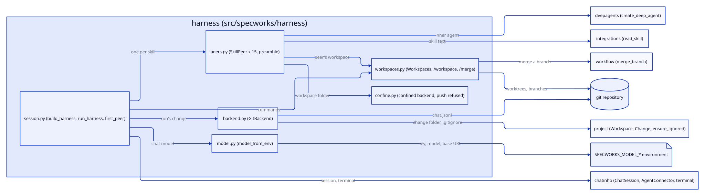
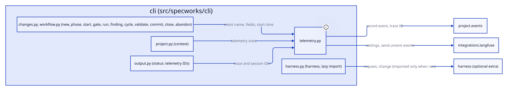
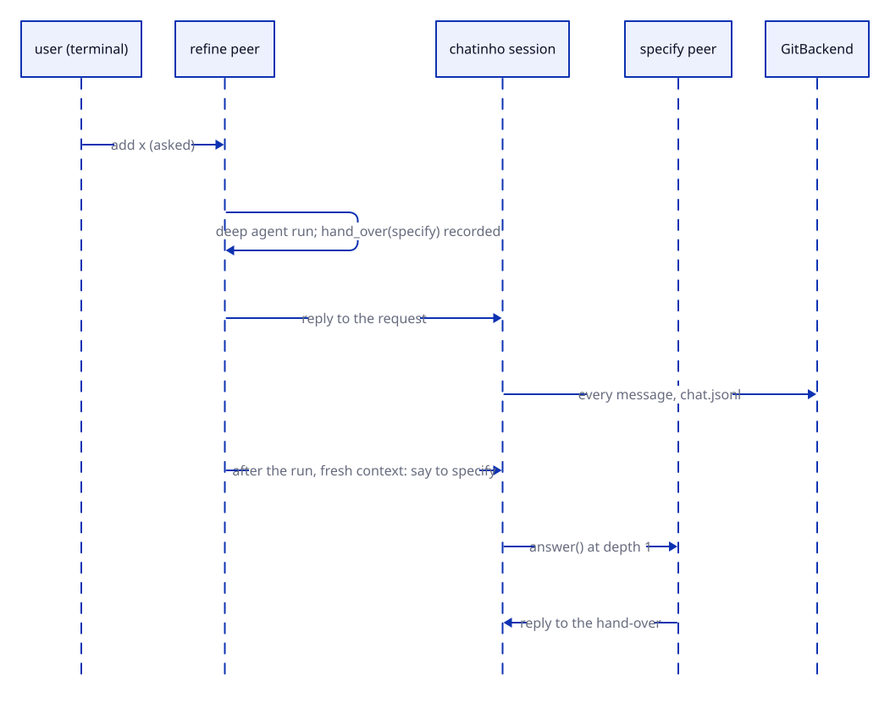

# Design: add-chatinho-harness

## Context

See proposal.md for why; refinement.md for the option chosen. chatinho (pinned
at commit `d3f29a263d323774c0820eb21b8276f25b170372`, Python >= 3.12) gives the
session, the terminal (`build_chat_session`), commands (`@tool` classes with
`execute(args, by)`), backends (`HookListen`/`HookLoad`/`HookForget`) and
`AgentConnector`, which wraps a LangChain agent in an
`extract -> agent -> verify -> load` graph and gives it the chat as tools
(`ask_<peer>`, `ask_user`, `run_<command>`). Its inner agent comes from
`create_agent` in `AgentConnector.graph()`.

Two facts of chatinho shape the design:
- `say(text, to=peer)` asks that peer without waiting: the peer's `answer()`
  runs, and its reply is posted replying to the message. The question's depth
  is one more than the depth of the task that says it (`_post`), so a peer
  that hands over from inside its own `answer()` makes each stage one level
  deeper, and a full run would pass `max_depth`.
- `AgentConnector.listen()` answers the user's says to nobody. With fifteen
  peers that would be fifteen answers to one line.

`deepagents` 0.7 (`create_deep_agent(model, tools, *, system_prompt, backend,
...)`, Python >= 3.11) gives file tools (`ls`, `read_file`, `write_file`,
`edit_file`, `glob`, `grep`) over a backend and `execute` when the backend
can run commands; `LocalShellBackend(root_dir, virtual_mode=True)` roots both
in a folder.

Specworks pieces reused: `read_skill(name)` and `packaged_skills()`
(`src/specworks/tools/skills.py`) for the skill text;
`merge_branch` (`src/specworks/workflow/merge.py`, REQ-FLOW-015) for merging a
workspace; `Workspace`, `Change` and `git` from `src/specworks/core`.

## Goals / Non-Goals

**Goals:**
- One package, `src/specworks/harness`, imported only by `specworks harness`.
- Reuse chatinho's `AgentConnector` (its graph, chat tools and error replies)
  and swap only the inner agent for a Deep Agent.
- Every behaviour testable without a terminal or a network: a session built
  with a test frontend and a scripted chat model.

**Non-Goals:**
- A sandbox for the shell; telemetry for the harness; headless runs.
- Any change to chatinho or to the skills.

## Decisions

### SkillPeer extends AgentConnector and swaps the inner agent

`SkillPeer(AgentConnector)` overrides `graph()` with the same eight lines,
calling `create_deep_agent(model, tools, system_prompt=instructions,
backend=confined(workspace))` instead of `create_agent`, and caches the graph
per (chat shape, workspace). The rest (history from the chat, `ask_<peer>`,
`ask_user`, `run_<command>`, error replies with the failure's kind, never its
message) is AgentConnector's. Its `listen()` does nothing: a skill peer acts
only on what is addressed to it (`answer()`). `ask_user=True`.
Serves: REQ-HARNESS-002, REQ-HARNESS-003, REQ-HARNESS-005.

Alternative: a connector from scratch around `create_deep_agent`. Rejected: it
would copy the chat-tool and history code; the pin makes the override safe,
and a test fails if `graph()`'s shape changes.

### A hand-over is said after the run, from a fresh context

`hand_over(peer, text)` checks the peer (a skill peer, not itself) and records
it on the run; after `answer()` has its reply, the peer schedules
`say(text, to=peer, reply_to=<the message it answered>)` in a task created with
`context=contextvars.Context()`, so its depth starts at one. The reply of the
peer that hands over is therefore posted before the next stage starts, and no
stage nests in another. `build` and `done` keep using `ask_<peer>`, which waits
and nests one level, as the skills expect.
Serves: REQ-HARNESS-003.

Alternative: put the next peer's name in the text (`@specify ...`) and have
peers listen for it. Rejected: it bypasses chatinho's addressing, so the
terminal would not show who was asked, and replies would not resolve.

### The preamble, and the skill appended unchanged

`skill_instructions(skill, peers)` is `preamble(peers)` + a blank line +
`read_skill(skill)`. Peer names are `skill.removeprefix("specworks-")`.
Serves: REQ-HARNESS-001, REQ-HARNESS-004.

**Pinned wording** (the preamble, `src/specworks/harness/peers.py`, verbatim;
`{peers}` is the names joined by `, `):

```
You are the peer `{name}` in a specworks harness chat. The other peers are: {peers}.
No one types slash commands here: `/specworks-<name>` in your skill means the peer `<name>`.
When your skill stops with a question that only offers the next step, take the option marked (recommended) and call hand_over with that peer and the change ref; do not ask the user.
When your skill asks the user anything else, call ask_user and wait for the answer.
When the recommended option is `stop here`, end without calling hand_over.
```

### Workspaces are git worktrees the backend's commands own

`Workspaces(ws, module)` keeps a map peer id -> workspace name (`main` by default).
`open(name, peer)` validates `^[a-z0-9][a-z0-9-]*$`, then runs
`git worktree add -b <branch>--<name> .specworks/workspaces/<name>` from the
main checkout, `ws.root` (or reuses an existing one), writing `.specworks/workspaces/.gitignore`
with `*` first. `merge(name, change)` calls `merge_branch(ws, module, change, branch)` in the main checkout (`MergeCommand` passes the backend's current change, and refuses when the run has none yet);
on success it runs `git worktree remove` and `git branch -D`, and moves every
peer in it back to `main`; a `BranchMergeError` becomes `WorkspaceError` with
the files, and the workspace stays. `WorkspaceCommand` (`/workspace`) and
`MergeCommand` (`/merge`) are chatinho `@tool` commands over it, so agents get
them as `run_workspace` and `run_merge`.
Serves: REQ-HARNESS-006, REQ-HARNESS-007.

Alternative: worktrees outside the repository (`../<repo>-ws/`). Rejected: a
folder outside the workspace root may not be writable, and tests are simpler
under one root.

### Confinement in the backend, push refused before the shell

`confined(path)` returns a `LocalShellBackend(root_dir=path, virtual_mode=True)`
subclass whose `execute` refuses a command matching `\bgit\b.*\bpush\b` with an
error and otherwise runs it with `path` as the working folder. Virtual mode
rejects `..` and absolute paths outside the root. Serves: REQ-HARNESS-008.

### GitBackend writes chat.jsonl; held until a change exists

`GitBackend(ws, module, change)` is a chatinho `@backend` with `HookListen`, `HookLoad`
and `HookForget`. Each heard message becomes
`{"id", "from", "to", "replyTo", "status", "text", "at"}` (ids as `str()`
writes them). With no change, it notes the active change names at start, holds
lines in memory, and after each message looks for a new active change; the
first one found becomes the run's change and the held lines are written. The
`.gitignore` in the change's folder gains `chat.jsonl` (the same "add the
missing names" helper as events). `load()` returns the change's messages as
`ChatMessage`s; a write failure is logged and ignored. Credentials are never
written (`ChatMessage.credentials` is skipped). Serves: REQ-HARNESS-009,
REQ-HARNESS-010.

### One helper for a change's .gitignore

`ensure_ignored(folder, names)` in `src/specworks/core/events.py` adds the
missing names to the folder's `.gitignore`, creating it when needed; both
`record_event` and `GitBackend` call it. Serves: REQ-PROJ-030,
REQ-HARNESS-009.

### The model is ChatOpenAI from SPECWORKS_MODEL_*

`model_from_env(env)` checks `SPECWORKS_MODEL_API_KEY` and
`SPECWORKS_MODEL_MODEL` (raising `ModelSettingsError` naming the first missing
one) and builds `ChatOpenAI(model=..., api_key=SecretStr(key),
base_url=env.get("SPECWORKS_MODEL_BASE_URL") or None)`. AgentConnector's error
replies already give only the failure's class name. Serves: REQ-HARNESS-010.

### The CLI imports the harness lazily

`src/specworks/cli/harness.py` registers `harness` on the app; its body imports
`specworks.harness` and turns an `ImportError` (or `sys.version_info < (3, 12)`)
into `SpecworksError("specworks harness needs the harness extra on Python 3.12
or later: install specworks[harness]")`. The first peer for `--change` comes
from its phase: `refine` -> `refine`, `specify` -> `specify`, `design` /
`implement` / `review` -> `build`, `validate` / `close` -> `done`; a
`baseline-<capability>` change in `specify` to `review` -> `baseline`.
Serves: REQ-CLI-022.

### Packaging, typing and CI

- `pyproject.toml`: extra `harness = ["chatinho[tui,langchain] @ git+https://github.com/lcmonteiro/chatinho@d3f29a2...; python_version >= '3.12'", "deepagents>=0.7,<0.8; python_version >= '3.12'"]`;
  the dev group gets the same two entries, so `uv sync` on 3.12+ installs them.
- mypy: an override with `ignore_missing_imports = true` for `chatinho.*`,
  `deepagents.*`, `langchain_core.*` and `langchain_openai.*`, so the lint job
  passes with or without the extra.
- Tests: `tests/harness/conftest.py` skips the folder when chatinho or
  deepagents cannot be imported. A scripted `BaseChatModel` lives in
  `tests/harness/scripted.py` (tests only).
- CI: on 3.11, `coverage report --omit "*/specworks/harness/*"`; on 3.12+ the
  harness counts toward the 95%.

## Interfaces

Agreed with the user

Every module below except `src/specworks/core/events.py` and `src/specworks/cli/harness.py` lives in the new package and is imported only from the `harness` command's body. Refusals inside the package are `SpecworksError` subclasses; a chatinho command turns them into `Reply(<message>, status=ReplyStatus.ERROR)` to the peer that ran it, and `hand_over` returns its refusal to the agent as the tool's text starting `error:`.

- `src/specworks/harness/__init__.py`: re-exports `build_harness`, `run_harness`, `model_from_env`, `ModelSettingsError` (new; REQ-HARNESS-001, REQ-HARNESS-010, REQ-CLI-022)
- `src/specworks/harness/model.py` (new):
  - `MODEL_KEY = "SPECWORKS_MODEL_API_KEY"`, `MODEL_NAME = "SPECWORKS_MODEL_MODEL"`, `MODEL_BASE_URL = "SPECWORKS_MODEL_BASE_URL"` (REQ-HARNESS-010)
  - `class ModelSettingsError(SpecworksError)`: `__init__(self, variable: str)`, `variable: str`; message `"<variable> is not set"`, never a value (REQ-HARNESS-010)
  - `model_from_env(env: Mapping[str, str] | None = None) -> BaseChatModel` (`os.environ` when `None`), raises `ModelSettingsError` for the first of `MODEL_KEY`, `MODEL_NAME` missing or empty (REQ-HARNESS-010)
- `src/specworks/harness/peers.py` (new):
  - `PREFIX = "specworks-"`; `PREAMBLE: str` (the pinned wording above, with `{name}` and `{peers}`) (REQ-HARNESS-004)
  - `peer_name(skill: str) -> str` (REQ-HARNESS-001)
  - `preamble(name: str, peers: Sequence[str]) -> str` (REQ-HARNESS-004)
  - `skill_instructions(skill: str, peers: Sequence[str]) -> str`: `preamble(peer_name(skill), peers)` + `"\n\n"` + `read_skill(skill)` (REQ-HARNESS-001, REQ-HARNESS-004)
  - `class SkillPeer(AgentConnector)` (`@connector("skill")`): `__init__(self, skill: str, model: BaseChatModel, workspaces: Workspaces, peers: Sequence[str])` (name `peer_name(skill)`, `ask_user=True`, `system_prompt=skill_instructions(...)`); `skill: str`; `async graph() -> Any` (a Deep Agent per chat shape and workspace); `async answer(msg: ChatMessage) -> Reply` (AgentConnector's run, then the recorded hand-over is said); `async listen(msg: ChatMessage) -> None` (does nothing); `hand_over_tool() -> StructuredTool`, the agent tool `hand_over(peer: str, text: str) -> str` returning `"handed over to <peer>"` or `"error: unknown peer '<peer>'"` / `"error: cannot hand over to yourself"` (REQ-HARNESS-002, REQ-HARNESS-003, REQ-HARNESS-005)
- `src/specworks/harness/workspaces.py` (new):
  - `WORKSPACES_DIR = ".specworks/workspaces"`; `MAIN = "main"`; `NAME_RE = re.compile(r"^[a-z0-9][a-z0-9-]*$")` (REQ-HARNESS-006)
  - `class WorkspaceError(SpecworksError)`: `__init__(self, message: str, files: list[Path] | None = None)`, `files: list[Path]` (REQ-HARNESS-006, REQ-HARNESS-007)
  - `class Workspaces`: `__init__(self, ws: Workspace, module: Module)`; `path_of(peer: int) -> Path`; `name_of(peer: int) -> str`; `branch_of(name: str) -> str` (`<main branch>--<name>`); `open(name: str, peer: int) -> Path`, raises `WorkspaceError` for a bad name (message names the rule: lowercase letters, digits and hyphens); `merge(name: str, change: Change) -> MergeResult`, raises `WorkspaceError` for an unknown workspace (`no workspace '<name>'`) or a conflict (`files` set) (REQ-HARNESS-006, REQ-HARNESS-007)
  - `class WorkspaceCommand` (`@tool("workspace", ...)`, `@require(HookExecute)`): `__init__(self, workspaces: Workspaces)`; `async execute(args: str = "", by: int = LOCAL, **kwargs: Any) -> Reply` (REQ-HARNESS-006)
  - `class MergeCommand` (`@tool("merge", ...)`, `@require(HookExecute)`): `__init__(self, workspaces: Workspaces, backend: GitBackend)`; `async execute(args: str = "", by: int = LOCAL, **kwargs: Any) -> Reply`, an error reply when the run has no change yet (REQ-HARNESS-007)
- `src/specworks/harness/confine.py` (new):
  - `PUSH_RE = re.compile(r"\bgit\b.*\bpush\b")`; `refuses(command: str) -> bool` (REQ-HARNESS-008)
  - `class ConfinedShell(LocalShellBackend)`: `__init__(self, root: Path)` (`root_dir=root`, `virtual_mode=True`); `execute(command: str, ...)` returns an error response for a refused command without running it (REQ-HARNESS-008)
  - `confined(root: Path) -> ConfinedShell` (REQ-HARNESS-008)
- `src/specworks/harness/backend.py` (new):
  - `CHAT_FILE = "chat.jsonl"`
  - `class GitBackend` (`@backend("git")`, `@require(HookListen)`, `@require(HookLoad)`, `@require(HookForget)`): `__init__(self, ws: Workspace, module: Module, change: Change | None)`; `change: Change | None` (the run's change once known); `async listen(msg: ChatMessage) -> None`; `async load(since: datetime | None = None, limit: int | None = None) -> list[ChatMessage]`; `async forget(before: datetime | None = None) -> int` (drops held lines only; the file is kept) (REQ-HARNESS-009)
  - `to_line(msg: ChatMessage) -> dict[str, Any]` (`id`, `from`, `to`, `replyTo`, `status`, `text`, `at`), `from_line(line: dict[str, Any]) -> ChatMessage` (REQ-HARNESS-009)
- `src/specworks/harness/session.py` (new):
  - `first_peer(change: Change | None) -> str` (REQ-CLI-022)
  - `build_harness(ws: Workspace, model: BaseChatModel, *, request: str | None = None, change: Change | None = None, frontend: Any = None) -> ChatSession`: `frontend=None` builds the terminal; the request is said by the user to `first_peer(change)` once the session starts (REQ-HARNESS-001, REQ-CLI-022)
  - `run_harness(ws: Workspace, request: str | None, change: Change | None) -> None`: `model_from_env()` first, then `build_harness(...).run()` (REQ-CLI-022)
- `src/specworks/core/events.py`: `ensure_ignored(folder: Path, names: Sequence[str]) -> None` (new; never raises, adds each missing name on its own line, keeps other lines) (REQ-PROJ-030)
- `src/specworks/cli/harness.py` (new): `specworks harness [REQUEST] [--change REF]`, registered in `src/specworks/cli/__init__.py`; no `--json` (it opens a terminal); errors as `error: ...` on stderr, exit 1 (REQ-CLI-022)

Nothing existing changes signature; `record_event` keeps its signature and calls `ensure_ignored`. No breaking change.

## Diagrams







## Risks / Trade-offs

- [`graph()` override tied to chatinho internals] -> chatinho is pinned to a
  commit; a test builds a SkillPeer graph and fails if the override breaks.
- [Fresh context relies on chatinho keeping depth in a contextvar] -> AC-HARNESS-003.2 runs a chain longer than `max_depth`.
- [The shell can still reach the machine] -> stated out of scope; the
  refused push is the hard line, and the file tools are confined.
- [A model may skip `hand_over` or ask when it should not] -> the preamble is
  pinned; a stalled run is visible in the chat and the user can `@peer`.
- [3.11 jobs do not measure the harness] -> 3.12+ jobs do, at 95%.

## Migration / Rollback

None: a new command and an optional extra. Removing the extra removes the
command's dependencies; existing `.gitignore` files are left as they are.

## Open Questions

None.
