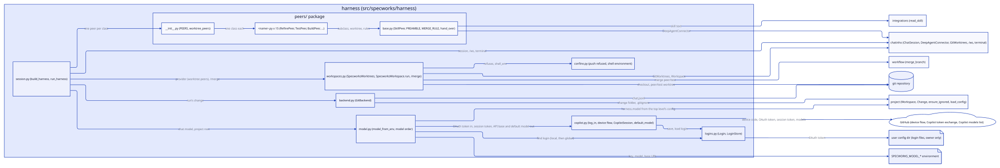

# Design: add-copilot-default-model

## Context

See [proposal.md](proposal.md). Today `model_from_env`
(`src/specworks/harness/model.py`) reads only `SPECWORKS_MODEL_*`, falling back
to a stored login for the key but never for the model. The project config
already has a top-level-only block with the same shape, `telemetry:`, loaded
by `load_telemetry` (`src/specworks/core/config.py`), refused in modules by
`src/specworks/core/workspace.py`, and written by `set_config_value`
(`src/specworks/core/config_file.py`) through `_set_block_line`. `config set`
(`src/specworks/cli/project.py`) already sends `telemetry.*` to the top level.

## Goals / Non-Goals

**Goals:**
- One model order, in one place: `SPECWORKS_MODEL_MODEL`, then
  `harness.model`, then Copilot's default for a stored login.
- `harness:` follows `telemetry:` exactly: loaded, checked, refused in a
  module, set by text edit, written to the top level.

**Non-Goals:**
- Caching the model list, or checking a named model against it.
- Any change to `login`, the login files or `CopilotSession`'s token logic.

## Decisions

### `harness:` mirrors `telemetry:`

A `HarnessConfig` dataclass and `load_harness(raw, present)` like
`load_telemetry`; `Config.harness` is None when the key is absent;
`workspace.py` refuses it in a module with the same message shape; `config
set` routes `harness.*` to `ws.top` next to `telemetry.*`; `set_config_value`
writes it with `_set_block_line`, which already quotes values with YAML
characters. An empty `model` in the file is an error (it would silently mean
"no model"); `config set harness.model ""` removes the line instead.
Alternative: a flat top-level `harness_model:` key: rejected, a block leaves
room for other harness settings without another top-level key. Serves:
REQ-PROJ-003, REQ-PROJ-025, REQ-PROJ-035, REQ-CLI-013.

### The model order lives in `model_from_env`

`model_from_env` already gets `root` (the workspace root, from
`run_harness`), so it loads the top level's config with `load_config(root)`
when `root` is given. Order: the key check first (unchanged: no key and no
login is still the key error), then the model from the variable, else the
config, else, only with a login, `CopilotSession.default_model()` after the
first `token()`. No model at the end is `ModelSettingsError(MODEL_NAME)`,
whose message now names both settings. Serves: REQ-HARNESS-010,
REQ-HARNESS-013, REQ-CLI-022.

### Copilot's default from `/models`

`CopilotSession.default_model()` sends `GET <api_base>/models` with
`Authorization: Bearer <session token>` and the editor headers, and returns
the `id` of the first entry of `data` whose `is_chat_default` is true. Any
failure (network error, non-200, not JSON, no `data` list, no marked entry,
an `id` that is not a non-empty string) returns None; `model_from_env` turns
None into the error naming both settings, so no response text or token
reaches the user. Alternative: raise `CopilotLoginError` with the status:
rejected, the user's fix is the same either way (name a model), and one
error path is simpler. Serves: REQ-HARNESS-013.

**Pinned wording** (asserted by the tests, written by the code):
- the missing-model error: `SPECWORKS_MODEL_MODEL is not set and the config has no harness.model`
- the module refusal: `module '<name>': 'harness' is set in the top level's config, not in a module's; remove it`

## Interfaces

- `src/specworks/core/config.py`: `HARNESS_KEYS = ("model",)`;
  `@dataclass class HarnessConfig: model: str = ""`;
  `load_harness(raw: object, present: bool) -> HarnessConfig | None` (raises
  `ConfigError` naming `harness` or `harness.model`); `Config.harness:
  HarnessConfig | None = None`; `"harness"` added to the known top-level keys
  (REQ-PROJ-003).
- `src/specworks/core/workspace.py`: a module's config that sets `harness`
  raises `ConfigError` with the pinned refusal (REQ-PROJ-003).
- `src/specworks/core/config_file.py`: `SETTABLE_KEYS` gains `"harness.model"`;
  `set_config_value(root, "harness.model", value)` writes or clears it
  (REQ-PROJ-025, REQ-PROJ-035).
- `src/specworks/cli/project.py`: `config set harness.model <id>` writes the
  top level's config from any module; the key's help names it (REQ-CLI-013).
- `src/specworks/harness/copilot.py`: `CopilotSession.default_model() -> str |
  None` (REQ-HARNESS-013).
- `src/specworks/harness/model.py`: `MODEL_CONFIG_KEY = "harness.model"`;
  `ModelSettingsError(MODEL_NAME)` carries the pinned missing-model message;
  `model_from_env(env=None, *, root=None, store=None, client=None)` keeps its
  signature and follows the model order (REQ-HARNESS-010, REQ-HARNESS-013,
  REQ-CLI-022).

## Diagrams

`model.py` now depends on the project config, and `copilot.py` also asks
GitHub's Copilot API for its model list.

## Risks / Trade-offs

- [`/models` is undocumented and may change] -> any unexpected shape gives
  the error naming both settings, and a named model never depends on it.
- [one extra request at start] -> made only with a login and no model named.
- [a project config's model may not be allowed for another user's login] ->
  `SPECWORKS_MODEL_MODEL` overrides it per shell.

## Migration / Rollback

None: configs without `harness:` load as before, and a user with
`SPECWORKS_MODEL_MODEL` set sees no change.

## Open Questions

- Whether github.com and GHE both mark `is_chat_default`: checked by hand with
  a live login after implement; a host that does not only needs a named model.
