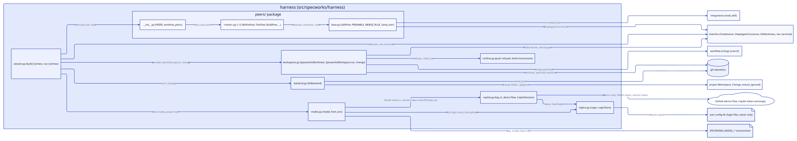
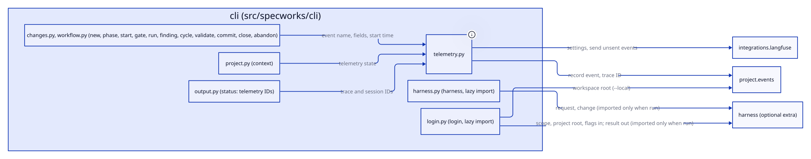

# Design: add-copilot-login

## Context

Motivation is in [proposal.md](proposal.md). Today `model_from_env` (`src/specworks/harness/model.py`) builds `ChatOpenAI` from three variables, and the CLI's `harness` command imports the harness lazily. The pinned `langchain-openai` (1.7.4) accepts a sync or async callable as `api_key` and builds both its sync and async clients from it, so a key that changes every ~25 minutes needs no custom client. `httpx` comes with the `harness` extra. A peer's file tools read the main checkout, so no token may be stored in the project.

## Goals / Non-Goals

**Goals:**
- One stored login per scope, a session token that renews on its own, and no token in any output.
- Network and time are injectable, so tests run on a fake transport with no waiting.

**Non-Goals:**
- `logout`, other providers, exporting variables, adopting other tools' tokens.
- Hiding the stored file from a peer's shell.

## Decisions

### The login and the session token live in the harness package

`copilot.py` (device flow, token exchange, `log_in`) and `logins.py` (the stored login) sit in `src/specworks/harness`, so they share the harness extra and the `cli` only calls them. Alternative: a new capability or `integrations`; rejected because only the harness uses them and `integrations` must stay free of the extra. Serves REQ-HARNESS-011, REQ-HARNESS-012, REQ-CLI-023.

### Synchronous `httpx`, and a callable key

The key given to `ChatOpenAI` is `CopilotSession.token`, a sync callable that returns the cached session token and exchanges a new one when it is within 60 seconds of expiry (a lock keeps two threads from exchanging at once). The exchange is one short request about every 25 minutes, so a sync call is acceptable inside the async chat; a sync callable also serves both of the model's clients. Alternative: the source's `asyncio` provider with an async callable; rejected because the sync client then fails ("Sync client is not available"). Serves REQ-HARNESS-012.

### The first exchange happens when the model is built

`model_from_env` calls `CopilotSession.token()` once, which yields the API base (`endpoints.api` from the exchange, `https://api.githubcopilot.com` when absent) and an early failure for a revoked login, before the chat opens (AC-HARNESS-012.5). A network failure there is the same error. Alternative: exchange lazily on the first message; rejected because the user would learn of a dead login in the middle of a chat.

### A login's storage

Files are in the user's config dir (`$XDG_CONFIG_HOME` or `~/.config`, `%APPDATA%` on Windows) under `specworks/copilot/`: `global.json`, and for a local login `projects/<sha256 of the project root path, 16 hex>.json`. Each holds `{"oauth_token", "ghe_host"}`, is created with mode 0600 inside a 0700 folder, and is written to a temporary file then renamed, so a failed write keeps the earlier login. A local login is keyed by path, so moving a project loses it (the user logs in again). Alternatives: inside `.specworks/` (rejected, readable by agents, REQ-HARNESS-008's file tools); the OS keychain (rejected, a dependency per OS). On Windows the permission bits are not enforced; the config dir is already per-user. Serves REQ-HARNESS-011.

### The device flow has no browser and no printing

`device_login` takes `prompt(uri, code)`, which the CLI points at stderr, and shows nothing itself. It does not open a browser (a side effect that fails on a server or WSL). It polls at the interval GitHub gives, adds 5 seconds on `slow_down`, and fails on `access_denied`, `expired_token` or its own deadline. The public client id of GitHub's Copilot clients is the one the existing tool uses. Serves REQ-HARNESS-011.

### Reuse means the token still exchanges

`log_in` loads the scope's login and, unless forced, tries one exchange; success is a reuse and nothing is written. A rejected token (401/403) starts the device flow; a network error is an error, not a reason to start the flow. Serves REQ-HARNESS-011.

### No token reaches an error or a repr

`Login` hides its token from `repr`; HTTP errors are turned into `CopilotLoginError` with a fixed message (status code only), raised `from None` so no request or header is chained; logging is never given a token. Serves REQ-HARNESS-010, REQ-HARNESS-011.

### The explicit key and the project root

`model_from_env` reads a login only when `SPECWORKS_MODEL_API_KEY` is empty or missing, so an explicit key makes no stored-file read and no request (AC-HARNESS-012.3). It takes the project root as a keyword to find the local login; `run_harness(ws)` passes `ws.root`. Serves REQ-HARNESS-010, REQ-HARNESS-012.

## Interfaces

Agreed with the user

- `src/specworks/harness/logins.py`:
  - `Scope = Literal["global", "local"]`
  - `Login(oauth_token: str, ghe_host: str = "")`, frozen dataclass, token hidden from `repr`.
  - `config_dir(env: Mapping[str, str] | None = None) -> Path` (the folder above, per OS).
  - `LoginStore(base: Path | None = None)`: `save(scope, root, login) -> None`, `load(scope, root) -> Login | None`, `find(root: Path | None) -> Login | None` (local first, then global). `root` is the project root and may be `None` for a global use.
- `src/specworks/harness/copilot.py`:
  - `CopilotLoginError(SpecworksError)`, with a `login_again: bool` set when the token was rejected.
  - `CopilotSession(login: Login, *, client: httpx.Client | None = None, now: Callable[[], float] = time.time)`: `token() -> str`, `api_base -> str`; header set `EDITOR_HEADERS` also sent with the model's requests.
  - `device_login(ghe_host: str, prompt: Callable[[str, str], None], *, client: httpx.Client | None = None, sleep: Callable[[float], None] = time.sleep, now: Callable[[], float] = time.time) -> Login`.
  - `LoginResult(scope: Scope, reused: bool)`, frozen dataclass; `log_in(scope: Scope, root: Path | None, *, force: bool, ghe_host: str, prompt: Callable[[str, str], None], store: LoginStore | None = None, client: httpx.Client | None = None, sleep=..., now=...) -> LoginResult`.
- `src/specworks/harness/model.py`: `model_from_env(env: Mapping[str, str] | None = None, *, root: Path | None = None, store: LoginStore | None = None, client: httpx.Client | None = None) -> BaseChatModel`; `ModelSettingsError` for the key says `SPECWORKS_MODEL_API_KEY is not set (or run `specworks login copilot`)`. `src/specworks/harness/session.py`: `run_harness(ws)` passes `root=ws.root`.
- `src/specworks/cli/login.py`: `login(provider: str, local: bool = False, global_: bool = False, force: bool = False, ghe_host: str = "", as_json: bool = False)`, registered as the command `login` with `--local`, `--global`, `--force`, `--ghe-host`, `--json`; the prompt writes `Open <uri> and enter <code>` to stderr; the result is `{"provider": "copilot", "scope": ..., "reused": ...}` or one line.

## Diagrams

## Risks / Trade-offs

- [The token exchange (`copilot_internal/v2/token`) and the editor headers are unofficial and may change] -> they are constants in `copilot.py`; a failure says to log in again and names no token.
- [A blocking exchange inside the async chat] -> one short request about every 25 minutes; the lock stops duplicates.
- [A peer's shell can read the stored login] -> out of scope; the file sits outside every workspace, and the user can revoke the token on GitHub.
- [Moving a project drops its local login] -> the user logs in again or uses the global one.
- [The public client id belongs to GitHub] -> as in the existing tool; it can be replaced in one constant.

## Open Questions

None.
