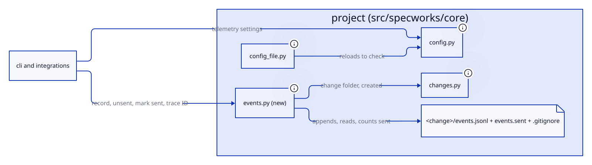
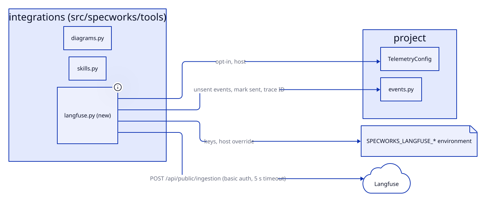
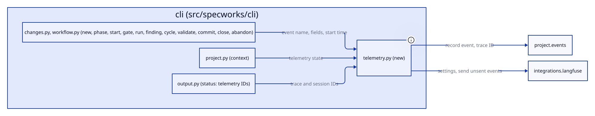
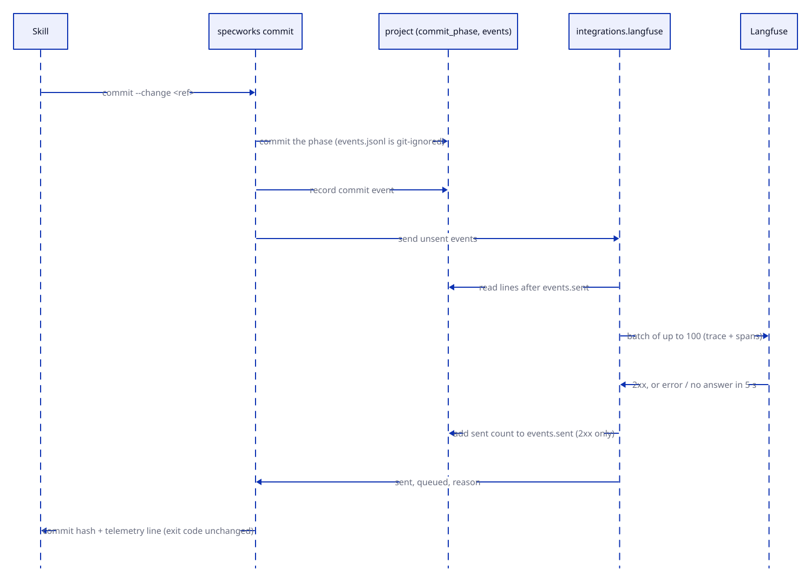

# Design: add-langfuse-monitoring

## Context

See [proposal.md](proposal.md) for why. Today specworks makes no network call;
its dependencies are pyd2, pyyaml and typer. The top-level-only settings
(`tools`, `branch_per_change`) are read from `ws.top.config`, and `tools` in a
module's config is refused in `core/workspace.py`. `config set` edits the
config as text (`core/config_file.py`) and reloads it to check the edit.
Commands end either by `emit(...)` or by `raise typer.Exit(code)` (a failed
gate, `run`'s exit code); a `SpecworksError` raised in a command becomes the
error output in `cli/app.py`. The run cache's tree fingerprint excludes
`.specworks/`, so writing to a change folder never stops a result being reused.

## Goals / Non-Goals

**Goals:**
- One small module per layer: the event log in `project`, the Langfuse client
  in `integrations`, recording and `telemetry push` in `cli`; no upward import.
- Recording costs one file append; only `commit` and `telemetry push` touch the
  network.
- No new dependency: `json`, `hashlib`, `base64`, `urllib.request` only.

**Non-Goals:**
- Agent-side telemetry, live streaming, retries in the background.
- Recording from inside `workflow`: the CLI already holds every result.

## Decisions

### The log is per change, in its folder, git-ignored there

`events.jsonl` and `events.sent` live in the change folder, with a
`.gitignore` there naming both, written by the first event (usually `new`), so
no project needs its own ignore rule and the log moves with the folder at
archive. Rejected: `.git/specworks-events/` (out of sight, needs git), and a
committed log (dirties the folder on every command, merge conflicts). Serves:
REQ-PROJ-030.

### `events.sent` holds a count, not IDs

Sending reads the lines after the count and adds each accepted batch's size.
A count is enough because the log is append-only. A line that does not parse
as a JSON object is skipped and still counted, so one bad line never blocks
the queue. Serves: REQ-INTEG-009.

### Stable IDs make a resend harmless

The trace ID is the first 32 hex characters of
`sha256("<module label>\n<name>\n<created>")`, which is valid as a Langfuse and
W3C trace ID. Each span's ID is `<trace ID>-<line number>`, so a batch sent
again after a lost answer updates the same spans in Langfuse instead of
duplicating them. The session ID is the change's ref. Serves: REQ-PROJ-031,
REQ-INTEG-009.

### Each line is a span, `ms` gives it a start

A batch is `{"batch": [...]}` for `POST <host>/api/public/ingestion`: one
`trace-create` (ID, name = ref, `sessionId` = ref, metadata `module`), then one
`span-create` per line with `traceId`, `name` = `event`, `endTime` = `at`,
`startTime` = `at - ms`, and `metadata` = the line's other fields (`phase`
included). Spans show durations in Langfuse; plain events would not.
`at` is UTC (`2026-11-03T13:22:45Z`) so times agree across machines. Serves:
REQ-INTEG-009.

### Telemetry state is computed once, in integrations

`langfuse_settings(config, env)` returns the state (`on`, `keys missing`,
`off`), the host and the keys. Only `send_events` uses the keys; the
`LangfuseSettings` repr leaves them out, and no error string is built from
them. The unprefixed `LANGFUSE_*` variables are never read. Serves:
REQ-INTEG-008.

### Recording is explicit in each command

Each command takes `started = time.monotonic()` once its change is resolved,
and calls `record(ws, module, change, event, started, **fields)` after its
work and before it emits or raises `typer.Exit`, so a failed gate (exit 1) is
recorded and a `SpecworksError` (raised before the call) is not. `record`
reads the opt-in from `ws.top.config.telemetry.langfuse`, so it needs no keys
and no network. A decorator that records on every exit was rejected: it can't
tell a failed check from a refusal without the command's help, and every
command builds different fields. Serves: REQ-CLI-017.

### The fields are fixed per event

Each call passes only the fields REQ-CLI-017 lists (names, IDs, counts,
booleans, phase lists); no call passes a finding's text, a reason, a proposal
or command output. `failed` holds check names from the gate's fixed list.
Serves: REQ-CLI-017.

### Commit sends after it commits, close does not send

`commit` commits, records its own event, then sends, so its event goes in the
same batch (AC-CLI-012.5). The send's result never changes the exit code. Close
records `close` into the archived folder and leaves the sending to the commit
that follows it, as every skill already does. Serves: REQ-CLI-012.

### `telemetry` config is a small block, top level only

`telemetry: {langfuse: bool, host: str}` loads into `TelemetryConfig`, with
`host` checked to start with `http://` or `https://`. A module's config that
sets it is refused next to `tools` in `core/workspace.py`. `config set`
handles `telemetry.langfuse` and `telemetry.host` with the same one-line
block edit as `commands.<key>` (generalised from `_set_command`), always in
the top level's config like `branch_per_change`. Serves: REQ-PROJ-003,
REQ-PROJ-025, REQ-PROJ-032, REQ-CLI-013.

## Interfaces

Agreed with the user

Changes from the plan written at specify, after reading the code:
- `Config.telemetry` is `TelemetryConfig | None` (None when the block is
  absent) and `load_telemetry` takes `present`, like `tools` / `load_tools`,
  so `load_module_config` can refuse a module's block (AC-PROJ-003.10).
  Callers read `ws.top.config.telemetry or TelemetryConfig()`.
- `telemetry_app` is declared in `src/specworks/cli/app.py` with the other
  command groups (as `finding_app`, `config_app`); `push` registers on it in
  `src/specworks/cli/telemetry.py`, imported from `src/specworks/cli/__init__.py`.
  Declaring it in `src/specworks/cli/telemetry.py` would make
  `src/specworks/cli/app.py` import a command module, which imports it back.

- `src/specworks/core/config.py`:
  - `TELEMETRY_KEYS = ("langfuse", "host")`; `"telemetry"` added to `CONFIG_KEYS`.
  - `@dataclass class TelemetryConfig: langfuse: bool = False; host: str = ""` (REQ-PROJ-003)
  - `load_telemetry(raw: object, present: bool) -> TelemetryConfig | None`, raising `ConfigError` naming `telemetry` or `telemetry.<key>` (REQ-PROJ-003)
  - `Config.telemetry: TelemetryConfig | None = None`, set by `load_config` (REQ-PROJ-003)
- `src/specworks/core/workspace.py`: `load_module_config` refuses a module's config with `telemetry`, naming the top level's config (REQ-PROJ-003)
- `src/specworks/core/config_file.py`:
  - `SETTABLE_KEYS` gains `telemetry.langfuse`, `telemetry.host` (REQ-PROJ-025, REQ-PROJ-032)
  - `set_config_value(root, key, value)`: unchanged signature, handles them (REQ-PROJ-032)
- `src/specworks/core/events.py` (new):
  - `EVENTS_FILE = "events.jsonl"`, `SENT_FILE = "events.sent"`, `IGNORE_FILE = ".gitignore"`
  - `record_event(change: Change, enabled: bool, event: str, **fields: object) -> None`: never raises (REQ-PROJ-030)
  - `read_unsent(change: Change) -> tuple[int, list[dict]]`: (lines already sent, the unsent events in order, each with its line number as `line`) (REQ-INTEG-009)
  - `mark_sent(change: Change, count: int) -> None`: adds `count` to `events.sent` (REQ-INTEG-009)
  - `trace_id(module_label: str, change: Change) -> str` (REQ-PROJ-031)
  - `session_id(ref: str) -> str` (REQ-PROJ-031)
- `src/specworks/tools/langfuse.py` (new):
  - `DEFAULT_HOST = "https://cloud.langfuse.com"`, `TIMEOUT = 5.0`, `BATCH_SIZE = 100`
  - `ENV_PUBLIC_KEY = "SPECWORKS_LANGFUSE_PUBLIC_KEY"`, `ENV_SECRET_KEY = "SPECWORKS_LANGFUSE_SECRET_KEY"`, `ENV_HOST = "SPECWORKS_LANGFUSE_HOST"`
  - `@dataclass(frozen=True) class LangfuseSettings: state: Literal["on", "keys missing", "off"]; host: str; missing: tuple[str, ...]` plus keys held with `repr=False` (REQ-INTEG-008)
  - `langfuse_settings(config: TelemetryConfig | None, env: Mapping[str, str] | None = None) -> LangfuseSettings`; `env` defaults to `os.environ` (REQ-INTEG-008)
  - `@dataclass(frozen=True) class SendResult: sent: int; queued: int; reason: str | None` (REQ-INTEG-009)
  - `send_events(change: Change, settings: LangfuseSettings, trace: str, session: str, module_label: str) -> SendResult`: never raises for network or server failures (REQ-INTEG-009)
- `src/specworks/cli/app.py`: `telemetry_app = App(...)`, added as `telemetry` (REQ-CLI-018)
- `src/specworks/cli/telemetry.py` (new, imported from `src/specworks/cli/__init__.py`):
  - `record(ws: Workspace, module: Module, change: Change, event: str, started: float, **fields: object) -> None` (REQ-CLI-017)
  - `telemetry_state(ws: Workspace) -> dict`: `{"state", "host"}` for `context` (REQ-CLI-004)
  - `telemetry_ids(module: Module, change: Change) -> dict`: `{"traceId", "sessionId"}` for `status` (REQ-CLI-019)
  - `send_after_commit(ws: Workspace, module: Module, change: Change) -> dict | None`: the `telemetry` value of `commit --json` (REQ-CLI-012)
  - `push(change: str = ChangeOpt, as_json: bool = JsonOpt) -> None` on `telemetry_app`: `specworks telemetry push --change <ref> [--json]` (REQ-CLI-018)
- `src/specworks/cli/changes.py`, `src/specworks/cli/workflow.py`: `new`, `phase`, `abandon`, `commit`, `start`, `gate`, `run`, `finding *`, `cycle`, `validate`, `close` call `record(...)` (REQ-CLI-017); `commit` adds `telemetry` (REQ-CLI-012); `status` adds `telemetry` IDs (REQ-CLI-019)
- `src/specworks/cli/project.py`: `context` adds `telemetry` (REQ-CLI-004); `config set` writes `telemetry.*` to the top level's config (REQ-CLI-013)

Event line, as written:

```json
{"at": "2026-11-03T14:02:10Z", "event": "gate", "phase": "specify", "ms": 900, "gate": "specify", "passed": false, "failed": ["tasks cover every AC"]}
```

`commit --json` and `telemetry push --json` add:

```json
"telemetry": {"sent": 7, "queued": 0, "reason": null}
```

## Diagrams









## Risks / Trade-offs

- [Langfuse answers 207 with per-item errors] -> any 2xx counts as accepted; the span IDs are stable, so `telemetry push` after a fix resends safely.
- [A commit waits up to 5 s per batch when Langfuse hangs] -> sending stops at the first failed batch, so one slow host costs one timeout per commit.
- [Two processes append at once] -> each line is written with one `write` call in append mode; a torn line is skipped and counted, never blocking the queue.
- [Keys leak into an error] -> reasons are built from the status code or the exception type and URL host only; AC-INTEG-009.6 and AC-CLI-004.7 test it.
- [First outbound HTTP in specworks] -> only to the configured host over the system's TLS defaults, only when opted in and keys are set.
- [Events from an old change without `.gitignore`] -> the first recorded event writes it.

## Migration / Rollback

None: telemetry is off until a project opts in. Turning it off again
(`config set telemetry.langfuse false`) stops recording; logs already written
stay git-ignored in their change folders.

## Open Questions

- None.
