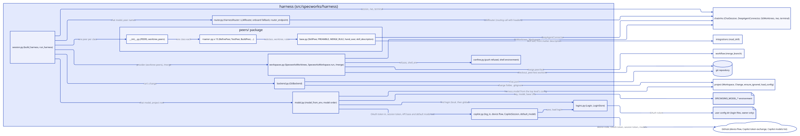

# Design: add-llm-router

## Context

See `proposal.md` and `refinement.md`. `build_harness` (`src/specworks/harness/session.py`)
passes `router=SimpleRouter()`; chatinho calls the router only for a say whose
`to` is unset, that is not from a command and does not answer a message, and
sets the say's `to` to the id it returns (a non-peer id or an exception is
logged and ignored). chatinho's `LLMRouter` (`chatinho/routers/llm.py`) first
applies `SimpleRouter`'s rules, then asks a model, and returns None for
`everyone` or any failure. The peers' model is a `ChatOpenAI` built by
`model_from_env` (`model.py`): its `model_name`, `openai_api_base` (None for
OpenAI), `openai_api_key` (a `SecretStr`, or the Copilot session's `token`
function, which renews) and `default_headers` (`EDITOR_HEADERS` with a login)
are readable attributes.

## Goals / Non-Goals

**Goals:**
- Route with chatinho's own `LLMRouter`, public API only.
- The router's endpoint derived from the peers' model object, so it can never
  disagree with it.

**Non-Goals:**
- A routing prompt of our own: chatinho's prompt and answer parsing are used as they are.
- Any setting for the router.

## Decisions

### Precondition: headers in chatinho's LLMRouter

`LLMRouter` builds `AsyncOpenAI(api_key=..., base_url=...)` with no headers;
the Copilot API needs `EDITOR_HEADERS`. chatinho gained a keyword
`headers: Mapping[str, str] | None = None` on `LLMRouter.__init__`, sent as
`default_headers` on every client it builds (its own and one for a lent key),
refusing `Authorization` (chatinho `add-router-headers`, REQ-ROUTE-012,
merged as `d783cc5`). The chatinho pin moves to that commit, and
`chatinho[openai]` joins the `harness` extra and the dev group.
Alternatives: subclassing `LLMRouter` to replace its private client methods
(fragile on bumps), or a specworks router (duplicates chatinho), both turned
down in refinement. Serves: REQ-HARNESS-015.

### The fallback as a subclass that overrides `route` only

`HarnessRouter(LLMRouter)` overrides the public `route`: it returns
`super().route(msg)` when that is a peer id, and otherwise the id of the peer
named `onboard` from `self.peers()`, unless `onboard` is the say's speaker
(then None). chatinho's `everyone`, an unusable name, a timeout, no key and an
API error all already come back as None, so one rule covers them. Only
unaddressed, non-reply says reach `route` (chatinho's own check), so
`@<peer>`, replies and hand-overs never touch it. Alternative: a wrapper
holding an `LLMRouter`, which would have to forward chatinho's `peers` and
`context` grants by hand. Serves: REQ-HARNESS-014.

### The endpoint read off the peers' model

`router_endpoint(model)` reads `model_name`, `openai_api_base` and
`default_headers` from the `ChatOpenAI`, and turns `openai_api_key` into a key
source: a `SecretStr` becomes a function returning its value, and a function
(the Copilot session's `token`) is passed as it is, so each routing call reads
the current, renewed token. `Endpoint` keeps the key out of its repr, and
`LLMRouter` logs only an error's type, so no key reaches a log line. A model
that is not a `ChatOpenAI` (a scripted model in tests) gives an endpoint with
no key: the router then always falls back to `onboard`. Serves:
REQ-HARNESS-015.

### Descriptions from the skills' front matter

`skill_description(skill)` takes the `description` of `read_skill(skill)`'s
front matter (`split_frontmatter`, folded lines joined). `SkillPeer.__init__`
sets it as the instance's `description`: `@connector(name)` sets the class's
`description` to `""`, so a class attribute would be overwritten, and the
router reads `description` from the peer instance. Alternative: a
`description=` on each `@connector`, which would copy 17 texts. Serves:
REQ-HARNESS-016.

## Interfaces

Proposed: waiting for the user's agreement

- `src/specworks/harness/router.py`: `class HarnessRouter(LLMRouter)`,
  `HarnessRouter(endpoint: Endpoint, *, headers: Mapping[str, str] | None = None, fallback: str = FALLBACK)`,
  `async route(msg: ChatMessage) -> int | None` (REQ-HARNESS-014)
- `src/specworks/harness/router.py`: `FALLBACK = "onboard"` (REQ-HARNESS-014)
- `src/specworks/harness/router.py`: `router_endpoint(model: BaseChatModel) -> tuple[Endpoint, dict[str, str]]`,
  the endpoint and the headers for the router (REQ-HARNESS-015)
- `src/specworks/harness/session.py`: `build_harness` passes
  `router=HarnessRouter(endpoint, headers=headers)`, with `endpoint, headers = router_endpoint(model)`,
  instead of `SimpleRouter()`; the headers are empty when the model sends none (REQ-HARNESS-014, REQ-HARNESS-015)
- `src/specworks/harness/peers/base.py`: `skill_description(skill: str) -> str`;
  `SkillPeer.description: str`, set in `__init__` (REQ-HARNESS-016)

## Diagrams

## Risks / Trade-offs

- [The chatinho change is not merged yet] -> build starts with it; until the
  pin moves, the test and code halves cannot pass AC-HARNESS-015.2.
- [17 long descriptions make each routing call a few thousand input tokens]
  -> one call per unaddressed message only; trimming them is a later change.
- [A wrong choice sends the message to the wrong skill] -> that peer still
  answers in the chat and the user can re-address with `@<peer>`.
- [Tests must not reach a real API] -> they script the router's `AsyncOpenAI`
  answers (or its transport) and assert the request's URL, model, key and headers.

## Open Questions

None.
