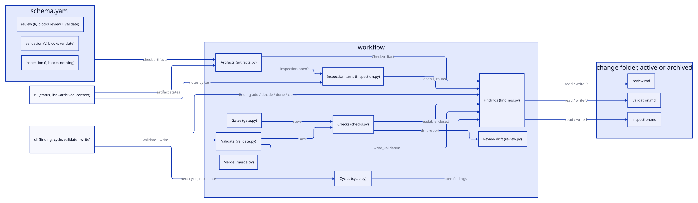

# Design: pr-review-with-inspect

## Context

See proposal.md. The notes and their lifecycle already live in
`inspection.md` and are parsed by `workflow/findings.py`
(`read_findings`, `Finding.phase`, REQ-FLOW-010), which already routes a note
to `inspect` after `done in review:`. `findings.py` imports `artifacts.py`,
so `artifacts.py` cannot import `findings.py` at module level. `change_dict`
(`cli/output.py`) builds the change row of every command, `finding`
included, so it must stay cheap.

## Goals / Non-Goals

**Goals:**
- One function gives a change's open inspection notes by turn; `status`,
  `list --archived`, `context` and inspection's artifact state all use it.
- The skills read the turns from the CLI's JSON, never by parsing
  inspection.md themselves.

**Non-Goals:**
- No new stored state, no new finding syntax, no change to routing.
- No change to `reopen`, `finding` or the gates.

## Decisions

### The turn is the finding's route

A note routed to `inspect` (`Finding.phase == "inspect"`) is the reviewer's;
every other open, readable note is the author's, with `phase` as its step.
Alternative: look for a `done in review:` line directly; rejected, it would
duplicate REQ-FLOW-010's rules (quoted forms, fences). Serves: REQ-FLOW-020.

### A module of its own: `workflow/inspection.py`

It imports `findings.py`; `artifacts.py` imports it inside
`artifact_states` only (a local import, as the cycle `findings → artifacts`
forbids a top-level one). Alternative: put the function in `findings.py`
and compute the `open` state in the CLI; rejected, REQ-FLOW-001 says the
state is the workflow's, and every reader of `artifact_states` should see
it. Serves: REQ-FLOW-001, REQ-FLOW-020.

### `inspection` is added by the overview commands, not `change_dict`

`status`, `list --archived` and `context` add `inspection` (via
`inspection_dict`) to the rows they build, for archived changes only;
`change_dict` is unchanged, so `finding`, `commit` and the rest do not parse
inspection.md. Serves: REQ-CLI-025, REQ-CLI-026, REQ-CLI-027.

### `context`'s `inspected` reads the archive of the listed modules

Like `changes`, it covers the current module, or every module with `--all`;
it lists the archived changes (`list_archived`) and keeps those with a note.
Abandoned changes are included when they have one (they are archived too);
nothing special-cases them. Serves: REQ-CLI-027.

### The reopen phase is the skill's, from the steps

The CLI only gives each note's step; `/specworks-reopen` picks `specify` when
a note's step is `specify`, else `review`, and keeps its one confirmation.
No CLI flag: the `reopen` command already takes `--reason` and `--phase`.

### Pinned wording

CLI text (status, list, context) — asserted verbatim by the tests:
- status: `inspection notes for the author: I1, I2 → /specworks-reopen xpto`
- status: `inspection notes for the reviewer: I3 → /specworks-inspect xpto`
- list --archived suffix: `  inspection: 2 for the author, 1 for the reviewer`
  (a turn with no note is left out: `  inspection: 1 for the reviewer`)
- context: a line `inspected:` and, per change, `  xpto` padded as the
  `changes:` lines, then `/specworks-reopen xpto` when the author has a note,
  else `/specworks-inspect xpto`; `inspected:` is not printed when empty.

Skill text — asserted by `tests/test_skills.py`:
- inspect: `Request changes on the pull request: the author runs /specworks-reopen <ref>.`
- inspect: `Never offer the reopen to the reviewer: only the author reopens.`
- reopen: `Notes for the author in inspection.md are the problem: do not ask why.`
- reopen: `inspection notes <IDs>`
- reopen: `Add no R finding for them: the I findings are already the findings review decides.`
- onboard: `A change in inspected waits for its notes before any new work.`
- refine: `inspected lists a closed change whose inspection notes wait`

## Interfaces

Agreed with the user

- `src/specworks/workflow/inspection.py`:
  - `@dataclass(frozen=True) InspectionNote(id: str, step: str)` (REQ-FLOW-020)
  - `@dataclass(frozen=True) InspectionTurns(author: list[InspectionNote], reviewer: list[InspectionNote])`
    with `__bool__` (any note) and `to_dict() -> dict` giving
    `{"author": [{"id", "step"}], "reviewer": [...]}`, each key only when
    non-empty (REQ-FLOW-020, REQ-CLI-025)
  - `inspection_turns(change: Change) -> InspectionTurns` (REQ-FLOW-020)
- `src/specworks/workflow/artifacts.py`: `artifact_states(change)` gives
  inspection `status: "open"` when `inspection_turns(change)` has a note
  (REQ-FLOW-001).
- `src/specworks/cli/output.py`: `inspection_dict(change: Change) -> dict`:
  `{"inspection": {...}}` for an archived change with notes, else `{}`
  (REQ-CLI-025); `inspection_hint(ref: str, turns: InspectionTurns) -> str`,
  the skill line (REQ-CLI-025, REQ-CLI-027).
- CLI JSON: `status` and `list --archived` rows gain `inspection`;
  `context` gains `inspected: [row + inspection]` (REQ-CLI-025..027).

## Diagrams

## Risks / Trade-offs

- [`context` now reads every archived change's inspection.md] -> only
  folders that hold one are parsed; there are two today.
- [A new artifact state `open` surprises a JSON consumer] -> nothing in the
  repository compares states except `done`/`ready`/`blocked` for display;
  the skills that read `status` are updated with it.
- [Local import in `artifact_states`] -> one line, with a comment naming the
  cycle.

## Migration / Rollback

None: nothing is stored; archived inspection.md files are read as they are.

## Open Questions

None.
