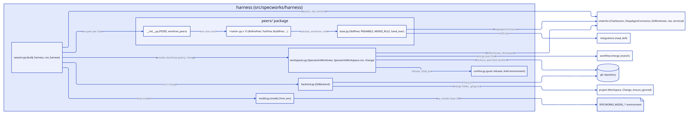

# Design: split-harness-peers

## Context

Today `src/specworks/harness/peers.py` holds one `SkillPeer(DeepAgentConnector)`
class, built by `build_harness` once per `packaged_skills()` entry as
`SkillPeer(skill, model, names)`. The pinned `PREAMBLE` has six lines; the last
one (the `/merge` rule) goes to every peer. `workspaces.py` decides which peer
gets a worktree with `WORKTREE_PEERS = frozenset({"test"})`, used in
`SpecworksWorktrees.provision`. chatinho's `@connector(name)` decorator sets the
class attribute `name`, which an instance may override. See proposal.md for why.

## Goals / Non-Goals

**Goals:**
- One class per step, each in its own module named after its peer, on a shared base.
- A step's specifics (its worktree, its extra preamble rules) stated on its class.
- One explicit list of the peer classes, which the session and the workspace provider read.

**Non-Goals:**
- Per-step models, memory or tools (the base keeps them common; a class can override later).
- Any change to the skills, the tools a peer gets, `/merge` or `/ws`.

## Decisions

### A `peers/` package: base, one module per step, an explicit list

`peers.py` becomes the package `src/specworks/harness/peers/`:
- `base.py`: everything `peers.py` holds today (`PREFIX`, `PREAMBLE`, `MEMORY`,
  `peer_name`, `preamble`, `skill_instructions`, `SkillPeer` and its
  `hand_over`), plus `MERGE_RULE` and the class attributes below.
- `<name>.py` for each of the 15 skills: one subclass, named
  `<Name>Peer`, decorated `@connector("<name>")`, with a one-line docstring
  and only the attributes that differ from the base.
- `__init__.py`: `PEERS`, the classes in alphabetical order of name, and
  `worktree_peers()`; it re-exports the base's public names, so
  `from specworks.harness.peers import SkillPeer, PREAMBLE, ...` keeps working.

The step's peer name comes from `@connector`, and its skill is
`PREFIX + name`, so a class states its name once. Auto-discovery (a decorator
registry plus `pkgutil`) was rejected in refinement: implicit and import-order
dependent. A settings table was rejected: it is not a class per step. Serves
REQ-HARNESS-001.

### The class says what is special about its step

`SkillPeer` gets two class attributes, both with a default that suits most steps:
- `worktree: ClassVar[bool] = False`: the step works in its own git worktree;
  only `TestPeer` sets it `True`.
- `rules: ClassVar[tuple[str, ...]] = ()`: preamble lines added after the
  common ones; only `BuildPeer` sets `(MERGE_RULE,)`.

`SkillPeer.__init__(model, peers)` no longer takes the skill: it reads it from
the class. The base stays usable on its own only through a subclass (`name`
comes from `@connector`); `@connector("skill")` on the base is dropped, and
its plain default `name = "skill"` only lets mypy read `cls.name` on a class.
Serves REQ-HARNESS-001, REQ-HARNESS-004.

### The `/merge` rule leaves the common preamble

`PREAMBLE` keeps its first five lines, unchanged. Its sixth line becomes
`MERGE_RULE`, word for word, and `preamble(name, peers, rules=())` appends each
rule on its own line after the formatted `PREAMBLE`. Only `build` merges a
worktree's branch (`specworks merge` in its step for the test half); `done`
merges specs at close, never a branch, so it does not get the rule. Serves
REQ-HARNESS-004.

**Pinned wording** (the test half asserts it, the code half writes it, both verbatim):

`PREAMBLE`:
```
You are the peer `{name}` in a specworks harness chat. The other peers are: {peers}.
No one types slash commands here: `/specworks-<name>` in your skill means the peer `<name>`.
When your skill stops with a question that only offers the next step, take the option marked (recommended) and call hand_over with that peer and the change ref; do not ask the user.
When your skill asks the user anything else, call ask_user and wait for the answer.
When the recommended option is `stop here`, end without calling hand_over.
```

`MERGE_RULE`:
```
When your skill merges a worktree's branch, do not merge it yourself: call ask_user asking the user to run `/merge <name>`, and wait.
```

### The provider takes the worktree peers from the peers

`WORKTREE_PEERS` is removed. `SpecworksWorktrees(ws, worktrees=None)` keeps
the names of the peers that get a worktree in `self.worktrees`; `None` means
`worktree_peers()` (from `PEERS`), so existing calls keep their behaviour.
`provision` checks `name in self.worktrees` and `owner not in self.worktrees`
where it used `WORKTREE_PEERS`. `build_harness` passes `worktree_peers(PEERS)`.
Serves REQ-HARNESS-006 (unchanged behaviour).

### `TestPeer` is not a pytest class

`TestPeer` starts with `Test`, so pytest would try to collect it wherever a
test module imports it and warn (it has an `__init__`). It sets
`__test__ = False`.

### Matching the skills is a test, not a runtime check

AC-HARNESS-001.4 compares `{cls.skill_name() for cls in PEERS}` with
`packaged_skills()`; `build_harness` builds `PEERS` and does not check. A skill
added without its class fails CI, not the user's chat (agreed in refinement).

## Interfaces

Agreed with the user

- `src/specworks/harness/peers/base.py`:
  - `PREFIX = "specworks-"`, `PREAMBLE` (five lines, above), `MERGE_RULE` (above), `MEMORY` (unchanged)
  - `peer_name(skill: str) -> str` (unchanged) (REQ-HARNESS-001)
  - `preamble(name: str, peers: Sequence[str], rules: Sequence[str] = ()) -> str` (REQ-HARNESS-004)
  - `skill_instructions(skill: str, peers: Sequence[str], rules: Sequence[str] = ()) -> str` (REQ-HARNESS-001, REQ-HARNESS-004)
  - `class SkillPeer(DeepAgentConnector)`: class attributes `name: str = "skill"` (the class default each `@connector` overrides; mypy refuses `ClassVar` here, since `AgentConnector` declares `name` per instance), `worktree: ClassVar[bool] = False`, `rules: ClassVar[tuple[str, ...]] = ()`; classmethod `skill_name() -> str` = `PREFIX + cls.name` (a classmethod, since `@connector` sets `name` after the class body runs), and the instance attribute `skill` set from it; `__init__(self, model: BaseChatModel, peers: Sequence[str]) -> None` (**BREAKING** for in-package callers: the `skill` parameter goes; only `src/specworks/harness/session.py` calls it, updated here); `answer`, `listen`, `hand_over_tool` unchanged (REQ-HARNESS-001 to 005)
- `src/specworks/harness/peers/`, one module <name>.py per skill, each `@connector("<name>") class <Name>Peer(SkillPeer)`:
  `adopt.AdoptPeer`, `baseline.BaselinePeer`, `build.BuildPeer` (`rules = (MERGE_RULE,)`), `close.ClosePeer`, `code.CodePeer`,
  `design.DesignPeer`, `done.DonePeer`, `onboard.OnboardPeer`, `refine.RefinePeer`, `reopen.ReopenPeer`, `review.ReviewPeer`,
  `specify.SpecifyPeer`, `start.StartPeer`, `test.TestPeer` (`worktree = True`, `__test__ = False`), `validate.ValidatePeer` (REQ-HARNESS-001)
- `src/specworks/harness/peers/__init__.py`:
  - `PEERS: tuple[type[SkillPeer], ...]`, the 15 classes in alphabetical order of name (REQ-HARNESS-001)
  - `worktree_peers(peers: Sequence[type[SkillPeer]] = PEERS) -> frozenset[str]`: the names of those with `worktree` (REQ-HARNESS-006)
- `src/specworks/harness/workspaces.py`: `SpecworksWorktrees(ws: Workspace, worktrees: AbstractSet[str] | None = None)`; `WORKTREE_PEERS` removed (**BREAKING** for in-package callers: only `src/specworks/harness/workspaces.py` used it; the chat behaves as today) (REQ-HARNESS-006)
- `src/specworks/harness/session.py`: `build_harness` builds `cls(model, names)` for each of `PEERS`, `names = [cls.name for cls in PEERS]` (REQ-HARNESS-001)

### The stubs keep the chat working

The split itself (the package, the 15 classes, `PEERS`, `skill_name()`,
`__init__(model, peers)` and `build_harness` building from `PEERS`) is
declarations and wiring, so the stubs carry it whole and every existing harness
test still passes; AC-HARNESS-001.3 and 001.4 hold on the stubs. The stubs
signal "not implemented" only on the new paths: `preamble`/`skill_instructions`
with non-empty `rules`, `worktree_peers()`, and `SpecworksWorktrees(ws,
worktrees=...)` with a set (until then the provider keeps `{"test"}` in
`self.worktrees`). `PREAMBLE` still has six lines, `BuildPeer.rules` and
`TestPeer.worktree` keep the base defaults, and `build_harness` still builds
`SpecworksWorktrees(ws)`: those are the code half's (tasks 2.3, 3.3).

## Diagrams



## Risks / Trade-offs

- [The python module `peers/test.py` could be taken for a test file] -> pytest only collects `test_*.py` and `*_test.py` under `tests/`; `TestPeer` sets `__test__ = False`.
- [15 near-empty files] -> accepted: the one rule (a file per step) is the request; each file is a few lines.
- [A new skill without its class is not a peer] -> the AC-HARNESS-001.4 test fails in CI.

## Open Questions

None.
