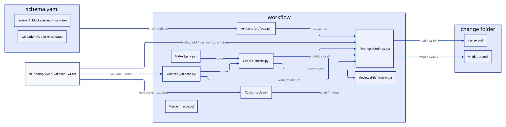

# Design: unify-check-findings

## Context

Findings live only in review.md, and everything about them lives in
`workflow/review.py` next to the drift report: the parser (`parse_review`,
`FINDING_RE` with a hard-coded `R`), the routing rules, the writers, and
`REVIEW_FILE`. `cycle.py`, `checks.py` (`review_readable`, `review_closed`)
and `cli/workflow.py` (`finding`, `cycle`) call them with review.md in mind.
Validate (`validate.py`) returns checks and a summary and writes nothing. The
artifacts come from `schema.yaml`. See proposal.md for the motivation.

## Goals / Non-Goals

**Goals:**
- One reader and one set of writers for findings, parametrised by the check
  artifact; the schema says which artifacts are check artifacts.
- Validate writes validation.md only with `--write`, and keeps its own
  findings in step with its checks on every run.
- Existing review.md files and the existing finding commands behave as before.

**Non-Goals:**
- `inspection.md` and its skill (add-inspect-skill adds a schema entry and a
  template on top of this).
- Warnings as findings; a single findings file; moving findings between files.

## Decisions

### The schema declares the check artifacts

An artifact in `schema.yaml` that holds findings gets a `findings:` entry
with its ID `letter` and the gates its open findings `block`:

```yaml
- id: review        # generates review.md, phase review
  findings: {letter: R, blocks: [review, validate]}
- id: validation    # generates validation.md, phase validate, optional, requires [review]
  findings: {letter: V, blocks: [validate]}
```

`check_artifacts()` lists them in schema order; the artifact's `phase` is the
step that closes its findings (`confirmed in <phase>:`) and names the skill of
its readability and open-findings checks (`/specworks-review`,
`/specworks-validate`). Letters are unique; a duplicate letter fails when the
schema loads. Adding inspect later is a schema entry and a template.
Hard-coding the two files was rejected in the refinement (option B).
Serves: REQ-FLOW-018, REQ-FLOW-001.

### Findings get their own module

The parser, routing and writers move from `review.py` to a new
`workflow/findings.py`, parametrised by a `CheckArtifact`; `review.py` keeps
the drift report only. `FINDING_RE` is built per letter
(`(?P<id>R\d+)` becomes `(?P<id>{letter}\d+)`), and a checkbox with any other
`<letter><n>` ID is reported as unreadable, like any other stray checkbox.
`BACK_RE` and `DECISION_RE` accept `review` as a step (`back to review:`),
with `only` still allowed after design alone. `_new_review` becomes
`_new_artifact`, filling the template's `<!-- change ref -->`. The callers
and the tests import from `findings.py`; no re-export is left in `review.py`.
Serves: REQ-FLOW-010, REQ-FLOW-016, REQ-FLOW-018.

### A finding's artifact comes from its ID

`decide`, `done` and `close` take an ID only, and its letter names the check
artifact (`check_artifact_for("V3")`), so a command line never has to say the
file twice and cannot name the wrong one. Only `add` needs `--artifact`
(default `review`); `--in` was not reused because `finding done --in <step>`
already means the step. Serves: REQ-FLOW-016, REQ-CLI-011.

### Gates read the artifacts that block them

`checks.py` gets two check factories, `artifact_readable(artifact)` and
`artifact_closed(artifact)`, replacing `review_readable` and `review_closed`
(their names and details stay the same for review). The review gate uses them
for every check artifact whose `blocks` holds `review`; validate for every one
whose `blocks` holds `validate`, each row's fix being the artifact's phase
skill. `review_written` stays: review.md is still required by the review gate
and validate. A missing validation.md is not a failure (it is optional).
`--allow-open` keeps applying to every artifact the review gate reads.
Serves: REQ-FLOW-011, REQ-FLOW-013.

### Validate keeps its own findings in step with its checks

`write_validation(ctx) -> tuple[list[Check], Path]` in `validate.py`:

1. Run every `VALIDATE` row except the validation artifact's own
   readability and open-findings checks.
2. For each blocking check that failed and has no open `V` finding with its
   `**Check**` line, add one: type from the row's fix (`/specworks-specify`
   → `spec-gap`, design → `design-gap`, test → `test-gap`, code →
   `code-gap`, review → `quality` with Proposal `back to review: …`),
   text = the check's name and its details joined with `; `.
3. For each open `V` finding with a `**Check**` line whose check now passes,
   close it with `confirmed in validate: the check passes`.
4. Rewrite the `## Summary` section (everything from its heading to the next
   `##` or the end) from the checks; replace `None.` under Findings once
   there is a finding, write it when there is none.
5. Run all checks again (now including the validation artifact's) and return
   them: the verdict validate prints is the one after the write.

Findings without a `**Check**` line (added by the skill or by hand) are
never touched. A check that passed and was closed, then fails again, gets a
new finding. Each step goes through the finding writers, so every write is
read back as today. Serves: REQ-FLOW-019, REQ-CLI-023.

**Pinned wording** (validation.md):
- the check line under a finding validate wrote: `  - **Check**: <check name>`
- its Proposal: `  - **Proposal**: back to <step>: make the check pass`
- its close: `  - confirmed in validate: the check passes`
- the Summary:
  ```
  ## Summary

  Verdict: PASS | FAIL (<n> critical, <n> warnings)

  - Completeness <passed>/<total>
  - Correctness <passed>/<total>
  - Coherence <passed>/<total>

  Warnings:
  - <check name>: <details joined with "; ">
  ```
  (`Warnings:` and its list only when there is one.)

### A finding waits for the step that found it

Review checks the work done for every finding, but closes only its own `R`
ones. For a `V` finding it adds `done in review:`, which routes the finding on
to validate (`NEXT_STEP["review"] = "validate"`, `done in` accepts `review`).
A finding routed to validate starts no build cycle, so `specworks cycle`
gives no start and `next` is validate, where validate confirms and closes it.
Without it a `V` finding routed back to code would be routed to review after
`done in code:` forever. Serves: REQ-FLOW-010, REQ-FLOW-012, REQ-FLOW-016.

### The next state is part of the cycle

`next_cycle(change)` reads every check artifact, lists each open finding with
its ID (its letter says the artifact) and adds `next`: `startAt` when a
finding is open, otherwise the phase after the change's current one in
`PHASES` (review → validate, validate → close), or None after close.
`reviewed` stays (review.md exists). `specworks cycle` prints `next: <phase>`.
A separate `specworks next` command was rejected: it would compute the same
thing from the same findings. Serves: REQ-FLOW-012.

## Interfaces

Proposed: waiting for the user's agreement

Nothing below is BREAKING for a user of the CLI: every existing command,
flag and output field stays; `finding add` gains `--artifact`, `validate`
gains `--write`, `cycle` gains `next`. Inside the package, the findings API
moves from the review module to a new findings module (callers and tests
re-import).

- `src/specworks/schema.yaml`: `findings: {letter, blocks}` on `review`
  (`R`, `[review, validate]`); new artifact `validation` (`validation.md`,
  phase `validate`, template `validation.md`, `requires: [review]`,
  `optional: true`, an `instruction`, `findings: {letter: V, blocks:
  [validate]}`) (REQ-FLOW-018, REQ-FLOW-001)
- `src/specworks/templates/validation.md`: `# Validation: <!-- change ref -->`,
  `## Findings` (guidance comment, `None.` when there are none),
  `## Summary` (REQ-FLOW-019)
- `src/specworks/workflow/artifacts.py`: `Artifact.findings: dict | None = None`;
  `CheckArtifact(id: str, file: str, letter: str, phase: str, blocks: tuple[str, ...])`
  (frozen dataclass); `check_artifacts() -> list[CheckArtifact]` (schema
  order; a duplicate letter raises `WorkflowError` when the schema loads);
  `check_artifact(artifact_id: str) -> CheckArtifact`, raises `WorkflowError`
  naming the check artifacts; `check_artifact_for(finding_id: str) ->
  CheckArtifact`, raises `WorkflowError` for an ID whose letter is no check
  artifact's (REQ-FLOW-018, REQ-FLOW-016)
- `src/specworks/workflow/findings.py` (new): `TYPE_PHASE`, `FINDING_STEPS`,
  `NEXT_STEP`, `Finding` (as today, plus `check: str = ""`, its `**Check**`
  line), `FindingsDoc` (today's `ReviewDoc`, plus `artifact: CheckArtifact`;
  `accounted`/`accounts_for` stay, empty outside review.md), `FindingError`
  (as today, naming the artifact's file) (REQ-FLOW-010, REQ-FLOW-018)
- `src/specworks/workflow/findings.py`: `parse_findings(text: str, artifact:
  CheckArtifact) -> FindingsDoc`, `read_findings(change: Change, artifact:
  CheckArtifact) -> FindingsDoc`, `read_all_findings(change: Change) ->
  list[FindingsDoc]` (one per check artifact, schema order, missing files
  with `exists=False`) (REQ-FLOW-010, REQ-FLOW-018)
- `src/specworks/workflow/findings.py`: the writers
  `add_finding(change, kind, text, proposal, artifact: str = "review", check: str = "") -> Finding`
  (an unknown `artifact` raises `FindingError` naming the check artifacts;
  `check` adds the `**Check**` line);
  `decide_finding(change, finding_id, decision) -> Finding`,
  `mark_finding_done(change, finding_id, step, text) -> Finding` (`step`
  one of specify, design, implement, test, code, review),
  `close_finding(change, finding_id, text) -> Finding` (writes
  `confirmed in <artifact phase>:`), each finding the artifact from the ID's
  letter (an ID of no check artifact raises `FindingError`)
  (REQ-FLOW-016)
- `src/specworks/workflow/review.py`: the drift report only
  (`review_change`, `ReviewReport`, `ChangedFile`, `changed_paths`,
  `deleted_paths`, `detect_base`, `CODE_EXTENSIONS`); `REVIEW_FILE`
  (replaced by `check_artifact("review").file`), `parse_review`,
  `read_review`, `ReviewDoc` and the writers move out, with no re-export
  (REQ-FLOW-010)
- `src/specworks/workflow/checks.py`: `artifact_readable(artifact:
  CheckArtifact) -> CheckFn`, `artifact_closed(artifact: CheckArtifact) ->
  CheckFn` (replacing `review_readable`, `review_closed`; review's rows keep
  their names and details); `GateContext.findings(artifact: CheckArtifact)
  -> FindingsDoc` (cached per artifact); `GateContext.review -> FindingsDoc`
  (review's) (REQ-FLOW-011, REQ-FLOW-013)
- `src/specworks/workflow/gate.py`: the review gate's rows built from the
  check artifacts whose `blocks` holds `review` (REQ-FLOW-011)
- `src/specworks/workflow/validate.py`: the `VALIDATE` rows built from the
  check artifacts whose `blocks` holds `validate`, each fixed by
  `/specworks-<artifact phase>`;
  `write_validation(ctx: GateContext) -> tuple[list[Check], Path]` (the
  checks after the write, validation.md's path) (REQ-FLOW-013, REQ-FLOW-019)
- `src/specworks/workflow/cycle.py`: `next_cycle(change)` reads every check
  artifact and adds `next: str | None`; each `open` entry keeps its `id`
  (REQ-FLOW-012)
- `src/specworks/cli/workflow.py`: `finding add ... --artifact <id>`
  (default `review`); `decide/done/close` print the path of the ID's
  artifact (REQ-CLI-011); `validate --write` (prints `path`, relative to
  the workspace root, `"path"` under `--json`; exit 1 on FAIL after
  writing) (REQ-CLI-023); `cycle` prints `next: <phase>` (`"next"` under
  `--json`) (REQ-FLOW-012)

## Diagrams



## Risks / Trade-offs

- [Moving the findings code breaks imports in tests and callers] -> one
  mechanical import change, done with the move; the suite catches any left.
- [`None.` handling touches the Findings section of validation.md] -> only
  the validation writer does it; review.md writes keep every other line byte
  for byte (AC-FLOW-016.6).
- [A check name changes between versions, so an old `**Check**` line matches
  nothing] -> the old finding stays open and validate fails naming it; the
  skill closes it by hand. Check names are stable in practice.
- [validate --write runs the checks twice] -> the project's commands reuse the
  first run's result (same code), so only the cheap checks run again.

## Migration / Rollback

None: review.md is read as before, and validation.md is new and optional.

## Open Questions

None.
