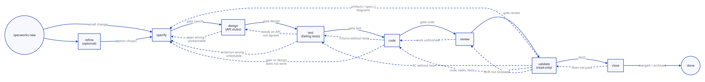

# specworks

[](https://github.com/lcmonteiro/specworks/actions/workflows/ci.yml)

Spec-driven development for AI coding agents, inspired by
[OpenSpec](https://github.com/Fission-AI/OpenSpec) and written in Python (managed with `uv`).

```
refine -> specify -> design -> test -> code -> review -> validate -> close
```



| Phase     | Skill                  | Output |
|-----------|------------------------|--------|
| refine    | `/specworks-refine`    | `refinement.md`: problem, context, constraints, options, recommendation |
| specify   | `/specworks-specify`   | `proposal.md`, delta specs (requirements + acceptance criteria), `design.md`, `tasks.md`, `traceability.md` |
| design    | `/specworks-design`    | the API decided with you (new and extended classes, functions, signatures, errors), recorded under Interfaces in `design.md` and created as empty stubs that build |
| test      | `/specworks-test`      | failing tests tagged `@ac` for every acceptance criterion, written against those stubs |
| code      | `/specworks-code`      | works through `tasks.md`: real code replacing the stubs, `@req` tags, tests green |
| review    | `/specworks-review`    | finds drift between code, spec and design/API, proposes a change to whichever is wrong (applied with you, or sent back to `specify` / `design` / `code`), records every decision in `review.md` |
| validate  | `/specworks-validate`  | **read-only** PASS/FAIL report (completeness, correctness, coherence); every failure names the phase that fixes it |
| close     | `/specworks-close`     | deltas merged into the living `spec.md`, `requirements.md` regenerated, design / architecture / diagrams updated in `<capability-path>/docs/`, change archived (phase `done`) |

[`docs/walkthrough.md`](docs/walkthrough.md) follows one small change through every phase, with the real output of
each step.

**`/specworks-build`** runs design → test → code → review in one go, each
phase exactly as its own skill. When the review has findings, it asks
whether to start a new cycle, and starts it at the earliest phase the
findings need: code findings → code, review; test findings → test, code,
review; design/API findings → design, test, code, review. A spec finding
stops the build and hands over to `/specworks-specify`.
`specworks cycle --change <ref>` shows where the next cycle would start.

The flow is not strictly linear (dashed arrows): `test` goes back to
`design` when a test needs an API that was not agreed, `design`, `test` and
`code` go back to `specify` when the spec turns out wrong, and a failing
`validate` names the phase that fixes each problem. `review` proposes, for
each drift, a change to the code, the spec or the design/API: small, local
ones are applied there with you, larger ones go back to `code`, `specify` or
`design`. The diagram shows every transition the skills and gates use: the
upper dashed lane goes back to `specify`, the lower one to the phase that
fixes a problem. It is a hand-written SVG
([`docs/diagrams/workflow.svg`](docs/diagrams/workflow.svg)), with light and
dark colours; edit it directly.
Each phase skill enters its phase with `specworks start <phase> --change <ref>`, which moves the change only
once the gates it depends on pass; `specworks phase <phase> --change <ref>` moves a change to any phase unchecked, except `done`, which only `specworks close` sets once it has merged and archived the change.

## Layout

```
<dir>.yml                          # config: context, capabilities -> code paths, modules
<dir>/changes/<name>/              # in-flight change artifacts
<dir>/changes/archive/             # finished changes
<capability-path>/<docs_dir>/      # living docs, next to the code
```

The config file is named after the workflow folder: `specworks init --dir spec`
creates `spec.yml` and `spec/` (or `docs.yml` + `docs/`, `context.yml` + `context/`, ...).
`<dir>` defaults to `specworks`. To rename later, rename both the file and the folder.
The file starts with `specworks: 1`, which marks it as a specworks config (so an
unrelated `docs.yml` is never mistaken for one).
`<docs_dir>` defaults to `docs`.

## Specs, IDs and traceability

A change describes behaviour changes as **delta specs**, one per capability, at
`<dir>/changes/<change>/specs/[<module>/]<capability>/spec.md`:

```markdown
## ADDED Requirements

### Requirement: REQ-AUTH-003 Password reset
The system SHALL email a single-use reset link valid for 30 minutes.

#### Scenario: AC-AUTH-003.1 Request reset
- **WHEN** a user asks for a reset with a known email
- **THEN** a reset link is emailed
```

- Requirements are `REQ-<prefix>-NNN`; their acceptance criteria are
  `AC-<prefix>-NNN.<n>`. The prefix is the capability name in upper case
  (`billing:invoices` -> `BILLING-INVOICES`) or the capability's `prefix:` in the config.
  Every capability needs its own prefix: two that share one are a config error.
- `## MODIFIED Requirements` repeats a whole existing block (same ID);
  `## REMOVED Requirements` needs **Reason** and **Migration**. IDs are never reused: a removed ID stays in `requirements.md`'s History, so
  `nextId` skips it and `specworks check` rejects adding it again.
- `close` merges the deltas into the living spec next to the code
  (`<capability path>/<docs_dir>/spec.md`).
- Tests and code point back with comment tags in any language:
  `# @ac AC-AUTH-003.1` in a test, `// @req REQ-AUTH-003` in code; one tag may
  list several IDs (`# @ac AC-AUTH-003.1, AC-AUTH-003.2`).
- `test_globs` / `source_globs` (in the config, relative to its folder) choose the
  files scanned for tags: `*` and `?` stay within one folder, `**` spans any number
  of folders (`tests/**/*.py` includes `tests/test_x.py`; `src/*` does not include
  `src/auth/x.py`, `src/**` does).
- `check` also warns when a `MODIFIED` block drops acceptance criteria the living
  spec has, and when a close recorded in `requirements.md` modified the
  requirement after this change started (re-copy the block, or closing undoes
  that edit). Gates and validate show `check`'s warnings without blocking on them.

| Command | What it does |
|---|---|
| `specworks spec list` / `spec show <ref>` | capabilities, their requirements, ID prefix, next free ID and delta path |
| `specworks check --change <ref>` | checks proposal, delta specs (IDs, SHALL/MUST, scenarios, MODIFIED/REMOVED targets, ID clashes with other changes: the same ID ADDED twice, or one requirement MODIFIED/REMOVED by two active changes) and tasks (format, every AC covered) |
| `specworks diagrams --change <ref> \| --dir <folder> [--check]` | renders `diagrams/*.d2` of a change (or of a living docs folder) to SVG with the workspace theme; `--check` reports missing/outdated SVGs without rendering |
| `specworks skip-specs --change <ref> [--off]` | marks a change with no behaviour change (refactor, tooling, docs): it needs no delta specs |
| `specworks task list\|done\|undo --change <ref> [N.M ...]` | lists tasks with their IDs; ticks or unticks checkboxes without touching the rest of `tasks.md` |
| `specworks gate <phase> --change <ref>` | checks a phase is finished: `specify` (valid specs, tasks cover every AC), `design` (design.md Interfaces recorded, the files it names exist, build/typecheck and the existing tests pass; once the change has `@ac` tests, a red suite is only a warning), `test` (every AC has an `@ac`-tagged test, no tags to unknown IDs), `code` (all tasks done, every requirement has `@req` code, removed ones gone, and `commands.test` passes; `--no-run` skips running it), `review` (`review.md` with no open finding (`--allow-open` in a build), every open finding of a known type or with `back to <phase>:`, every untagged changed file accounted for, tags complete, tests pass), `validate` (same checks as `specworks validate`) |
| `specworks start <phase> --change <ref> [--no-run] [--base]` | moves a change to a phase once the gates it depends on pass, and leaves it where it is (exit 1) when one fails: moving forward, every phase left behind must pass its gate; going back or re-entering needs the gate of the phase just before |
| `specworks close --change <ref> [--dry-run]` | after a passing validate: merges the deltas into each living `spec.md` (ADDED appended, MODIFIED replaced by ID, REMOVED deleted), regenerates `requirements.md` with a History line, marks the change `done` and moves it to `changes/archive/<date>-<name>/` |
| `specworks capability add <name> --path <dir> [--module] [--prefix]` | registers a new capability in a module's config (required before closing a change that creates it) |
| `specworks validate --change <ref> [--base] [--no-run]` | final read-only report in three groups (completeness, correctness, coherence): artifacts, tasks, tags, review, specs valid, test/lint/typecheck pass, untagged files accounted for, diagrams current; each failure names the phase to go back to |
| `specworks review --change <ref> [--base <branch>]` | drift candidates: requirements without code, criteria without tests, bad tags, and files changed on the branch (git) with no `@req`/`@ac` tag |
| `specworks cycle --change <ref>` | after a review: the open findings in `review.md`, the phase each one needs, and where the next design → test → code → review cycle starts (or that a spec finding hands over to specify) |
| `specworks run <test\|lint\|...> [--change <ref>]` | runs a configured project command in the change's module folder; the exit code passes through |
| `specworks trace --change <ref> [--write]` | REQ -> AC -> tasks -> tests (`@ac`) -> code (`@req`) matrix and its gaps; `--write` saves `traceability.md` |

## Diagrams

Designs use [D2](https://d2lang.com) for diagrams: the agent writes a short
text file (`diagrams/<name>.d2`) and `specworks diagrams` renders it to SVG,
which `design.md` embeds. The source stays reviewable in diffs, the SVG looks
good on GitHub, and every diagram shares one theme set in the top-level config:

```yaml
diagrams:
  theme: neutral-default   # by name or number: c4, colorblind-clear, cool-classics, origami, ...
  dark_theme: dark-mauve   # used in dark mode; dark-flagship-terrastruct, or none
  layout: elk              # or dagre
  sketch: false            # true for a hand-drawn look
```

`specworks diagrams --themes` lists every theme and the one in use, and
`specworks init --diagram-theme c4` sets it when creating the project. Changing
the theme marks every SVG as outdated until `specworks diagrams` re-renders it.

Each SVG is stamped with a hash of its source and these settings, so
`specworks check` (and `diagrams --check`, e.g. in CI) can tell when one is
outdated.

D2 comes with specworks: installing it also installs the official, pinned D2
release for your platform (see [Install](#install)), so every machine renders
identical SVGs. `specworks diagrams --themes` shows which `d2` is used.

## Modules (sub-projects)

Like git submodules, a project can link other folders that have their own
config. Each module is a complete project (own context, capabilities and
changes), and the parent lists it explicitly:

```yaml
# spec.yml (top level)
specworks: 1
modules:
  billing: services/billing
```

```
repo/
  spec.yml                # top level: lists billing
  spec/changes/           # cross-module changes
  services/billing/
    spec.yml              # module: lists tax
    spec/changes/         # billing's own changes
    src/invoices/docs/    # living docs of billing:invoices
    tax/spec.yml          # nested module billing/tax
```

- `specworks module add <path>` (or `specworks init <path>` under a project) creates and links a module.
- Every module uses the **same config and folder name** as the top level (set once by
  `specworks init --dir ...`): `spec.yml` + `spec/` everywhere. A module with another
  name (e.g. `docs.yml`) is an error that says what to rename.
- Commands act on the **nearest** module; `--all` shows the whole workspace.
- Context is **inherited**: top-level context first, then each module down to the current one.
- Capabilities and changes of other modules are named `module:name` (`billing:invoices`, `billing/tax:add-vat`).
- A listed module whose folder has no config (e.g. a submodule not checked out) shows up under `missingModules`.

## Install

```bash
uv tool install git+https://github.com/lcmonteiro/specworks
cd your-project && specworks init --dir spec   # writes spec.yml, spec/ and the agent skills
```

The install includes [D2](https://d2lang.com) for diagrams through the
[`pyd2`](https://github.com/lcmonteiro/pyd2) dependency, pinned to one commit of
its git repository. Installing builds it for your platform
(Linux, macOS and Windows on x86-64 and ARM64): it downloads the official D2
release it pins, checks its SHA-256, and packages it; the archive is cached,
so reinstalling does not download it again.

| Variable | Effect |
|---|---|
| `SPECWORKS_D2` | use this `d2` instead of the one from `pyd2` |

`pyproject.toml` names that commit, so `uv sync`, CI and
`uv tool install git+https://github.com/lcmonteiro/specworks` (which does not
read `uv.lock`) all build the same pyd2 and D2. To take a newer pyd2 (a newer
D2, API changes, fixes), put its commit in `pyproject.toml`, then:

```bash
uv lock                          # updates uv.lock to that commit
uv run pytest                    # then commit pyproject.toml and uv.lock
```

## Project commands

Skills run the project's own tools, configured per module (a module's entries
override the top level's), in any language:

```yaml
commands:
  test: uv run pytest     # npm test, go test ./..., cargo test, ctest ...
  lint: uv run ruff check .
```

Gates and `specworks validate` reuse the result of a command already run on the
same code: same command and folder, same commit, same uncommitted and untracked
files (the workflow folder, with specs, tasks and `review.md`, does not count).
A reused result says so (`same code as the run at ...`). The cache is kept in
`.git/specworks-runs.json`; without git, or with `SPECWORKS_RUN_CACHE=0`, every run
is real. `specworks run` always runs. Keep files the commands themselves create (`__pycache__/`,
`.pytest_cache/`, `node_modules/`, build output) in `.gitignore`, or every run changes the fingerprint. Files git ignores (installed dependencies, a local
`.env`) are not part of the fingerprint: after changing only those, run once with
`SPECWORKS_RUN_CACHE=0` (a tracked lockfile change already counts). Edits inside git submodules count too; while a submodule holds untracked files, nothing is reused.

## AI tools

The skills use the open [Agent Skills](https://agentskills.io) format, so the same
files work in several tools:

| Tool | Installed files | How to run a phase |
|------|-----------------|--------------------|
| Claude Code | `.claude/skills/specworks-*/SKILL.md` | `/specworks-refine` or just ask ("let's refine ...") |
| GitHub Copilot | `.github/skills/specworks-*/SKILL.md` and `.github/prompts/specworks-*.prompt.md` | `/specworks-refine` in Copilot Chat (agent mode), or just ask |

`specworks init --tools auto` (the default) installs for the tools the project
already uses (`.claude/`, `CLAUDE.md`, `.github/copilot-instructions.md`,
`.github/prompts/`, ...) and for all of them when none is found. Use
`--tools copilot`, `--tools claude,copilot` or `--tools all` to choose.
`specworks skills` re-installs them, e.g. after upgrading specworks.

The skills call the `specworks` CLI from the terminal, so the agent needs
terminal access (Copilot agent mode, Claude Code).

## Development

```bash
uv sync
uv run pytest
uv run ruff check src tests   # lint (CI runs both)
uv run mypy                   # typecheck
uv run specworks --help
```

Code layout (`src/specworks/`):

| Package | What it holds |
|---|---|
| `cli/` | the `specworks` command: `app.py` (Typer app and command groups), `output.py` (options, JSON/text output, resolving changes), and one module per area: `project.py`, `changes.py`, `specs.py`, `workflow.py` |
| `core/` | `config.py` (find and read `<dir>.yml`), `config_file.py` (write it), `workspace.py` (modules), `changes.py` (changes and phases), `runner.py` (project commands), `files.py` (reading project files), `validators.py` (folder, name and prefix rules), `errors.py` (`SpecworksError`, the base of every error the CLI reports, and `ConfigError`) |
| `specs/` | `specfile.py` (parse specs), `capabilities.py`, `check.py` (`specworks check`), `tasks.py`, `trace.py` (tags, matrix, and `Analysis`: everything known about a change, computed once), `merge.py` (close) |
| `workflow/` | `artifacts.py` (artifacts and instructions, `schema.yaml`), `checks.py` (every check, each defined once; gates and validate are lists of them), `gate.py`, `review.py` (drift and `review.md`), `cycle.py`, `validate.py` (`specworks validate`) |
| `tools/` | `diagrams.py` (D2 via pyd2), `skills.py` (install the skills) |

`schema.yaml`, `templates/` and `skills/` are package data next to them. Text several skills share lives once in
`skills/_shared/<name>.md`; a skill marks its place with `<!-- specworks:include <name> -->`, filled in on install.
