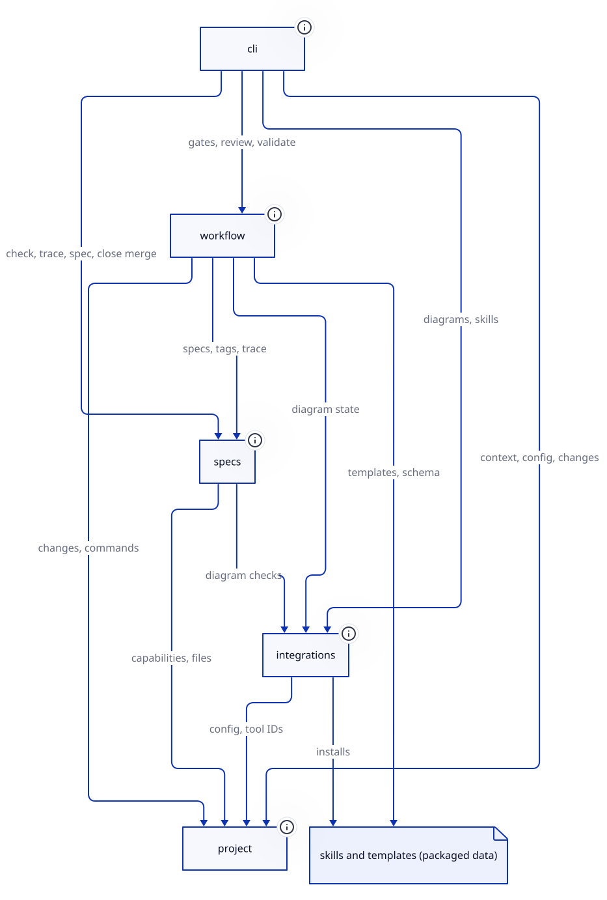

# Architecture: specworks

## Overview

specworks is a spec-driven development CLI (Python 3.11+, typer, uv) plus the
agent skills it installs. The skills do the work that needs judgement (refine,
specify, design, test, code, review, close); the CLI gives them facts and
gates: where the project and its changes are, what a change's specs, tasks and
tags say, whether a phase may start, and how deltas fold into the living docs.
Everything is one Python package, `src/specworks`, layered so lower capabilities
never import higher ones.

## Capabilities and how they interact

- **project** (`src/specworks/core`): the base. Config, workspace and modules,
  changes and their phases, running the project's commands with result reuse,
  git. Uses nothing else.
- **specs** (`src/specworks/specs`): spec files, requirement IDs, tasks, the
  trace matrix, and merging deltas into living specs at close. Uses project,
  and integrations for its diagram checks.
- **integrations** (`src/specworks/tools`): rendering D2 diagrams and
  installing the packaged skills for Claude Code and Copilot. Uses project.
- **workflow** (`src/specworks/workflow`): artifacts and instructions, phase
  gates, review drift and findings, build cycles, validate. Uses project, specs
  and integrations (diagram state).
- **cli** (`src/specworks/cli`): the command surface; resolves the workspace
  and the change, calls the capability that does the work, prints text or
  JSON. Uses all of the above.
- Skills and templates (`src/specworks/skills`, `src/specworks/templates`) are
  packaged data with no capability yet; they run the CLI.

## Architectural decisions

- **Layered capabilities**: project at the bottom, integrations on it, specs
  above them, workflow above, cli on top; no import goes upward.
  (baseline-project)
- **The CLI checks, the skills judge**: gates and validate check only what the
  CLI can see (specs, tasks, tags, review.md, git, commands); judgement stays
  in the skills. (baseline-workflow)
- **Errors are values**: every expected failure is a `SpecworksError`; under
  `--json` it is `{"error": ...}` with exit 1, and every printed path is
  relative to the workspace root. (baseline-cli)
- **Living docs next to the code**: each capability's `spec.md`,
  `requirements.md` and `design.md` live in `<path>/docs/`, written only by
  `specworks close`; each module's architecture lives in its own
  `docs/architecture.md`, and close refuses a module without one.
  (baseline-specs, project-docs)
- **Skills share text**: common wording lives once in `skills/_shared/` and is
  included with `<!-- specworks:include <name> -->`; installed copies are
  refreshed with `specworks skills`. (project-docs)

## Glossary

- **Capability**: a named part of the code with a path, an ID prefix and its
  own living docs.
- **Module**: a folder with its own `.specworks/config.yml`, linked from its
  parent's `modules:`; the top level is a module too.
- **Change**: one unit of work in `.specworks/changes/active/<name>/`, moving
  through the phases; archived at close.
- **Phase**: refine, specify, design, implement (test and code halves),
  review, validate, close, done.
- **Delta spec**: a change's ADDED, MODIFIED and REMOVED requirements for one
  capability, merged into its living `spec.md` at close.
- **Gate**: the checks a phase must pass before the next one starts.
- **Finding**: one drift recorded in review.md, routed back to the step that
  fixes it.
- **Living docs**: a capability's spec, requirements index and design, plus a
  module's architecture, describing the system as it is now.
