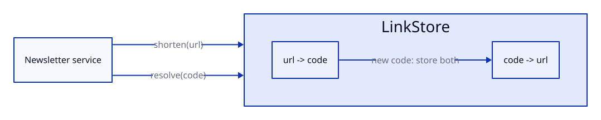

# Design: add-short-links

## Context

Empty package today; see proposal.md for motivation.

## Goals / Non-Goals

**Goals:**
- One code per URL, codes resolvable in O(1).

**Non-Goals:**
- Persistence and expiry (proposal, Out of Scope).

## Decisions

### Two dicts, random base62 codes

`LinkStore` keeps `url -> code` and `code -> url`. A new URL draws random
6-character codes from `secrets.choice` over `[A-Za-z0-9]` until one is free.
Alternative: hash of the URL (refinement Option B), rejected: collisions still
need handling and the user preferred random codes. Serves: REQ-LINK-001, REQ-LINK-002.

### URL validation with urllib.parse

A URL is valid when `urlparse` gives scheme `http`/`https` and a non-empty
host. Serves: AC-LINK-001.3.

## Interfaces

- `src/shortlink/store.py`: `LinkStore()` - an empty in-memory store (REQ-LINK-001, REQ-LINK-002)
- `src/shortlink/store.py`: `LinkStore.shorten(url: str) -> str`, raises `InvalidUrl` (REQ-LINK-001)
- `src/shortlink/store.py`: `LinkStore.resolve(code: str) -> str`, raises `UnknownCode` (REQ-LINK-002)
- `src/shortlink/errors.py`: `ShortlinkError`, `InvalidUrl(ShortlinkError)`, `UnknownCode(ShortlinkError)` (new)

## Diagrams

## Risks / Trade-offs

- [the store is lost on restart] -> documented; persistence is a later change.
