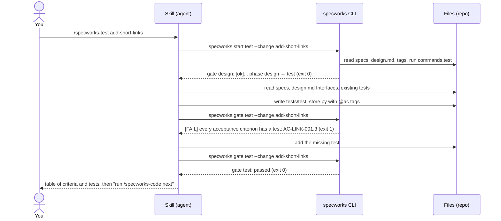
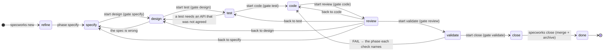
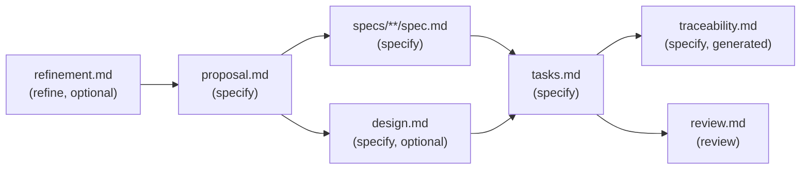
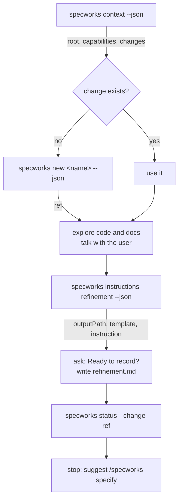
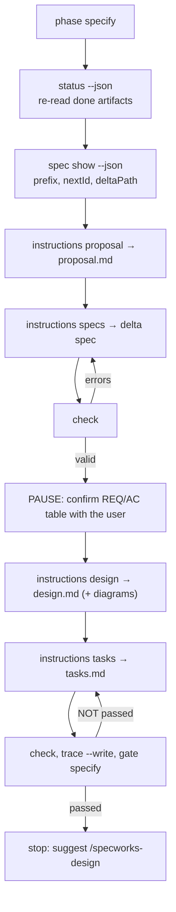
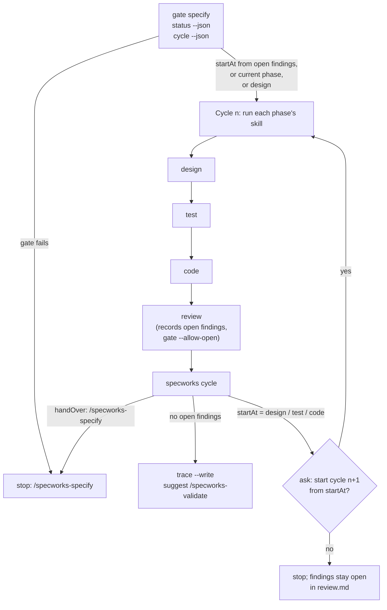
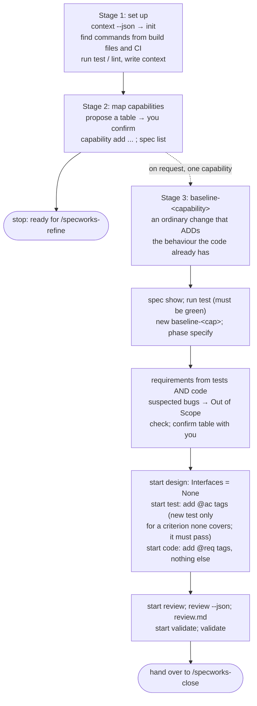

# specworks in depth: the process, the skills, the commands

This guide explains the whole specworks process in detail: every phase, every
skill, every CLI command, what each command prints, and how the skill running
it uses that output to decide what to do next.

It follows one small example project, **`shortlink`** (a tiny URL shortener),
through two changes:

1. `add-short-links`: a new behaviour, through every phase, including failing
   checks, a review finding and a second build cycle.
2. `add-link-expiry`: a change to a capability that already has a living spec
   (`MODIFIED` requirements).

**All command output in this guide is real.** It was captured by running
specworks on the project; only the absolute workspace path is shortened to
`/work/shortlink`. The finished project, with its living docs and archived
changes, is in [`example/shortlink/`](example/shortlink/).

For a shorter tour, see [`walkthrough.md`](walkthrough.md). For the command
list, see the [README](../README.md).

---

## Contents

1. [The mental model](#1-the-mental-model)
   - [1.1 Three actors: you, the skill, the CLI](#11-three-actors-you-the-skill-the-cli)
   - [1.2 How a command result feeds a skill](#12-how-a-command-result-feeds-a-skill)
   - [1.3 Phases, gates and how a change moves](#13-phases-gates-and-how-a-change-moves)
   - [1.4 Files: the change folder and the living docs](#14-files-the-change-folder-and-the-living-docs)
   - [1.5 IDs, tags and traceability](#15-ids-tags-and-traceability)
   - [1.6 Artifacts and their dependencies](#16-artifacts-and-their-dependencies)
2. [The example project: set up](#2-the-example-project-set-up)
3. [Change 1, phase by phase: `add-short-links`](#3-change-1-phase-by-phase-add-short-links)
   - [3.1 refine](#31-refine)
   - [3.2 specify](#32-specify)
   - [3.3 design](#33-design)
   - [3.4 test](#34-test)
   - [3.5 code](#35-code)
   - [3.6 review](#36-review)
   - [3.7 The second build cycle](#37-the-second-build-cycle)
   - [3.8 validate](#38-validate)
   - [3.9 close](#39-close)
4. [Change 2: modifying a capability with a living spec](#4-change-2-modifying-a-capability-with-a-living-spec)
5. [Other lifecycle commands](#5-other-lifecycle-commands)
6. [`/specworks-build` in depth](#6-specworks-build-in-depth)
7. [`/specworks-adopt` in depth](#7-specworks-adopt-in-depth)
8. [Reference](#8-reference)
   - [8.1 Every command](#81-every-command)
   - [8.2 Every gate check](#82-every-gate-check)
   - [8.3 Every validate check](#83-every-validate-check)
   - [8.4 Review findings and build cycles](#84-review-findings-and-build-cycles)
   - [8.5 What `start` checks](#85-what-start-checks)
   - [8.6 The run cache](#86-the-run-cache)
   - [8.7 Who writes which file](#87-who-writes-which-file)
9. [Troubleshooting: gate messages and what to do](#9-troubleshooting-gate-messages-and-what-to-do)

---

## 1. The mental model

### 1.1 Three actors: you, the skill, the CLI

specworks splits the work between three actors:

| Actor | What it is | What it does | What it never does |
|---|---|---|---|
| **You** | the developer | decide product questions; confirm requirements, the API, review decisions, merges | — |
| **The skill** | a `SKILL.md` file (e.g. `.claude/skills/specworks-test/SKILL.md`) that the agent follows | reads code, talks with you, writes artifacts (specs, tests, code), runs the CLI and reacts to its output | invent paths or IDs; decide on its own that a phase is finished |
| **The CLI** | the `specworks` command | knows the paths, IDs and phases; parses specs, tasks, tags and `review.md`; runs your test/lint commands; says PASS or FAIL | write your code, tests or specs |

The rule behind every skill: **the skill decides, the CLI measures.** The
skill asks the CLI where a file goes and which ID comes next, writes the file,
then asks the CLI whether the result is valid. A phase is finished only when its
**gate** (`specworks gate <phase>`) passes.



The skills are installed by `specworks init` (or `specworks skills`) into
`.claude/skills/specworks-*/SKILL.md` (Claude Code) and/or
`.github/skills/` + `.github/prompts/` (GitHub Copilot). You run one by typing
`/specworks-<phase>` or just asking ("let's specify this").

| Skill | Phase(s) | Goal |
|---|---|---|
| `/specworks-adopt` | — | set specworks up on an existing project; map capabilities; on request, baseline one |
| `/specworks-refine` | refine | understand the problem, compare options → `refinement.md` |
| `/specworks-specify` | specify | proposal, delta specs (REQ/AC), design, tasks, traceability |
| `/specworks-design` | design | decide the API with you, record it in `design.md` → stubs |
| `/specworks-test` | test | failing tests tagged `@ac`, one or more per criterion |
| `/specworks-code` | code | implement task by task, tag `@req`, suite green |
| `/specworks-review` | review | find drift between code, spec and design → `review.md` |
| `/specworks-build` | design → test → code → review | chain the four, in cycles, until the review is clean |
| `/specworks-validate` | validate | read-only PASS/FAIL report |
| `/specworks-close` | close | merge deltas into the living docs, archive the change |

Two pieces of text are shared by several skills (`src/specworks/skills/_shared/`)
and inlined at install time:

- **Running the CLI**: use `specworks`, or `uv run specworks` / `uvx ... specworks`
  when it is not on `PATH`; gates reuse a test result from the same code.
- **Picking the change**: start with `specworks context --json`; `"root": null`
  means "not set up, ask about `specworks init`"; the change is the one you named
  or the only one in flight; otherwise ask; then announce `Using change: <ref>`.

### 1.2 How a command result feeds a skill

A skill reads a command's result through three channels:

**1. The exit code.** `check`, `gate`, `start`, `validate` and `close` exit `1`
when something blocks; `run` passes the project command's exit code through.
Every skill branches on it: *"If it fails, stop: show the failing checks and
suggest `/specworks-design <ref>`."*

**2. Check lines.** Gates and validate print one line per check:

```
[ok  ] every requirement has code (@req tag)
[FAIL] every acceptance criterion has a test (@ac tag)
         AC-LINK-001.3
         AC-LINK-002.2
[warn] the specs are the ones agreed when specify passed
         REQ-LINK-002 changed
```

- `[ok  ]` passed; `[FAIL]` a **blocking** check failed (the gate fails);
  `[warn]` a non-blocking check failed (the gate still passes; the skill must
  fix it or explain it).
- The indented **details** are the to-do list: the exact IDs that miss a test,
  the `file:line` of a bad tag, the pending tasks, the tail of the failing test
  output. The skill fixes exactly those and re-runs the gate.

**3. JSON (`--json`).** Every command has a `--json` form. The skills read
specific fields from it rather than guessing:

| Field | Command | Read by | What it decides |
|---|---|---|---|
| `root`, `context`, `capabilities[].docsPath`, `changes` | `context --json` | every skill, first step | is the project set up; which constraints apply; which docs to read; which change to use |
| `ref` | `new --json` | refine, specify | the name used in every later command |
| `outputPath`, `template`, `instruction`, `exists` | `instructions <artifact> --json` | refine, specify, design, review | where to write the artifact, its structure and rules; update instead of overwrite when `exists` |
| `prefix`, `nextId`, `deltaPath`, `codePath`, `requirements` | `spec show <cap> --json` | specify, design, test, review, close | delta spec path and the next free ID; the code folder to read; the whole existing block to copy for MODIFIED |
| `rows[].tests`, `rows[].code` | `trace --json` | test, code, validate | which tests already cover a criterion, where a requirement is implemented |
| `findings.*`, `changedFiles` | `review --json` | review | drift candidates in both directions |
| `open[].phase`, `startAt`, `phases`, `handOver` | `cycle --json` | build, specify | where the next build cycle starts, or whether to hand over to specify |
| `verdict`, `goBackTo`, `checks[].fix` | `validate --json` | validate, close | PASS/FAIL, and the phase skill that fixes each failure |
| `artifacts[].status` | `status --json` | specify, build | which artifacts are `done` (re-read them from disk), `ready`, `blocked` or `skipped` |

### 1.3 Phases, gates and how a change moves

A change is always in one phase, stored in its `.change.yaml`:

```
refine → specify → design → test → code → review → validate → close → done
```

There are three ways to move a change:

| Command | Checks first? | Used by |
|---|---|---|
| `specworks start <phase> --change <ref>` | **yes**: runs the gates the move depends on; moves only if they all pass (exit 1, phase unchanged, otherwise) | every phase skill from design on, as its first step |
| `specworks phase <phase> --change <ref>` | no | `/specworks-specify` (enter specify), `/specworks-review` (send a change back), a user who knows what they are doing |
| `specworks close --change <ref>` | yes: the full validate | `/specworks-close`; the only way to reach `done` |

Which gates `start` runs:

- **Moving forward**, every phase left behind must pass its gate.
  `start test` from `specify` runs `gate specify` *and* `gate design`.
- **Going back or re-entering**, only the gate of the phase just before the
  target runs. `start test` from `review` runs only `gate design`.



What each gate requires, in one line (the full list is in [8.2](#82-every-gate-check)):

| Gate | Passes when |
|---|---|
| `specify` | specs and tasks valid (`specworks check`), `tasks.md` written, every criterion covered by a task |
| `design` | `design.md` has `## Interfaces`, every file named there exists, build/typecheck (if configured) and the existing tests pass |
| `test` | every criterion has an `@ac` test, no tag to an unknown ID |
| `code` | every task ticked, every requirement has `@req` code, every criterion still tested, removed requirements gone, test suite green |
| `review` | `review.md` written, no open finding (or `--allow-open` in a build), every untagged changed file accounted for, tags complete, suite green |
| `validate` | the full validate report has no critical failure |

### 1.4 Files: the change folder and the living docs

```
spec.yml                                  # config (named after the workflow folder: spec/)
spec/changes/<change>/                    # one folder per change in flight
  .change.yaml                            # name, created, phase, specified (fingerprints)
  refinement.md                           # refine
  proposal.md                             # specify: why, what, which capabilities
  specs/<capability>/spec.md              # specify: delta spec (ADDED / MODIFIED / REMOVED)
  design.md                               # specify (decisions), design (Interfaces)
  diagrams/<name>.d2 + .svg               # specify/design: D2 source and rendered SVG
  tasks.md                                # specify: checklist; ticked in design/test/code
  traceability.md                         # generated by `specworks trace --write`
  review.md                               # review: findings and decisions
spec/changes/archive/<date>-<change>/     # closed or abandoned changes
<capability path>/docs/                   # living docs, next to the code
  spec.md                                 # merged by `specworks close`
  requirements.md                         # index + History, generated by `specworks close`
  design.md, architecture.md, diagrams/   # written by /specworks-close
```

A **delta spec** describes what a change changes; the **living spec** describes
the system as it is. `close` applies the delta to the living spec.

### 1.5 IDs, tags and traceability

- A **capability** is a durable behaviour owned by a code folder, registered in
  the config (`links` → `src/shortlink`, prefix `LINK`).
- **Requirements** are `REQ-<prefix>-NNN`; their **acceptance criteria** are
  `AC-<prefix>-NNN.<n>`. The next free ID comes from `specworks spec show`
  (`nextId`), never from the agent. IDs are never reused: a removed ID stays in
  `requirements.md`'s History.
- **Tags** are comments in any language that link code back to the spec:
  `# @ac AC-LINK-001.1` above a test, `# @req REQ-LINK-001` above the code that
  implements a requirement. One tag may list several IDs.
- A file is a **test file** or a **source file** according to `test_globs` /
  `source_globs` in the config. When they are empty, every file outside the
  workflow folder is scanned (except docs: `.md`, `.rst`, `.txt`, ...), and a
  file is a test file when one of its folders is `test`, `tests`, `__tests__`
  or `testing`, or its name looks like a test (`test_x.py`, `x_test.go`,
  `x.test.ts`, `x.spec.ts`, `XTest.java`, ...).
- **`specworks trace`** builds the matrix REQ → AC → tasks → tests (`@ac`) →
  code (`@req`) and lists the gaps. The gates use the same analysis.

### 1.6 Artifacts and their dependencies

`src/specworks/schema.yaml` lists the artifacts of a change, the phase that
writes each one, its template and the rules (`instruction`) the agent follows.
`specworks status` shows each one as `done`, `ready` (its dependencies are done),
`blocked` or `skipped`.



`specworks instructions <artifact> --change <ref> --json` returns, for one
artifact: `outputPath` (where to write it), `template` (its structure),
`instruction` (its rules), `exists`, `dependencies`, the inherited `context`,
and for `specs` the `capabilities` with their `prefix`, `nextId` and
`deltaPath`. This is the skill's main input for writing any artifact.

---

## 2. The example project: set up

`shortlink` starts as an empty Python package with one test:

```
src/shortlink/__init__.py
tests/test_package.py
.gitignore                 # __pycache__/, .pytest_cache/
```

On a project like this, `/specworks-adopt` stages 1 and 2 do the set-up. These
are the commands it runs.

**`specworks init`** writes the config, the changes folder and the skills:

```
$ specworks init --dir spec --tools claude
created spec.yml
ready   spec/changes/
tools   Claude Code
skill   .claude/skills/specworks-adopt/SKILL.md
skill   .claude/skills/specworks-build/SKILL.md
skill   .claude/skills/specworks-close/SKILL.md
skill   .claude/skills/specworks-code/SKILL.md
skill   .claude/skills/specworks-design/SKILL.md
skill   .claude/skills/specworks-refine/SKILL.md
skill   .claude/skills/specworks-review/SKILL.md
skill   .claude/skills/specworks-specify/SKILL.md
skill   .claude/skills/specworks-test/SKILL.md
skill   .claude/skills/specworks-validate/SKILL.md
```

`spec.yml` is commented; these are the parts filled in for `shortlink`
(adopt proposes `commands` from the build files and CI, and `context` from the
README; you confirm them):

```yaml
specworks: 1
context: |
  Python 3.12 library, standard library only. Public API lives in src/shortlink/.
  Errors are raised as subclasses of shortlink.errors.ShortlinkError.
docs_dir: docs
capabilities:
  links:
    path: src/shortlink
    description: Create short codes for URLs and resolve them
    prefix: LINK
modules: {}
test_globs: []
source_globs: []
commands:
  test: python -m pytest -q -p no:cacheprovider -o pythonpath=src tests
  lint: ruff check src tests
diagrams:
  theme: neutral-default
  dark_theme: dark-mauve
  layout: elk
  sketch: false
```

**`specworks capability add`** registers the capability (adopt does this for
each row of the capability table you confirmed):

```
$ specworks capability add links --path src/shortlink --prefix LINK --description "Create short codes for URLs and resolve them"
registered links -> src/shortlink (REQ-LINK-)
```

**`specworks run`** runs a configured command in the right folder. Adopt runs
each one once to record the project's starting state (a failing command is
reported, not fixed):

```
$ specworks run test
.                                                                        [100%]
1 passed in 0.00s
$ specworks run lint
All checks passed!
$ specworks spec list
links                        REQ-LINK-  0 req  src/shortlink/docs/spec.md
```

**`specworks context --json`** is the first command of every skill:

```json
{
  "root": "/work/shortlink",
  "module": "(top)",
  "dir": "spec",
  "changesDir": "spec/changes",
  "context": "Python 3.12 library, standard library only. Public API lives in src/shortlink/.\nErrors are raised as subclasses of shortlink.errors.ShortlinkError.",
  "contextChain": [
    {
      "module": "(top)",
      "context": "Python 3.12 library, standard library only. Public API lives in src/shortlink/.\nErrors are raised as subclasses of shortlink.errors.ShortlinkError."
    }
  ],
  "commands": {
    "test": "python -m pytest -q -p no:cacheprovider -o pythonpath=src tests",
    "lint": "ruff check src tests"
  },
  "modules": [
    { "name": "(top)", "path": ".", "dir": "spec", "changesDir": "spec/changes", "current": true }
  ],
  "missingModules": [],
  "capabilities": [
    {
      "name": "links",
      "module": "(top)",
      "path": "src/shortlink",
      "description": "Create short codes for URLs and resolve them",
      "docsPath": "src/shortlink/docs",
      "hasSpec": false,
      "prefix": "LINK",
      "deltaPath": "specs/links/spec.md"
    }
  ],
  "changes": []
}
```

How the skills use it:

- `root` is not `null` → the project is set up (otherwise: ask about `specworks init`).
- `context` → constraints every artifact must respect ("standard library only"),
  never copied into an artifact.
- `commands.test` → the project can be tested; the design and code gates need it.
- `capabilities[].docsPath` + `hasSpec: false` → `links` has no living spec yet:
  refine and specify know there is nothing to read there, and the first change
  will ADD its first requirements.
- `changes: []` → nothing in flight: refine creates a new change.

The set-up is committed on `main`; the first change is developed on a branch
(`git checkout -b add-short-links`), because review compares the branch with
its base.

---

## 3. Change 1, phase by phase: `add-short-links`

Each section below has the same parts: what the skill is for, its steps with
the command each one runs, the real output, the artifacts written, and **how
the output feeds the skill**.

### 3.1 refine

**Skill**: `/specworks-refine`. **Writes**: `refinement.md` only. **Boundary**:
no requirements, tasks, tests or code, even if you ask to "build" something.



| Step | Command | Output used for |
|---|---|---|
| 1. Check the project | `specworks context --json` | see [section 2](#2-the-example-project-set-up) |
| 2. Create the change | `specworks new add-short-links --json` | `ref` for every later command |
| 3. Explore | (reads code, asks one question at a time) | problem, scope, constraints, options |
| 4. Write `refinement.md` | `specworks instructions refinement --change <ref> --json` | `outputPath`, `template`, `instruction`, `exists` |
| 5. Show the result | `specworks status --change <ref>` | summary; then stop |

```
$ specworks new add-short-links --json
{
  "name": "add-short-links",
  "ref": "add-short-links",
  "module": "(top)",
  "path": "spec/changes/add-short-links",
  "phase": "refine",
  "created": "2026-10-17T19:55:11",
  "skipSpecs": false
}
```

It creates `spec/changes/add-short-links/.change.yaml`:

```yaml
name: add-short-links
created: '2026-10-17T19:55:11'
phase: refine
```

The skill then asks for the artifact's instructions (long strings abridged):

```
$ specworks instructions refinement --change add-short-links --json
{
  "artifact": "refinement",
  "phase": "refine",
  "change": "add-short-links",
  "module": "(top)",
  "root": "/work/shortlink",
  "changeDir": "spec/changes/add-short-links",
  "outputPath": "spec/changes/add-short-links/refinement.md",
  "exists": false,
  "optional": true,
  "context": "Python 3.12 library, standard library only. ...",
  "instruction": "Capture the shared understanding of the problem BEFORE committing to a solution.\nThis is the input for the proposal; it is not a plan.\n\nSections:\n- **Problem**: 2-4 sentences. ...",
  "template": "# Refinement: <!-- change name -->\n\n## Problem\n\n<!-- What hurts, for whom, and why now -->\n\n## Context\n\n**Observed:** ...",
  "dependencies": []
}
```

**How it feeds the skill**: `template` gives the headings, `instruction` the
rules for each section (Problem in 2-4 sentences, Observed vs Assumed, 2-3 real
options with effort and capabilities touched, a Recommendation or "Pending"),
`outputPath` the file to write. `exists: false` means "create"; `true` would
mean "re-read it and update it, do not overwrite the user's edits".

After the conversation, and after asking "Ready to record the refinement?",
the agent writes:

```markdown
# Refinement: add-short-links

## Problem

Our newsletter tool pastes long tracking URLs into emails; they wrap, break and
look untrustworthy. The team wants "a tiny library that turns a long URL into a
short code and back", usable from the newsletter service.

## Context

**Observed:**
- `src/shortlink/` holds only an empty package; capability `links` is registered
  (prefix LINK) with no living spec yet.
- The project is standard-library only (context).

**Assumed:**
- One process; persistence is not needed for the first version.

## Constraints

- [hard] Standard library only.
- [hard] The same URL must not get two different codes (analytics count per code).
- [soft] Codes short enough to read aloud (6-8 characters).

## Options

### Option A: Random codes in an in-memory store

`LinkStore.shorten(url)` draws a random 6-char base62 code, stores it in a dict.

- **Pros:** simple, codes not guessable in sequence
- **Cons:** needs a reverse map to keep one code per URL
- **Effort:** S
- **Touches:** links

### Option B: Hash of the URL

Code = first 6 chars of base62(sha256(url)).

- **Pros:** deterministic, no reverse map
- **Cons:** collisions must still be handled; code leaks nothing but is fixed forever
- **Effort:** S
- **Touches:** links

## Recommendation

Option A, agreed with the user: a reverse map is trivial and collision handling is simpler.

## Open Questions

- Should codes expire? (who can answer: product owner) - not now; a later change.

## Candidate Capabilities

- `links`: modified - first requirements of the registered capability.
```

```
$ specworks status --change add-short-links
add-short-links (phase: refine)
  [ done  ] refinement.md
  [ ready ] proposal.md
  [blocked] specs/**/spec.md
  [blocked] design.md
  [blocked] tasks.md
  [blocked] traceability.md
  [blocked] review.md
```

`refinement.md` went from `ready` to `done`, which makes `proposal.md` the next
artifact. The skill stops and suggests `/specworks-specify add-short-links`.

> The open question "Should codes expire?" is the seed of change 2
> ([section 4](#4-change-2-modifying-a-capability-with-a-living-spec)).

### 3.2 specify

**Skill**: `/specworks-specify`. **Writes**: `proposal.md`, delta specs,
`design.md` (when needed), `tasks.md`, `traceability.md`, all inside the change
folder. **Boundary**: planning only; no tests, no code.



| Step | Command | Output used for |
|---|---|---|
| 1. Enter the phase | `specworks phase specify --change <ref>` | phase marker |
| 2. Load what exists | `specworks status --change <ref> --json`; `specworks spec show <cap> --json`; `specworks cycle --change <ref> --json` (only when coming back from review) | which artifacts to re-read; existing requirements; findings to carry out |
| 3. Proposal | `specworks instructions proposal --change <ref> --json` | template and rules |
| 4. Delta specs | `specworks instructions specs --change <ref> --json`, then `specworks check` | `capabilities[].deltaPath/prefix/nextId`; errors to fix |
| 5. Confirm | (table shown to you; **stop and wait**) | your corrections |
| 6. Design | `specworks instructions design --change <ref> --json`; `specworks diagrams --change <ref>` | whether a design is worth writing; SVGs |
| 7. Tasks | `specworks instructions tasks --change <ref> --json` | rules for tasks |
| 8. Validate | `specworks check`, `specworks trace --write`, `specworks gate specify` | must pass |
| 9. Report | `specworks status --change <ref>` | summary |

**Step 1-2: where things go, and which ID comes next.**

```
$ specworks phase specify --change add-short-links
add-short-links: phase → specify
$ specworks spec show links --json
{
  "ref": "links",
  "module": "(top)",
  "name": "links",
  "new": false,
  "prefix": "LINK",
  "nextId": "REQ-LINK-001",
  "deltaPath": "specs/links/spec.md",
  "codePath": "src/shortlink",
  "livingSpec": "src/shortlink/docs/spec.md",
  "hasSpec": false,
  "purpose": "",
  "requirements": []
}
```

**How it feeds the skill**: the delta spec goes to
`spec/changes/add-short-links/` + `deltaPath` = `.../specs/links/spec.md`; the
first requirement is `nextId` = `REQ-LINK-001`; `hasSpec: false` means the
delta starts with `## Purpose` and has only ADDED requirements.
`specworks instructions specs --json` returns the same data under
`capabilities`, plus the rules:

```
$ specworks instructions specs --change add-short-links --json   (instruction, template, context omitted)
{
  "artifact": "specs",
  "phase": "specify",
  "change": "add-short-links",
  "module": "(top)",
  "changeDir": "spec/changes/add-short-links",
  "outputPath": "spec/changes/add-short-links/specs/**/spec.md",
  "exists": false,
  "optional": false,
  "dependencies": [
    { "id": "proposal", "path": "spec/changes/add-short-links/proposal.md", "done": false }
  ],
  "capabilities": [
    {
      "ref": "links", "module": "(top)", "name": "links", "new": false,
      "prefix": "LINK", "nextId": "REQ-LINK-001", "deltaPath": "specs/links/spec.md",
      "codePath": "src/shortlink", "livingSpec": "src/shortlink/docs/spec.md",
      "hasSpec": false, "purpose": "", "requirements": []
    }
  ],
  "writtenDeltas": []
}
```

**Step 3: `proposal.md`.** Its Capabilities section is the contract for the
next step: every capability listed there gets a delta spec.

```markdown
# Proposal: add-short-links

## Why

Long tracking URLs break in newsletter emails. A short code per URL fixes that
(refinement.md, Option A).

## What Changes

- New `LinkStore` with `shorten(url)` and `resolve(code)`.
- New errors `InvalidUrl` and `UnknownCode`.

## Capabilities

### Modified Capabilities

- `links`: first requirements of the registered capability (no living spec yet).

## Impact

New module `src/shortlink/store.py` and `src/shortlink/errors.py`. No dependencies.

## Out of Scope

- Persistence; expiry of codes; custom codes.
```

**Step 4: the delta spec, and how `check` feeds back.** A first draft with two
mistakes (no SHALL/MUST; a criterion numbered under the wrong requirement):

```markdown
### Requirement: REQ-LINK-001 Shorten a URL

The system returns a 6-character code made of letters and digits for an http(s) URL.
...
### Requirement: REQ-LINK-002 Resolve a code

The system SHALL return the original URL for a code it issued.

#### Scenario: AC-LINK-001.2 Known code
```

```
$ specworks check --change add-short-links
error   spec/changes/add-short-links/specs/links/spec.md:9: REQ-LINK-001: state the requirement with SHALL or MUST
error   spec/changes/add-short-links/specs/links/spec.md:22: AC-LINK-001.2 is under REQ-LINK-002; number it AC-LINK-002.<n>
warning spec/changes/add-short-links/tasks.md: tasks.md is not written yet
add-short-links: INVALID (2 errors, 1 warnings)
```

**How it feeds the skill**: each `error` names the file, the line and the fix;
the skill applies them and re-runs `check` until it is valid ("fix every error
before going on"). The warning `tasks.md is not written yet` is expected at
this point, the skill says so explicitly. The corrected spec, with error and
edge cases as their own criteria:

```markdown
# Spec Delta: links

## Purpose

Turn long URLs into short codes and resolve the codes back.

## ADDED Requirements

### Requirement: REQ-LINK-001 Shorten a URL

The system SHALL return a 6-character code of letters and digits for an http or https URL, and the same code every time the same URL is shortened.

#### Scenario: AC-LINK-001.1 A valid URL gets a code

- **WHEN** `shorten("https://example.com/a")` is called
- **THEN** it returns a 6-character code of letters and digits

#### Scenario: AC-LINK-001.2 The same URL keeps its code

- **GIVEN** `shorten("https://example.com/a")` returned code `c`
- **WHEN** `shorten("https://example.com/a")` is called again
- **THEN** it returns `c`

#### Scenario: AC-LINK-001.3 A URL that is not http(s) is rejected

- **WHEN** `shorten("ftp://example.com")` or `shorten("not a url")` is called
- **THEN** it raises `InvalidUrl`

### Requirement: REQ-LINK-002 Resolve a code

The system SHALL return the original URL for a code it issued, and reject a code it did not issue.

#### Scenario: AC-LINK-002.1 A known code resolves

- **GIVEN** `shorten(url)` returned code `c`
- **WHEN** `resolve(c)` is called
- **THEN** it returns `url`

#### Scenario: AC-LINK-002.2 An unknown code is rejected

- **WHEN** `resolve("zzzzzz")` is called on an empty store
- **THEN** it raises `UnknownCode`
```

```
$ specworks check --change add-short-links
warning spec/changes/add-short-links/tasks.md: tasks.md is not written yet
add-short-links: valid (0 errors, 1 warnings)
```

**Step 5: the pause.** The skill shows you one line per criterion and **stops**
until you confirm, because design, tests and code are all built on this list:

```
Capability  Requirement                          Acceptance criterion
links       REQ-LINK-001 Shorten a URL (ADDED)   AC-LINK-001.1 A valid URL gets a code
                                                 AC-LINK-001.2 The same URL keeps its code
                                                 AC-LINK-001.3 A URL that is not http(s) is rejected
links       REQ-LINK-002 Resolve a code (ADDED)  AC-LINK-002.1 A known code resolves
                                                 AC-LINK-002.2 An unknown code is rejected
Are these the right requirements and acceptance criteria? Design and tasks are built on them.
```

**Step 6: `design.md` and a diagram.** The design instruction lists when a
design is worth writing (cross-cutting change, new pattern, data model or API
change, risk, real ambiguity). Here the API is new, so it is written, with
the Decisions; `## Interfaces` is left for the design phase. A D2 diagram goes
in `diagrams/shorten-flow.d2`:

```d2
direction: right
caller: Newsletter service
store: LinkStore {
  by_url: "url -> code"
  by_code: "code -> url"
}
caller -> store: "shorten(url)"
store.by_url -> store.by_code: "new code: store both"
caller -> store: "resolve(code)"
```

```
$ specworks diagrams --change add-short-links
rendered  spec/changes/add-short-links/diagrams/shorten-flow.svg
```

The SVG is stamped with a hash of its source and the theme settings, so
`validate` can tell later if it is outdated. `design.md`:

```markdown
# Design: add-short-links

## Context

Empty package today; see proposal.md for motivation.

## Goals / Non-Goals

**Goals:**
- One code per URL, codes resolvable in O(1).

**Non-Goals:**
- Persistence and expiry (proposal, Out of Scope).

## Decisions

### Two dicts, random base62 codes

`LinkStore` keeps `url -> code` and `code -> url`. A new URL draws random
6-character codes from `secrets.choice` over `[A-Za-z0-9]` until one is free.
Alternative: hash of the URL (refinement Option B), rejected: collisions still
need handling and the user preferred random codes. Serves: REQ-LINK-001, REQ-LINK-002.

### URL validation with urllib.parse

A URL is valid when `urlparse` gives scheme `http`/`https` and a non-empty
host. Serves: AC-LINK-001.3.

## Interfaces

<!-- Settled in the design phase. -->

## Diagrams


## Risks / Trade-offs

- [the store is lost on restart] -> documented; persistence is a later change.
```

**Step 7: `tasks.md`.** The rules from `specworks instructions tasks`:

```
- Group tasks under `## N. <group>` headings, in dependency order.
- Every task is `- [ ] N.M <description>`; only `- [x]` counts as done.
- Every task names the requirement or acceptance-criterion IDs it serves
  (e.g. `(REQ-AUTH-001, AC-AUTH-001.2)`), and every acceptance criterion
  is covered by at least one task.
- Every task says how to verify it: a test, a command or an observable
  result.
- Interfaces, then tests, then behaviour: in each group, first the task
  that adds or extends the API as stubs (the design phase), then the
  failing tests for its acceptance criteria (tagged `@ac <AC-ID>`), then
  the implementation tasks (tagged `@req <REQ-ID>`). ...
```

```markdown
# Tasks: add-short-links

## 1. Shorten

- [ ] 1.1 Add `LinkStore.shorten` and `InvalidUrl` as stubs (REQ-LINK-001); verify the existing tests pass
- [ ] 1.2 Write failing tests for AC-LINK-001.1, AC-LINK-001.2 tagged `@ac`; verify they fail on the stub
- [ ] 1.3 Implement `shorten` (REQ-LINK-001) tagged `@req`; verify the 1.2 tests pass

## 2. Resolve

- [ ] 2.1 Add `LinkStore.resolve` and `UnknownCode` as stubs (REQ-LINK-002); verify the existing tests pass
- [ ] 2.2 Write failing tests for AC-LINK-002.1, AC-LINK-002.2 tagged `@ac`; verify they fail on the stub
- [ ] 2.3 Implement `resolve` (REQ-LINK-002) tagged `@req`; verify the 2.2 tests pass
```

> **Coverage rule.** A criterion is covered by a task that names either the
> criterion (`AC-LINK-001.3`) or its requirement (`REQ-LINK-001`). Task 1.2
> does not name `AC-LINK-001.3`, but tasks 1.1 and 1.3 name `REQ-LINK-001`, so
> `check` is satisfied. When neither is named, `check` reports
> `AC-... (links) is not covered by any task; mention AC-... or REQ-... in a task`.

**Step 8: check, trace, gate.**

```
$ specworks check --change add-short-links
add-short-links: valid (0 errors, 0 warnings)
$ specworks trace --change add-short-links --write
# Traceability: add-short-links

Generated by `specworks trace --write`; do not edit by hand.

| Capability | Requirement | Acceptance criterion | Tasks | Tests | Code |
|---|---|---|---|---|---|
| links | REQ-LINK-001 Shorten a URL (ADDED) | AC-LINK-001.1 A valid URL gets a code | 1.1, 1.2, 1.3 | — | — |
| links | REQ-LINK-001 Shorten a URL (ADDED) | AC-LINK-001.2 The same URL keeps its code | 1.1, 1.2, 1.3 | — | — |
| links | REQ-LINK-001 Shorten a URL (ADDED) | AC-LINK-001.3 A URL that is not http(s) is rejected | 1.1, 1.3 | — | — |
| links | REQ-LINK-002 Resolve a code (ADDED) | AC-LINK-002.1 A known code resolves | 2.1, 2.2, 2.3 | — | — |
| links | REQ-LINK-002 Resolve a code (ADDED) | AC-LINK-002.2 An unknown code is rejected | 2.1, 2.2, 2.3 | — | — |

## Gaps

- Acceptance criteria without a test (`@ac`): AC-LINK-001.1, AC-LINK-001.2, AC-LINK-001.3, AC-LINK-002.1, AC-LINK-002.2
- Requirements without code (`@req`): REQ-LINK-001, REQ-LINK-002

wrote spec/changes/add-short-links/traceability.md
$ specworks gate specify --change add-short-links
[ok  ] specs and tasks are valid (specworks check)
[ok  ] specworks check has no warnings
[ok  ] tasks.md is written
gate specify: passed
```

At this phase the Tests and Code columns are empty, and the gaps are expected:
they are exactly what the test and code phases will fill.

### 3.3 design

**Skill**: `/specworks-design`. **Writes**: `## Interfaces` in `design.md`,
and stubs in the code. **Boundary**: a stub has the real signature, types,
errors and doc comment, and a body that only says "not implemented". No tests,
no behaviour.

| Step | Command | Output used for |
|---|---|---|
| 1. Start the phase | `specworks start design --change <ref>` | gate specify must pass; otherwise back to `/specworks-specify` |
| 2. Load the plan | `specworks task list --change <ref> --pending`; `specworks spec show <cap> --json` (`codePath`) | interface tasks; the code conventions to follow |
| 3. Propose the API | (table shown to you; agree before writing code) | the agreed API |
| 4. Record it | write `## Interfaces` in `design.md` | what the gate and the tests check |
| 5. Create the stubs | (code) | — |
| 6. Check and gate | `specworks run build/typecheck/test`; `specworks task done`; `specworks gate design` | must pass |

**What happens if you skip a phase.** `start` refuses to move forward over a
phase whose gate does not pass. Trying `start test` from specify runs both
gates, and the design gate fails:

```
$ specworks start test --change add-short-links
gate specify:
[ok  ] specs and tasks are valid (specworks check)
[ok  ] specworks check has no warnings
[ok  ] tasks.md is written
gate design:
[ok  ] specs and tasks are valid (specworks check)
[ok  ] specworks check has no warnings
[ok  ] the specs are the ones agreed when specify passed
[FAIL] design.md has an Interfaces section (write "None" when the API does not change)
         write the agreed API under ## Interfaces in design.md (specworks instructions design)
[ok  ] every file named under Interfaces exists
[ok  ] the existing tests still pass with the stubs (commands.test)
         $ python -m pytest -q -p no:cacheprovider -o pythonpath=src tests  (in ., exit 0)
add-short-links: stays in specify; gate design NOT passed
```

The right move:

```
$ specworks start design --change add-short-links
gate specify:
[ok  ] specs and tasks are valid (specworks check)
[ok  ] specworks check has no warnings
[ok  ] tasks.md is written
add-short-links: phase specify → design
```

Passing `gate specify` through `start` also records a fingerprint of every
requirement in `.change.yaml`. Later gates compare the specs with it and warn
when they change (see [section 4](#4-change-2-modifying-a-capability-with-a-living-spec)):

```yaml
name: add-short-links
created: '2026-10-17T19:55:11'
phase: design
specified:
  REQ-LINK-001: 0f0b38da1971
  REQ-LINK-002: 04c19f6ab6af
```

**Load the plan.**

```
$ specworks task list --change add-short-links --pending
[ ] 1.1 Add `LinkStore.shorten` and `InvalidUrl` as stubs (REQ-LINK-001); verify the existing tests pass
[ ] 1.2 Write failing tests for AC-LINK-001.1, AC-LINK-001.2 tagged `@ac`; verify they fail on the stub
[ ] 1.3 Implement `shorten` (REQ-LINK-001) tagged `@req`; verify the 1.2 tests pass
[ ] 2.1 Add `LinkStore.resolve` and `UnknownCode` as stubs (REQ-LINK-002); verify the existing tests pass
[ ] 2.2 Write failing tests for AC-LINK-002.1, AC-LINK-002.2 tagged `@ac`; verify they fail on the stub
[ ] 2.3 Implement `resolve` (REQ-LINK-002) tagged `@req`; verify the 2.2 tests pass
0/6 done
```

**Record the agreed API.** One entry per interface, each naming its file in a
code span, which is how the gate finds the files to check:

```markdown
## Interfaces

- `src/shortlink/store.py`: `LinkStore()` - an empty in-memory store (REQ-LINK-001, REQ-LINK-002)
- `src/shortlink/store.py`: `LinkStore.shorten(url: str) -> str`, raises `InvalidUrl` (REQ-LINK-001)
- `src/shortlink/store.py`: `LinkStore.resolve(code: str) -> str`, raises `UnknownCode` (REQ-LINK-002)
- `src/shortlink/errors.py`: `ShortlinkError`, `InvalidUrl(ShortlinkError)`, `UnknownCode(ShortlinkError)` (new)
```

> The gate treats a code span as a file when it has a folder and a dot
> (`src/shortlink/store.py`), or no folder but a code extension (`main.py`).
> `LinkStore.shorten` is not a file. If no span is a file and the section is
> not "None", the gate warns that it cannot check the stubs exist.

**Create the stubs.** Error types are complete (they have no behaviour to
defer); functions only raise:

```python
# src/shortlink/errors.py
class ShortlinkError(Exception):
    """Base of every error shortlink raises."""


class InvalidUrl(ShortlinkError):
    """The URL is not an http(s) URL with a host. Implements REQ-LINK-001."""


class UnknownCode(ShortlinkError):
    """The code was not issued by this store. Implements REQ-LINK-002."""
```

```python
# src/shortlink/store.py
class LinkStore:
    """An in-memory store of short codes for URLs."""

    def shorten(self, url: str) -> str:
        """Return the 6-character code of ``url``. Implements REQ-LINK-001.

        Raises InvalidUrl when ``url`` is not an http(s) URL with a host.
        """
        raise NotImplementedError

    def resolve(self, code: str) -> str:
        """Return the URL a code was issued for. Implements REQ-LINK-002.

        Raises UnknownCode when this store did not issue ``code``.
        """
        raise NotImplementedError
```

No `@req` tag yet: `@req` marks *implemented* code, added in the code phase.

**Check and gate.**

```
$ specworks run test --change add-short-links
.                                                                        [100%]
1 passed in 0.01s
$ specworks task done 1.1 2.1 --change add-short-links
[x] 1.1 Add `LinkStore.shorten` and `InvalidUrl` as stubs (REQ-LINK-001); verify the existing tests pass
[ ] 1.2 Write failing tests for AC-LINK-001.1, AC-LINK-001.2 tagged `@ac`; verify they fail on the stub
[ ] 1.3 Implement `shorten` (REQ-LINK-001) tagged `@req`; verify the 1.2 tests pass
[x] 2.1 Add `LinkStore.resolve` and `UnknownCode` as stubs (REQ-LINK-002); verify the existing tests pass
[ ] 2.2 Write failing tests for AC-LINK-002.1, AC-LINK-002.2 tagged `@ac`; verify they fail on the stub
[ ] 2.3 Implement `resolve` (REQ-LINK-002) tagged `@req`; verify the 2.2 tests pass
2/6 done
$ specworks gate design --change add-short-links
[ok  ] specs and tasks are valid (specworks check)
[ok  ] specworks check has no warnings
[ok  ] the specs are the ones agreed when specify passed
[ok  ] design.md has an Interfaces section (write "None" when the API does not change)
[ok  ] every file named under Interfaces exists
[ok  ] the existing tests still pass with the stubs (commands.test)
         $ python -m pytest -q -p no:cacheprovider -o pythonpath=src tests  (in ., exit 0, same code as the run at 2026-10-17 19:56:14)
gate design: passed
```

**How it feeds the skill**: "the existing tests still pass" proves the stubs
broke no import or existing behaviour. Note `same code as the run at ...`: the
gate reused the result of `specworks run test` because no code changed since
(see [8.6](#86-the-run-cache)). `task done` only flips checkboxes; it never
rewrites the rest of `tasks.md`.

The skill reports a table of interfaces (file, new/extended, requirement) and
stops: "run `/specworks-test add-short-links`".

### 3.4 test

**Skill**: `/specworks-test`. **Writes**: tests tagged `@ac`. **Boundary**: no
behaviour, no new interfaces (a missing one sends you back to
`/specworks-design`); never weaken, skip or xfail a test.

| Step | Command | Output used for |
|---|---|---|
| 1. Start | `specworks start test --change <ref>` | gate design must pass |
| 2. Load | `specworks task list --pending`; `specworks trace --json` | the tests that already cover MODIFIED/REMOVED criteria |
| 3. API covers every criterion? | (read design.md Interfaces) | else back to design |
| 4. Write tests | one or more per criterion, tag `@ac` | — |
| 5. Run them | `specworks run test --change <ref>` | **red for the right reason** |
| 6. Gate and trace | `specworks task done`; `specworks gate test`; `specworks trace --write` | must pass |

```
$ specworks start test --change add-short-links
gate design:
[ok  ] specs and tasks are valid (specworks check)
[ok  ] specworks check has no warnings
[ok  ] the specs are the ones agreed when specify passed
[ok  ] design.md has an Interfaces section (write "None" when the API does not change)
[ok  ] every file named under Interfaces exists
[ok  ] the existing tests still pass with the stubs (commands.test)
         $ python -m pytest -q -p no:cacheprovider -o pythonpath=src tests  (in ., exit 0, same code as the run at 2026-10-17 19:56:14)
add-short-links: phase design → test
```

**A first attempt with two mistakes**: no test for `AC-LINK-001.3`, and a typo
in a tag (`AC-LNK-002.2`):

```
$ specworks gate test --change add-short-links
[ok  ] specs and tasks are valid (specworks check)
[ok  ] specworks check has no warnings
[ok  ] the specs are the ones agreed when specify passed
[FAIL] every acceptance criterion has a test (@ac tag)
         AC-LINK-001.3
         AC-LINK-002.2
[FAIL] no tag refers to an unknown requirement or criterion
         AC-LNK-002.2 at tests/test_store.py:28 (no capability uses the prefix LNK; did you mean LINK?)
[ok  ] @ac tags are in test files (configure test_globs if your tests live elsewhere)
[ok  ] removed requirements and criteria are gone from tests and code
gate test: NOT passed
```

**How it feeds the skill**: the details are the exact to-do list.
`AC-LINK-001.3` has no test at all; `AC-LINK-002.2` has one, but its tag is
misspelled, so it does not count, and the second check points at the line and
suggests the right prefix. The skill writes the missing test and fixes the tag.
The final tests:

```python
import re

import pytest

from shortlink.errors import InvalidUrl, UnknownCode
from shortlink.store import LinkStore


# @ac AC-LINK-001.1
def test_ac_link_001_1_valid_url_gets_a_code():
    code = LinkStore().shorten("https://example.com/a")
    assert re.fullmatch(r"[A-Za-z0-9]{6}", code)


# @ac AC-LINK-001.2
def test_ac_link_001_2_same_url_keeps_its_code():
    store = LinkStore()
    assert store.shorten("https://example.com/a") == store.shorten("https://example.com/a")


# @ac AC-LINK-001.3
@pytest.mark.parametrize("url", ["ftp://example.com", "not a url"])
def test_ac_link_001_3_non_http_url_is_rejected(url):
    with pytest.raises(InvalidUrl):
        LinkStore().shorten(url)


# @ac AC-LINK-002.1
def test_ac_link_002_1_known_code_resolves():
    store = LinkStore()
    code = store.shorten("https://example.com/a")
    assert store.resolve(code) == "https://example.com/a"


# @ac AC-LINK-002.2
def test_ac_link_002_2_unknown_code_is_rejected():
    with pytest.raises(UnknownCode):
        LinkStore().resolve("zzzzzz")
```

**Red for the right reason.** The gate does not run the tests; the skill does,
and reads the failures (output abridged):

```
$ specworks run test --change add-short-links
.FFFFFF                                                                  [100%]
=================================== FAILURES ===================================
___________________ test_ac_link_001_1_valid_url_gets_a_code ___________________
...
>       raise NotImplementedError
E       NotImplementedError

src/shortlink/store.py:9: NotImplementedError
...
=========================== short test summary info ============================
FAILED tests/test_store.py::test_ac_link_001_1_valid_url_gets_a_code - NotImp...
FAILED tests/test_store.py::test_ac_link_001_2_same_url_keeps_its_code - NotI...
FAILED tests/test_store.py::test_ac_link_001_3_non_http_url_is_rejected[ftp://example.com]
FAILED tests/test_store.py::test_ac_link_001_3_non_http_url_is_rejected[not a url]
FAILED tests/test_store.py::test_ac_link_002_1_known_code_resolves - NotImple...
FAILED tests/test_store.py::test_ac_link_002_2_unknown_code_is_rejected - Not...
6 failed, 1 passed in 0.04s
```

**How it feeds the skill**: the skill checks three things in this output:
every new test **fails**; each fails on `NotImplementedError` (the stub), not
on an `ImportError` or a syntax error (those would be bugs to fix now); and the
existing test (`1 passed`) still passes. A new test that already *passed* would
mean it checks nothing new.

```
$ specworks task done 1.2 2.2 --change add-short-links
...
4/6 done
$ specworks gate test --change add-short-links
[ok  ] specs and tasks are valid (specworks check)
[ok  ] specworks check has no warnings
[ok  ] the specs are the ones agreed when specify passed
[ok  ] every acceptance criterion has a test (@ac tag)
[ok  ] no tag refers to an unknown requirement or criterion
[ok  ] @ac tags are in test files (configure test_globs if your tests live elsewhere)
[ok  ] removed requirements and criteria are gone from tests and code
gate test: passed
```

`specworks trace --json` now has the tests (first rows shown):

```json
"rows": [
  {
    "capability": "links",
    "req": "REQ-LINK-001",
    "title": "Shorten a URL",
    "section": "ADDED",
    "ac": "AC-LINK-001.1",
    "ac_title": "A valid URL gets a code",
    "tasks": ["1.1", "1.2", "1.3"],
    "tests": ["tests/test_store.py:9"],
    "code": []
  },
  ...
```

### 3.5 code

**Skill**: `/specworks-code`. **Writes**: the implementation, tagged `@req`.
**Boundary**: the specs and tests are the contract; no scope creep; a task is
ticked only after its verification passed.

| Step | Command | Output used for |
|---|---|---|
| 1. Start | `specworks start code --change <ref>` | gate test must pass |
| 2. Load | `specworks task list --pending`; `specworks trace --json` | tasks in order; which tests cover what |
| 3. Each task | code → `specworks run test` → `specworks task done N.M` | the verification of the task |
| 4. Project checks | `specworks run test/lint/typecheck` | fix what fails |
| 5. Gate and trace | `specworks gate code`; `specworks trace --write` | must pass |

```
$ specworks start code --change add-short-links
gate test:
[ok  ] specs and tasks are valid (specworks check)
[ok  ] specworks check has no warnings
[ok  ] the specs are the ones agreed when specify passed
[ok  ] every acceptance criterion has a test (@ac tag)
[ok  ] no tag refers to an unknown requirement or criterion
[ok  ] @ac tags are in test files (configure test_globs if your tests live elsewhere)
[ok  ] removed requirements and criteria are gone from tests and code
add-short-links: phase test → code
```

The implementation replaces the stubs. Each requirement is tagged at its entry
point:

```python
import secrets
import string
from urllib.parse import urlparse

from .errors import InvalidUrl, UnknownCode

ALPHABET = string.ascii_letters + string.digits
CODE_LENGTH = 6


class LinkStore:
    """An in-memory store of short codes for URLs."""

    def __init__(self) -> None:
        self._by_url: dict[str, str] = {}
        self._by_code: dict[str, str] = {}

    # @req REQ-LINK-001
    def shorten(self, url: str) -> str:
        """Return the 6-character code of ``url``. Implements REQ-LINK-001.

        Raises InvalidUrl when ``url`` is not an http(s) URL with a host.
        """
        if urlparse(url).scheme not in ("http", "https"):
            raise InvalidUrl(url)
        if url in self._by_url:
            return self._by_url[url]
        code = self._new_code()
        self._by_url[url] = code
        self._by_code[code] = url
        return code

    # @req REQ-LINK-002
    def resolve(self, code: str) -> str:
        """Return the URL a code was issued for. Implements REQ-LINK-002.

        Raises UnknownCode when this store did not issue ``code``.
        """
        try:
            return self._by_code[code]
        except KeyError:
            raise UnknownCode(code) from None

    def _new_code(self) -> str:
        while True:
            code = "".join(secrets.choice(ALPHABET) for _ in range(CODE_LENGTH))
            if code not in self._by_code:
                return code
```

> This code has a gap on purpose: it checks the scheme but not the host, so
> `shorten("https://")` is accepted although design.md says "a non-empty host".
> The tests do not catch it. The review will.

```
$ specworks run test --change add-short-links
.......                                                                  [100%]
7 passed in 0.02s
```

Forgetting to tick the tasks shows how the gate reports them:

```
$ specworks gate code --change add-short-links
[ok  ] specs and tasks are valid (specworks check)
[ok  ] specworks check has no warnings
[ok  ] the specs are the ones agreed when specify passed
[FAIL] every task is done (specworks task list --pending)
         1.3 Implement `shorten` (REQ-LINK-001) tagged `@req`; verify the 1.2 tests pass
         2.3 Implement `resolve` (REQ-LINK-002) tagged `@req`; verify the 2.2 tests pass
[ok  ] every requirement has code (@req tag)
[ok  ] every acceptance criterion has a test (@ac tag)
[ok  ] no tag refers to an unknown requirement or criterion
[ok  ] removed requirements and criteria are gone from tests and code
[ok  ] the test suite passes (commands.test)
         $ python -m pytest -q -p no:cacheprovider -o pythonpath=src tests  (in ., exit 0, same code as the run at 2026-10-17 19:56:40)
gate code: NOT passed
$ specworks task done 1.3 2.3 --change add-short-links
...
6/6 done
$ specworks run lint --change add-short-links
All checks passed!
$ specworks gate code --change add-short-links
[ok  ] specs and tasks are valid (specworks check)
[ok  ] specworks check has no warnings
[ok  ] the specs are the ones agreed when specify passed
[ok  ] every task is done (specworks task list --pending)
[ok  ] every requirement has code (@req tag)
[ok  ] every acceptance criterion has a test (@ac tag)
[ok  ] no tag refers to an unknown requirement or criterion
[ok  ] removed requirements and criteria are gone from tests and code
[ok  ] the test suite passes (commands.test)
         $ python -m pytest -q -p no:cacheprovider -o pythonpath=src tests  (in ., exit 0, same code as the run at 2026-10-17 19:56:40)
gate code: passed
```

Ticking tasks did not invalidate the test result: files in the workflow folder
(`spec/`) are not part of the code fingerprint. The work is committed on the
branch before the review, so `git diff main...HEAD` shows it.

### 3.6 review

**Skill**: `/specworks-review`. **Writes**: `review.md`; small, local fixes to
code, tests, delta specs or design.md, each agreed with you. **Boundary**: it
removes drift, it does not add features. Inside `/specworks-build` it fixes
nothing: it records open findings for the next cycle.

| Step | Command | Output used for |
|---|---|---|
| 1. Start | `specworks start review --change <ref>` | gate code must pass |
| 2. Candidates | `specworks review --change <ref> --json` | drift the CLI can see |
| 3. Read the diff | `git diff <base>...HEAD`, re-read specs and design.md | drift only reading can see |
| 4. Decide each finding | (with you) | fix here, or send back |
| 5. Write `review.md` | `specworks instructions review --change <ref> --json` | template and rules |
| 6. Gate and trace | `specworks gate review [--allow-open]`; `specworks trace --write` | must pass |

```
$ specworks start review --change add-short-links
gate code:
...
[ok  ] the test suite passes (commands.test)
         $ python -m pytest -q -p no:cacheprovider -o pythonpath=src tests  (in ., exit 0)
add-short-links: phase code → review
$ specworks review --change add-short-links --base main
base: main
requirements without code (`@req`): 0
acceptance criteria without a test (`@ac`): 0
removed requirements or criteria still tagged in tests or code: 0
tags to unknown IDs: 0
changed code files without `@req` tags: 1
  src/shortlink/errors.py
changed test files without `@ac` tags: 0
1 drift candidates
```

The JSON form, which is what the skill reads:

```json
{
  "name": "add-short-links",
  "ref": "add-short-links",
  "module": "(top)",
  "path": "spec/changes/add-short-links",
  "phase": "review",
  "created": "2026-10-17T19:55:11",
  "skipSpecs": false,
  "base": "main",
  "since": "main",
  "note": "",
  "specErrors": [],
  "findings": {
    "reqWithoutCode": [],
    "acWithoutTests": [],
    "removedStillTagged": [],
    "unknownTags": [],
    "untracedSource": ["src/shortlink/errors.py"],
    "untracedTests": []
  },
  "findingCount": 1,
  "changedFiles": [
    { "path": "src/shortlink/errors.py", "kind": "source", "tags": [] },
    { "path": "src/shortlink/store.py", "kind": "source", "tags": ["REQ-LINK-001", "REQ-LINK-002"] },
    { "path": "tests/test_store.py", "kind": "test", "tags": ["AC-LINK-001.1", "AC-LINK-001.2", "AC-LINK-001.3", "AC-LINK-002.1", "AC-LINK-002.2"] }
  ]
}
```

**How it feeds the skill**:

- `reqWithoutCode`, `acWithoutTests`, `removedStillTagged`, `unknownTags`
  (spec → code direction): all empty, the tags are complete.
- `untracedSource` (code → spec direction): `errors.py` changed but carries no
  `@req`. It is either plumbing for a tagged requirement, a pure refactor, or
  behaviour no requirement describes. Here it is plumbing (error types used by
  `shorten` and `resolve`), and `review.md` must say so under "Changed files
  without tags", or the gate fails.
- The files compared are those changed since `main` (committed, uncommitted and
  untracked); files in the workflow folder are left out.

The CLI candidates are only the start. **Reading the diff** against the specs
and design.md finds what no tag can show: `urlparse("https://")` gives scheme
`https` and an empty `netloc`, so `shorten("https://")` returns a code, while
design.md's decision says "a non-empty host". The test for `AC-LINK-001.3`
asserts too little to notice. That is a finding of type `test-gap` (a test
that would not fail if the behaviour broke), plus a code fix.

Before `review.md` exists, the gate says what is missing:

```
$ specworks gate review --change add-short-links --base main
[ok  ] specs and tasks are valid (specworks check)
[ok  ] specworks check has no warnings
[ok  ] the specs are the ones agreed when specify passed
[FAIL] review.md is written
         write review.md (specworks instructions review)
[ok  ] every finding in review.md is readable (- [ ] R<n> ...)
[FAIL] no open finding in review.md
[ok  ] every requirement has code (@req tag)
[ok  ] every acceptance criterion has a test (@ac tag)
[ok  ] no tag refers to an unknown requirement or criterion
[ok  ] removed requirements and criteria are gone from tests and code
[FAIL] changed files without tags are accounted for in review.md (base main)
         src/shortlink/errors.py
[ok  ] the test suite passes (commands.test)
         $ python -m pytest -q -p no:cacheprovider -o pythonpath=src tests  (in ., exit 0, same code as the run at 2026-10-17 19:56:47)
gate review: NOT passed
```

The skill proposes the fix to you and decides where it is made. Standalone, a
change this small would be fixed right here (test and code, then
`specworks run test`). In `/specworks-build` (shown here), every finding that
needs work is recorded **open**, with the agreed proposal and the phase that
carries it out:

```markdown
# Review: add-short-links

Base: `main`

## Findings

- [ ] R1 **test-gap** AC-LINK-001.3 tests only `ftp://` and `not a url`; `shorten("https://")` (no host) returns a code, although design.md (URL validation) requires a non-empty host (`src/shortlink/store.py:24`)
  - **Decision**: back to test: add `"https://"` and `"http:///path"` to the AC-LINK-001.3 cases; then code: check `netloc` as design.md says. Agreed with the user.

## Changed files without tags

- `src/shortlink/errors.py`: error types only, used by the tagged `shorten` (REQ-LINK-001) and `resolve` (REQ-LINK-002); no behaviour of their own.

## Summary

One test gap: hostless URLs are accepted. Sent back to test, then code.
```

An open finding fails the plain gate; `--allow-open` (used inside a build)
turns it into a warning, while every other check must still pass:

```
$ specworks gate review --change add-short-links --base main
...
[FAIL] no open finding in review.md
         R1 **test-gap** AC-LINK-001.3 tests only `ftp://` and `not a url`; `shorten("https://")` (no host) returns a code, ...
...
[ok  ] changed files without tags are accounted for in review.md (base main)
...
gate review: NOT passed
$ specworks gate review --change add-short-links --base main --allow-open
...
[warn] no open finding in review.md
         R1 **test-gap** AC-LINK-001.3 tests only `ftp://` and `not a url`; `shorten("https://")` (no host) returns a code, ...
...
gate review: passed
```

**`specworks cycle`** reads the open findings and says where the next cycle
starts:

```
$ specworks cycle --change add-short-links
R1 test-gap -> test
next cycle: test -> code -> review
$ specworks cycle --change add-short-links --json
{
  "name": "add-short-links",
  "ref": "add-short-links",
  "module": "(top)",
  "path": "spec/changes/add-short-links",
  "phase": "review",
  "created": "2026-10-17T19:55:11",
  "skipSpecs": false,
  "reviewed": true,
  "open": [
    {
      "id": "R1",
      "type": "test-gap",
      "text": "**test-gap** AC-LINK-001.3 tests only `ftp://` and `not a url`; ...",
      "phase": "test"
    }
  ],
  "startAt": "test",
  "phases": ["test", "code", "review"],
  "handOver": null
}
```

**How it feeds the skill**: `/specworks-build` shows you the open findings and
asks "Start cycle 2 from test: test → code → review?". On yes it runs the
`startAt` phase's skill, which moves the change back with
`specworks start test`. `handOver` would be `/specworks-specify` for a spec
finding: the build stops there.

**How `cycle` routes other findings.** The same command on a different
`review.md` (temporarily, to show the rules):

```markdown
- [ ] R1 **code-gap** resolve is case-sensitive but codes are read aloud
- [ ] R2 **design-gap** `shorten` should return a `ShortLink` object, not a str
- [ ] R3 **spec-gap** nothing says what happens with a URL longer than 2048 chars
  - **Decision**: back to specify: add REQ-LINK-003 (reject URLs over 2048 chars)
```

```
$ specworks cycle --change add-short-links
R1 code-gap -> code
R2 design-gap -> design
R3 spec-gap -> specify
a spec finding: stop the build and run /specworks-specify add-short-links
```

After `/specworks-specify` carries out R3, it adds
`  - done in specify: ADDED REQ-LINK-003 with AC-LINK-003.1` under it (and
leaves the box open). The finding then needs the phases after specify:

```
$ specworks cycle --change add-short-links
R1 code-gap -> code
R2 design-gap -> design
R3 spec-gap -> design
next cycle: design -> test -> code -> review
```

A finding type the parser does not know cannot be routed, so the gate refuses it:

```markdown
- [ ] R1 **style** naming of `_new_code`
```

```
$ specworks gate review --change add-short-links --base main --allow-open --no-run
[FAIL] every finding in review.md is readable (- [ ] R<n> ...)
         R1: type 'style' is not one of spec-gap, design-gap, test-gap, code-gap, tag, quality; name one, or add a Decision 'back to <specify|design|test|code>: ...'
```

### 3.7 The second build cycle

Cycle 2 runs test → code → review, each phase working only on R1.

**test.** Going back from review to test needs only the gate of the phase
before test (design):

```
$ specworks start test --change add-short-links
gate design:
[ok  ] specs and tasks are valid (specworks check)
[ok  ] specworks check has no warnings
[ok  ] the specs are the ones agreed when specify passed
[ok  ] design.md has an Interfaces section (write "None" when the API does not change)
[ok  ] every file named under Interfaces exists
[ok  ] the existing tests still pass with the stubs (commands.test)
         $ python -m pytest -q -p no:cacheprovider -o pythonpath=src tests  (in ., exit 0, same code as the run at 2026-10-17 19:56:47)
add-short-links: phase review → test
```

The two hostless URLs are added to the `AC-LINK-001.3` cases:

```python
@pytest.mark.parametrize("url", ["ftp://example.com", "not a url", "https://", "http:///path"])
```

```
$ specworks run test --change add-short-links
=========================== short test summary info ============================
FAILED tests/test_store.py::test_ac_link_001_3_non_http_url_is_rejected[https://]
FAILED tests/test_store.py::test_ac_link_001_3_non_http_url_is_rejected[http:///path]
2 failed, 7 passed in 0.02s
```

Red for the right reason: `DID NOT RAISE InvalidUrl`, the gap R1 describes.

**code.** The fix follows the design decision:

```python
        parts = urlparse(url)
        if parts.scheme not in ("http", "https") or not parts.netloc:
            raise InvalidUrl(url)
```

```
$ specworks start code --change add-short-links
...
add-short-links: phase test → code
$ specworks gate code --change add-short-links
...
[ok  ] the test suite passes (commands.test)
         $ python -m pytest -q -p no:cacheprovider -o pythonpath=src tests  (in ., exit 0)
gate code: passed
```

**review.** The review checks that the proposal was carried out and ticks R1,
recording what each phase did:

```markdown
- [x] R1 **test-gap** AC-LINK-001.3 tests only `ftp://` and `not a url`; `shorten("https://")` (no host) returns a code, although design.md (URL validation) requires a non-empty host (`src/shortlink/store.py:24`)
  - **Decision**: back to test: add `"https://"` and `"http:///path"` to the AC-LINK-001.3 cases; then code: check `netloc` as design.md says. Agreed with the user.
  - done in test: `https://` and `http:///path` added to the AC-LINK-001.3 cases (failed: DID NOT RAISE).
  - done in code: `shorten` checks `netloc`; all tests pass.
```

```
$ specworks start review --change add-short-links
add-short-links: phase code → review
$ specworks cycle --change add-short-links
no open findings: the build is done; next is /specworks-validate
$ specworks gate review --change add-short-links --base main
[ok  ] specs and tasks are valid (specworks check)
[ok  ] specworks check has no warnings
[ok  ] the specs are the ones agreed when specify passed
[ok  ] review.md is written
[ok  ] every finding in review.md is readable (- [ ] R<n> ...)
[ok  ] no open finding in review.md
[ok  ] every requirement has code (@req tag)
[ok  ] every acceptance criterion has a test (@ac tag)
[ok  ] no tag refers to an unknown requirement or criterion
[ok  ] removed requirements and criteria are gone from tests and code
[ok  ] changed files without tags are accounted for in review.md (base main)
[ok  ] the test suite passes (commands.test)
         $ python -m pytest -q -p no:cacheprovider -o pythonpath=src tests  (in ., exit 0, same code as the run at 2026-10-17 19:57:19)
gate review: passed
```

### 3.8 validate

**Skill**: `/specworks-validate`. **Writes**: nothing (only the phase marker).
**Boundary**: read-only, even for a one-line fix; it reports and points to
the phase that owns each problem. Its own reading can add issues but never
overrides a FAIL from the CLI.

| Step | Command | Output used for |
|---|---|---|
| 1. Start | `specworks start validate --change <ref>` | gate review must pass, else FAIL → `/specworks-review` |
| 2. Measurable checks | `specworks validate --change <ref> --json` | `verdict`, `checks[].fix`, `goBackTo` |
| 3. Reading checks | `git diff`, `specworks trace --json` | does each test assert its THEN; does the code follow the design |
| 4. Verdict | — | PASS → `/specworks-close`; FAIL → the earliest phase to go back to |

```
$ specworks start validate --change add-short-links --base main
...
         $ python -m pytest -q -p no:cacheprovider -o pythonpath=src tests  (in ., exit 0)
add-short-links: phase review → validate
$ specworks validate --change add-short-links --base main
Completeness (7/7)
  [ok  ] planning artifacts exist (proposal, specs, tasks)
  [ok  ] every task is done (specworks task list --pending)
  [ok  ] every requirement has code (@req tag)
  [ok  ] every acceptance criterion has a test (@ac tag)
  [ok  ] review.md is written
  [ok  ] every finding in review.md is readable (- [ ] R<n> ...)
  [ok  ] no open finding in review.md
Correctness (8/8)
  [ok  ] specs and tasks are valid (specworks check)
  [ok  ] specworks check has no warnings
  [ok  ] the specs are the ones agreed when specify passed
  [ok  ] the test suite passes (commands.test)
           $ python -m pytest -q -p no:cacheprovider -o pythonpath=src tests  (in ., exit 0, same code as the run at 2026-10-17 19:57:25)
  [ok  ] lint passes (commands.lint)
           $ ruff check src tests  (in ., exit 0)
  [ok  ] typecheck passes (commands.typecheck)
  [ok  ] no tag refers to an unknown requirement or criterion
  [ok  ] removed requirements and criteria are gone from tests and code
Coherence (3/3)
  [ok  ] changed files without tags are accounted for in review.md (base main)
  [ok  ] diagram SVGs are up to date (specworks diagrams)
  [ok  ] the change went through review
add-short-links: PASS (0 critical, 0 warnings)
```

`typecheck` is not configured here, so it passes as "not configured". The JSON
form (first checks shown):

```json
{
  "name": "add-short-links",
  "verdict": "PASS",
  "critical": 0,
  "warnings": 0,
  "groups": {
    "completeness": { "passed": 7, "total": 7 },
    "correctness": { "passed": 8, "total": 8 },
    "coherence": { "passed": 3, "total": 3 }
  },
  "goBackTo": [],
  "checks": [
    { "name": "planning artifacts exist (proposal, specs, tasks)", "ok": true, "blocking": true, "details": [], "group": "completeness", "fix": "/specworks-specify" },
    { "name": "every task is done (specworks task list --pending)", "ok": true, "blocking": true, "details": [], "group": "completeness", "fix": "/specworks-code" },
    { "name": "every requirement has code (@req tag)", "ok": true, "blocking": true, "details": [], "group": "completeness", "fix": "/specworks-code" },
    ...
  ]
}
```

**What a FAIL looks like**, and how it routes the agent. With task 2.3
unticked (`specworks task undo 2.3`) and `--no-run`:

```
$ specworks validate --change add-short-links --base main --no-run
Completeness (6/7)
  [ok  ] planning artifacts exist (proposal, specs, tasks)
  [FAIL] every task is done (specworks task list --pending)  -> /specworks-code
           2.3 Implement `resolve` (REQ-LINK-002) tagged `@req`; verify the 2.2 tests pass
  ...
Correctness (6/8)
  ...
  [warn] the test suite passes (commands.test)  -> /specworks-code
           not run (--no-run); run `specworks run test`
  [warn] lint passes (commands.lint)  -> /specworks-code
           not run (--no-run); run `specworks run lint`
  ...
add-short-links: FAIL (1 critical, 2 warnings)
go back to: /specworks-code
```

```json
{
  "verdict": "FAIL",
  "critical": 1,
  "warnings": 2,
  "goBackTo": ["/specworks-code"]
}
```

**How it feeds the skill**: each failed check carries `fix`, the phase skill
that owns it; `goBackTo` lists them for the critical ones. The skill reports
the critical issues grouped by phase and suggests the earliest one
(`specworks phase code --change add-short-links`, then `/specworks-code`).
Warnings are listed but do not block.

### 3.9 close

**Skill**: `/specworks-close`. **Writes**: the living docs
(`<capability path>/docs/`) and, for new capabilities, the config. No code,
tests or delta specs change.

| Step | Command | Output used for |
|---|---|---|
| 1. Start | `specworks start close --change <ref>` | gate validate must pass |
| 2. New capabilities | `specworks capability add ...` (when `spec show` says `"new": true`) | registered before the merge |
| 3. Merge plan | `specworks close --change <ref> --dry-run --no-run` | shown to you; **ask "Merge and archive?"** |
| 4. Living design | write `design.md` / `architecture.md`, copy diagrams, `specworks diagrams --dir <docsPath>` | before the change folder moves |
| 5. Merge and archive | `specworks close --change <ref>` | spec.md, requirements.md, archive |
| 6. Report | — | suggest committing docs, archive and code together |

```
$ specworks start close --change add-short-links --base main
...
[ok  ] the change went through review
add-short-links: phase validate → close
$ specworks close --change add-short-links --base main --dry-run --no-run
would merge links -> src/shortlink/docs/spec.md (new): ADDED REQ-LINK-001, REQ-LINK-002
```

**How it feeds the skill**: the dry run is the merge plan shown to you
(`(new)`: the living spec does not exist yet). Nothing is written until you
agree. Meanwhile the skill writes the capability's living design (the system
as it is now, not the story of the change), copies the diagram source and
renders it:

```markdown
# Design: links

## Overview

`LinkStore` keeps two in-memory dicts, `url -> code` and `code -> url`, so a URL
keeps one code and a code resolves in O(1).


## Decisions

- **Random base62 codes, 6 characters** (add-short-links): `secrets.choice` over
  `[A-Za-z0-9]`, redrawn on collision. Alternative: hash of the URL; rejected,
  collisions still need handling.
- **URL validation with `urllib.parse`** (add-short-links): scheme `http`/`https`
  and a non-empty `netloc`.

## Interfaces

- `src/shortlink/store.py`: `LinkStore.shorten(url) -> str` raises `InvalidUrl`;
  `LinkStore.resolve(code) -> str` raises `UnknownCode`.
- `src/shortlink/errors.py`: `ShortlinkError` and its subclasses.

## Constraints

- In memory only: the store is lost when the process ends.
```

```
$ specworks diagrams --dir src/shortlink/docs
rendered  src/shortlink/docs/diagrams/shorten-flow.svg
$ specworks close --change add-short-links --base main
merged links -> src/shortlink/docs/spec.md (new): ADDED REQ-LINK-001, REQ-LINK-002
archived -> spec/changes/archive/2026-10-17-add-short-links
```

`close` (without `--dry-run`) runs validate again with fresh project
commands, refuses a change that does not pass, merges every delta (ADDED
appended, MODIFIED replaced by ID, REMOVED deleted), regenerates
`requirements.md`, sets the phase to `done` and moves the folder to the
archive. The living spec now reads:

```markdown
# links

## Purpose

Turn long URLs into short codes and resolve the codes back.

## Requirements

### Requirement: REQ-LINK-001 Shorten a URL

The system SHALL return a 6-character code of letters and digits for an http or https URL, and the same code every time the same URL is shortened.

#### Scenario: AC-LINK-001.1 A valid URL gets a code
...
### Requirement: REQ-LINK-002 Resolve a code
...
```

```markdown
# Requirements: links

Generated by `specworks close` from spec.md; do not edit by hand.

| Requirement | Title | Acceptance criteria |
|---|---|---|
| REQ-LINK-001 | Shorten a URL | AC-LINK-001.1, AC-LINK-001.2, AC-LINK-001.3 |
| REQ-LINK-002 | Resolve a code | AC-LINK-002.1, AC-LINK-002.2 |

## History

- 2026-10-17 `add-short-links`: ADDED REQ-LINK-001, REQ-LINK-002
```

```
$ specworks list --archived
add-short-links                  2026-10-17  closed
$ specworks status --change add-short-links
add-short-links (phase: done), archived at spec/changes/archive/2026-10-17-add-short-links
  [ done  ] refinement.md
  [ done  ] proposal.md
  [ done  ] specs/**/spec.md
  [ done  ] design.md
  [ done  ] tasks.md
  [ done  ] traceability.md
  [ done  ] review.md
$ specworks spec show links
links
  prefix:    REQ-LINK-  next: REQ-LINK-003
  delta:     specs/links/spec.md
  living:    src/shortlink/docs/spec.md
  REQ-LINK-001  Shorten a URL
  REQ-LINK-002  Resolve a code
```

**How it feeds the next change**: `spec show` now returns the living
requirements and `nextId: REQ-LINK-003`. That is where change 2 starts. The
skill ends by suggesting one commit for code, living docs and archive.

---

## 4. Change 2: modifying a capability with a living spec

`add-link-expiry` answers the open question from the first refinement. It is
small, so it skips refine (`specworks new add-link-expiry`, then
`specworks phase specify`). Only what differs from change 1 is shown.

**The living spec is the starting point.** `spec show --json` now returns the
existing requirements with every scenario's text, which is what a MODIFIED
block must copy:

```
$ specworks spec show links --json
{
  "ref": "links",
  "module": "(top)",
  "name": "links",
  "new": false,
  "prefix": "LINK",
  "nextId": "REQ-LINK-003",
  "deltaPath": "specs/links/spec.md",
  "codePath": "src/shortlink",
  "livingSpec": "src/shortlink/docs/spec.md",
  "hasSpec": true,
  "purpose": "Turn long URLs into short codes and resolve the codes back.",
  "requirements": [
    {
      "id": "REQ-LINK-001",
      "title": "Shorten a URL",
      "scenarios": [
        {
          "id": "AC-LINK-001.1",
          "title": "A valid URL gets a code",
          "text": "- **WHEN** `shorten(\"https://example.com/a\")` is called\n- **THEN** it returns a 6-character code of letters and digits"
        },
        ...
```

The proposal lists `links` under Modified Capabilities: "REQ-LINK-002 (resolve
rejects expired codes) is MODIFIED; REQ-LINK-003 (lifetime) is ADDED".

**A partial MODIFIED block is caught.** The first delta spec adds
`AC-LINK-002.3` but forgets to copy `AC-LINK-002.2`:

```markdown
## ADDED Requirements

### Requirement: REQ-LINK-003 Shorten with a lifetime

The system SHALL accept an optional lifetime in seconds when shortening a URL; the code expires that many seconds after it is issued.

#### Scenario: AC-LINK-003.1 A code resolves before its lifetime ends
...
#### Scenario: AC-LINK-003.2 A lifetime that is not positive is rejected
...

## MODIFIED Requirements

### Requirement: REQ-LINK-002 Resolve a code

The system SHALL return the original URL for a code it issued that has not expired, reject a code it did not issue, and reject an expired code.

#### Scenario: AC-LINK-002.1 A known code resolves
...
#### Scenario: AC-LINK-002.3 An expired code is rejected
...
```

```
$ specworks check --change add-link-expiry
warning spec/changes/add-link-expiry/specs/links/spec.md:22: REQ-LINK-002: this MODIFIED block drops AC-LINK-002.2; copy the whole block from the living spec, or drop a criterion only on purpose (with its tests)
add-link-expiry: valid (0 errors, 1 warnings)
```

**Why it matters**: `close` replaces the whole REQ-LINK-002 block by ID. A
block that leaves out `AC-LINK-002.2` would delete that criterion from the
living spec. After copying it back:

```
$ specworks check --change add-link-expiry
add-link-expiry: valid (0 errors, 0 warnings)
$ specworks start design --change add-link-expiry
add-link-expiry: phase specify → design
```

```yaml
specified:
  REQ-LINK-003: f9d27063c4e9
  REQ-LINK-002: 0da9b328e3a8
```

**Specs edited after specify passed.** Changing REQ-LINK-002's text during
design (adding "with `ExpiredCode`") is noticed by every later gate:

```
$ specworks gate design --change add-link-expiry --no-run
[ok  ] specs and tasks are valid (specworks check)
[ok  ] specworks check has no warnings
[warn] the specs are the ones agreed when specify passed
         REQ-LINK-002 changed
         if that is intended, `specworks start design --change add-link-expiry` re-checks specify and accepts them; the tests and code then follow the new specs
[FAIL] design.md has an Interfaces section (write "None" when the API does not change)
         write the agreed API under ## Interfaces in design.md (specworks instructions design)
[ok  ] every file named under Interfaces exists
[warn] the existing tests still pass with the stubs (commands.test)
         not run (--no-run); run `specworks run test`
gate design: NOT passed
$ specworks start design --change add-link-expiry   # accept the new specs
add-link-expiry: phase design → design
```

Re-entering design runs `gate specify` again and records the new fingerprints.

**Extended interfaces.** This time the API is *extended*, with defaults so
existing callers do not break:

```markdown
## Interfaces

- `src/shortlink/store.py`: `LinkStore(clock: Callable[[], float] = time.time)` (extended, REQ-LINK-003)
- `src/shortlink/store.py`: `LinkStore.shorten(url: str, ttl: float | None = None) -> str`, raises `ValueError` when `ttl <= 0` (extended, REQ-LINK-003)
- `src/shortlink/store.py`: `LinkStore.resolve(code: str) -> str`, also raises `ExpiredCode` (extended, REQ-LINK-002)
- `src/shortlink/errors.py`: `ExpiredCode(ShortlinkError)` (new)
```

The stub only covers the new path (`if ttl is not None: raise NotImplementedError`),
so the existing behaviour and its tests keep working:

```
$ specworks gate design --change add-link-expiry
[ok  ] every file named under Interfaces exists
[ok  ] the existing tests still pass with the stubs (commands.test)
         $ python -m pytest -q -p no:cacheprovider -o pythonpath=src tests  (in ., exit 0)
gate design: passed
```

**test, code.** The new tests use a fake clock (the injected `clock`):

```python
class FakeClock:
    def __init__(self) -> None:
        self.now = 0.0

    def __call__(self) -> float:
        return self.now


# @ac AC-LINK-002.3
def test_ac_link_002_3_expired_code_is_rejected():
    clock = FakeClock()
    store = LinkStore(clock=clock)
    code = store.shorten("https://example.com/a", ttl=60)
    clock.now = 60
    with pytest.raises(ExpiredCode):
        store.resolve(code)
```

```
$ specworks run test --change add-link-expiry
FAILED tests/test_store.py::test_ac_link_003_1_code_resolves_before_its_lifetime_ends
FAILED tests/test_store.py::test_ac_link_003_2_non_positive_lifetime_is_rejected
FAILED tests/test_store.py::test_ac_link_002_3_expired_code_is_rejected - Not...
3 failed, 9 passed in 0.04s
$ specworks gate test --change add-link-expiry
gate test: passed
```

One tag can name several requirements: `shorten` now implements both.

```python
    # @req REQ-LINK-001, REQ-LINK-003
    def shorten(self, url: str, ttl: float | None = None) -> str:
```

```
$ specworks gate code --change add-link-expiry
[ok  ] the test suite passes (commands.test)
         $ python -m pytest -q -p no:cacheprovider -o pythonpath=src tests  (in ., exit 0)
gate code: passed
```

**review.** A MODIFIED requirement gets one more check: its tests must have
changed on the branch (old tests only check the old behaviour). Here the
`AC-LINK-002.3` test was added to `tests/test_store.py`, so it passes:

```
$ specworks review --change add-link-expiry --base main
...
changed code files without `@req` tags: 1
  src/shortlink/errors.py
changed test files without `@ac` tags: 0
1 drift candidates
$ specworks gate review --change add-link-expiry --base main
...
[ok  ] the tests of each MODIFIED requirement changed with it
[ok  ] the test suite passes (commands.test)
         $ python -m pytest -q -p no:cacheprovider -o pythonpath=src tests  (in ., exit 0, same code as the run at 2026-10-17 19:58:38)
gate review: passed
```

`review.md` has "None." under Findings, and `errors.py` explained under
"Changed files without tags".

**validate, close.** The merge plan now shows a MODIFIED block:

```
$ specworks validate --change add-link-expiry --base main
add-link-expiry: PASS (0 critical, 0 warnings)
$ specworks close --change add-link-expiry --base main --dry-run --no-run
would merge links -> src/shortlink/docs/spec.md: ADDED REQ-LINK-003; MODIFIED REQ-LINK-002
$ specworks close --change add-link-expiry --base main
merged links -> src/shortlink/docs/spec.md: ADDED REQ-LINK-003; MODIFIED REQ-LINK-002
archived -> spec/changes/archive/2026-10-17-add-link-expiry
```

REQ-LINK-002 is replaced in place (same position, all three criteria), and
REQ-LINK-003 is appended:

```markdown
### Requirement: REQ-LINK-002 Resolve a code

The system SHALL return the original URL for a code it issued that has not expired, reject a code it did not issue, and reject an expired code with `ExpiredCode`.

#### Scenario: AC-LINK-002.1 A known code resolves
...
#### Scenario: AC-LINK-002.2 An unknown code is rejected
...
#### Scenario: AC-LINK-002.3 An expired code is rejected
...

### Requirement: REQ-LINK-003 Shorten with a lifetime
...
```

```markdown
| Requirement | Title | Acceptance criteria |
|---|---|---|
| REQ-LINK-001 | Shorten a URL | AC-LINK-001.1, AC-LINK-001.2, AC-LINK-001.3 |
| REQ-LINK-002 | Resolve a code | AC-LINK-002.1, AC-LINK-002.2, AC-LINK-002.3 |
| REQ-LINK-003 | Shorten with a lifetime | AC-LINK-003.1, AC-LINK-003.2 |

## History

- 2026-10-17 `add-short-links`: ADDED REQ-LINK-001, REQ-LINK-002
- 2026-10-17 `add-link-expiry`: ADDED REQ-LINK-003; MODIFIED REQ-LINK-002
```

---

## 5. Other lifecycle commands

**Names are never reused.** `requirements.md`'s History refers to a change by
name, so an archived name stays taken:

```
$ specworks new add-short-links
error: change 'add-short-links' was archived at spec/changes/archive/2026-10-17-add-short-links; requirements.md History refers to it by name, so pick another one
```

**Changes with no behaviour change** (a refactor, tooling, docs) have no delta
specs. They are marked rather than given an invented requirement:

```
$ specworks list
add-custom-codes                 refine
tidy-store-internals             refine
$ specworks skip-specs --change tidy-store-internals
tidy-store-internals: skips delta specs
$ specworks status --change tidy-store-internals --json   (abridged)
{
  "name": "tidy-store-internals",
  "skipSpecs": true,
  "artifacts": [
    { "id": "refinement", "status": "ready", ... },
    { "id": "proposal", "status": "ready", ... },
    { "id": "specs", "status": "skipped", ... },
    { "id": "design", "status": "blocked", ... },
    { "id": "tasks", "status": "ready", ... },
    ...
  ]
}
```

`specworks skip-specs --off` undoes it.

**Dropping a change.** `abandon` archives without merging anything, keeps the
phase and the reason:

```
$ specworks abandon --change add-custom-codes --reason "product dropped vanity codes"
add-custom-codes: abandoned in phase refine, archived at spec/changes/archive/2026-10-17-add-custom-codes
$ specworks list --archived
add-custom-codes                 2026-10-17  abandoned in refine: product dropped vanity codes
add-link-expiry                  2026-10-17  closed
add-short-links                  2026-10-17  closed
```

`specworks status` also reads an archived change, by name or by
`<date>-<name>`; its JSON then has `"archived": true` and `"phase": "done"`.

---

## 6. `/specworks-build` in depth

`/specworks-build` chains design → test → code → review for a specified
change, running each phase **exactly as its own skill** (same steps, same
gates, same questions to you), and repeats the part of the cycle the review
findings need.



| Step | Command | Output used for |
|---|---|---|
| 1. Where to start | `specworks gate specify`; `specworks status --json`; `specworks cycle --json` | gate fails → stop; `startAt` → resume a cycle; current phase → resume there; else design |
| 2. Each phase | the phase skill's own steps | one-line result per phase instead of its "Report and stop" |
| 3. Review | `/specworks-review` steps, but findings are recorded open; `specworks gate review --allow-open` | the hand-off to the next cycle |
| 4. Next cycle? | `specworks cycle` | none → done; spec finding → stop; otherwise ask you |
| 5. Report | `specworks trace --write` | per-cycle summary |

Rules worth knowing:

- From cycle 2 on, each phase works only on the open findings that belong to
  it (and what later phases need to follow them), not on untouched work.
- A finding marked `done in <phase>:` has that phase's part done; the next
  phase carries out what it means for itself.
- A new cycle starts only after you say yes, and only from the phase the
  findings need. Spec problems are never fixed inside the build.
- After the third cycle the skill says how many cycles ran and what keeps
  coming back: repeated findings usually mean the spec or design needs a
  decision, not another cycle.

In this guide, section [3.6](#36-review) → [3.7](#37-the-second-build-cycle)
is exactly a build's cycle 1 → cycle 2.

---

## 7. `/specworks-adopt` in depth

`/specworks-adopt` brings an existing project into specworks without
changing any behaviour. It runs in three stages and **stops after stage 2
unless you ask for a baseline**.



Stage 1 and 2 are the commands of [section 2](#2-the-example-project-set-up):
`specworks init --dir <dir>`, writing `commands:` and `context:` after you
confirm them, `specworks run test` / `run lint` to record the starting state,
then `specworks capability add` for every row you confirmed and
`specworks spec list` to check.

Stage 3 uses the same commands as a normal change (sections 3.2-3.8), with
these differences:

| Phase | In a normal change | In a baseline |
|---|---|---|
| specify | requirements for new behaviour | requirements for behaviour the code **already has**, read from the existing tests **and** the code; `## Purpose` + only ADDED; suspected bugs go to Out of Scope, each a candidate change |
| design | the API decided with you, stubs | `## Interfaces` = "None: a baseline records existing behaviour and changes no API." |
| test | failing tests | `@ac` tags added to existing tests; a new test only for a criterion no test covers, and it must **pass** (if it fails, the criterion is wrong or it is a bug: back to specify) |
| code | implementation | `@req` tags only; any other code change is a review finding |
| close | as usual | as usual: it writes the capability's first living spec |

Why the suite must be green first: the design and code gates require it, and a
red suite cannot show that the baseline matches the code. Adopt never narrows
`commands.test` to hide failures.

---

## 8. Reference

### 8.1 Every command

| Command | Options | What it does | Exit 1 when |
|---|---|---|---|
| `init [path]` | `--dir`, `--name`, `--diagram-theme`, `--no-link`, `--tools auto\|all\|claude,copilot`, `--no-skills` | creates `<dir>.yml` and `<dir>/changes/`, links to a parent project as a module, installs the skills | config error |
| `skills` | `--tools` | re-installs the skills (after upgrading specworks) | |
| `context` | `--json`, `--all` | inherited context, every capability of the workspace, modules, changes | |
| `list` | `--json`, `--all`, `--archived` | active changes, or closed/abandoned ones | |
| `new <name>` | `--module`, `--json` | creates a change folder (phase refine) | name invalid, taken or archived |
| `status` | `--change`, `--json` | phase and artifact states, also for an archived change | |
| `phase <to>` | `--change`, `--json` | moves a change, unchecked (not to `done`) | |
| `start <phase>` | `--change`, `--no-run`, `--base`, `--fresh`, `--json` | runs the gates the move needs, moves only if they pass | a gate fails |
| `gate <phase>` | `--change`, `--no-run`, `--base`, `--allow-open`, `--fresh`, `--json` | checks a phase is finished | a blocking check fails |
| `instructions <artifact>` | `--change`, `--json` | template, rules, output path, context, capabilities | |
| `check` | `--change`, `--strict`, `--json` | validates proposal, delta specs and tasks | an error (or a warning with `--strict`) |
| `trace` | `--change`, `--write`, `--json` | REQ → AC → tasks → tests → code matrix and gaps | |
| `diagrams` | `--change` \| `--dir`, `--check`, `--force`, `--themes`, `--json` | renders `diagrams/*.d2` to SVG | `--check` finds a missing/outdated SVG; a D2 error |
| `review` | `--change`, `--base`, `--json` | drift candidates in both directions | |
| `cycle` | `--change`, `--json` | open findings, the phase each needs, where the next cycle starts | |
| `validate` | `--change`, `--base`, `--no-run`, `--fresh`, `--json` | completeness / correctness / coherence report | FAIL |
| `close` | `--change`, `--dry-run`, `--base`, `--no-run` (with `--dry-run`), `--json` | merges deltas into living specs, regenerates `requirements.md`, archives | validate fails; a living spec is broken |
| `abandon` | `--change`, `--reason`, `--json` | archives without merging | |
| `skip-specs` | `--change`, `--off`, `--json` | marks a change with no behaviour change | |
| `run <key>` | `--change`, `--json` | runs `commands.<key>` (test, lint, typecheck, build, format) in the module's folder | the command's own exit code |
| `task list\|done\|undo [N.M ...]` | `--change`, `--pending` (list) | lists tasks, ticks or unticks checkboxes | |
| `spec list` / `spec show <ref>` | `--json` | capabilities; one capability's requirements, prefix, `nextId`, paths | |
| `capability add <name>` | `--path`, `--module`, `--prefix`, `--description`, `--json` | registers a capability | prefix clash, invalid name |
| `module add <path>` / `module list` | | links a sub-project with its own config | |

### 8.2 Every gate check

Blocking checks fail the gate; warnings (`[warn]`) never do. A check that does
not apply is not shown (e.g. `the specs are the ones agreed ...` before
`start` ever passed specify).

| Check | specify | design | test | code | review |
|---|:-:|:-:|:-:|:-:|:-:|
| specs and tasks are valid (`specworks check`) | ✔ | ✔ | ✔ | ✔ | ✔ |
| `specworks check` has no warnings | warn | warn | warn | warn | warn |
| `tasks.md` is written | ✔ | | | | |
| the specs are the ones agreed when specify passed | | warn | warn | warn | warn |
| design.md has an Interfaces section | | ✔ | | | |
| every file named under Interfaces exists | | ✔ | | | |
| Interfaces names the file of each interface | | warn | | | |
| the stubs build (`commands.build`, `commands.typecheck`, when configured) | | ✔ | | | |
| the existing tests still pass with the stubs (`commands.test`) | | ✔ (warn once the change has `@ac` tests) | | | |
| every acceptance criterion has a test (`@ac`) | | | ✔ | ✔ | ✔ |
| no tag refers to an unknown requirement or criterion | | | ✔ | ✔ | ✔ |
| `@ac` tags are in test files | | | warn | | |
| removed requirements and criteria are gone | | | warn | ✔ | ✔ |
| every task is done | | | | ✔ | |
| every requirement has code (`@req`) | | | | ✔ | ✔ |
| the test suite passes (`commands.test`) | | | | ✔ | ✔ |
| `review.md` is written | | | | | ✔ |
| every finding in `review.md` is readable | | | | | ✔ |
| no open finding in `review.md` | | | | | ✔ (warn with `--allow-open`) |
| changed files without tags are accounted for | | | | | ✔ |
| the change's commits are compared with its base | | | | | warn (only on the base branch) |
| the tests of each MODIFIED requirement changed with it | | | | | warn |

The `validate` gate runs the checks of [8.3](#83-every-validate-check).

With `--no-run`, project commands are not run and their checks become
warnings (`not run (--no-run); run specworks run <key>`).

### 8.3 Every validate check

| Group | Check | Blocking | Fix (`fix` in JSON) |
|---|---|:-:|---|
| Completeness | planning artifacts exist (proposal, specs, tasks) | ✔ | `/specworks-specify` |
| Completeness | every task is done | ✔ | `/specworks-code` |
| Completeness | every requirement has code (`@req`) | ✔ | `/specworks-code` |
| Completeness | every acceptance criterion has a test (`@ac`) | ✔ | `/specworks-test` |
| Completeness | `review.md` is written | ✔ | `/specworks-review` |
| Completeness | every finding in `review.md` is readable | ✔ | `/specworks-review` |
| Completeness | no open finding in `review.md` | ✔ | `/specworks-review` |
| Correctness | specs and tasks are valid | ✔ | `/specworks-specify` |
| Correctness | `specworks check` has no warnings | warn | `/specworks-specify` |
| Correctness | the specs are the ones agreed when specify passed | warn | `/specworks-specify` |
| Correctness | the test suite passes | ✔ | `/specworks-code` |
| Correctness | lint passes (passes as "not configured" when absent) | ✔ | `/specworks-code` |
| Correctness | typecheck passes (same) | ✔ | `/specworks-code` |
| Correctness | no tag refers to an unknown ID | ✔ | `/specworks-review` |
| Correctness | removed requirements and criteria are gone | ✔ | `/specworks-code` |
| Coherence | changed files without tags are accounted for | ✔ | `/specworks-review` |
| Coherence | the change's commits are compared with its base | warn | `/specworks-review` |
| Coherence | the tests of each MODIFIED requirement changed with it | warn | `/specworks-test` |
| Coherence | diagram SVGs are up to date | ✔ | `/specworks-specify` |
| Coherence | the change went through review | warn | `/specworks-review` |

`verdict` is PASS when no blocking check fails; `goBackTo` lists the `fix` of
every critical failure.

### 8.4 Review findings and build cycles

A finding in `review.md` is a checkbox with an ID and a type in bold:

```markdown
- [ ] R2 **design-gap** `reset()` returns None; callers need the token (REQ-AUTH-003)
  - **Decision**: back to design: return `ResetToken` from `ResetService.request_reset`
```

| Type | Means | Phase that resolves it |
|---|---|---|
| `spec-gap` | behaviour no requirement describes, or a requirement that is wrong | specify (stops a build) |
| `design-gap` | the code differs from Interfaces/Decisions, or implementing proved them wrong | design |
| `test-gap` | a test does not really check its criterion | test |
| `code-gap` | the code misses part of a requirement | code |
| `tag` | a tag missing, misplaced or to a wrong ID | code |
| `quality` | security, data loss, error handling, obvious bug | code |

- `back to <specify|design|test|code>: ...` in the Decision overrides the type.
- `done in <phase>: ...` says that phase carried out its part; the finding then
  needs the phase after it (`done in specify` → design).
- `- [x]` closes a finding. `accepted: <reason>` (with your explicit agreement)
  closes it without a change.
- `specworks cycle` starts at the earliest phase any open finding needs and runs
  every later phase up to review: code → code, review; test → test, code, review;
  design → design, test, code, review; specify → hand over to `/specworks-specify`.
- A checkbox the parser cannot read, or an open finding with an unknown type and
  no `back to`, fails the review gate: a finding it could not see would let the
  gate pass with it open.

### 8.5 What `start` checks

| From → to | Gates run | Why |
|---|---|---|
| refine → specify | none | refine has no gate |
| specify → design | specify | forward one phase |
| specify → test | specify, design | forward: every phase left behind |
| refine → code | specify, design, test | forward |
| design → design | specify | re-enter: the gate before it (accepts edited specs) |
| review → test | design | back: the gate before the target |
| review → design | specify | back |
| code → specify | none | back: refine has no gate |
| review → validate | review | forward |
| validate → close | validate | forward |

`start` stops at the first gate that fails; the change stays where it was.
The gates reuse a project command's result from the same code; with
`--fresh`, each command runs for real once per `start`, however many gates use it.

### 8.6 The run cache

Gates and `validate` reuse the result of a project command already run on the
**same code**: same command and folder, same commit, same uncommitted and
untracked files. The workflow folder (specs, tasks, `review.md`) does not count,
which is why ticking a task did not re-run the tests in [3.5](#35-code). A reused
result says `same code as the run at <time>`.

- `specworks run <key>` always runs and records its result.
- `--fresh` on `gate`, `start` or `validate` runs each command once for real.
- `specworks close` (without `--dry-run`) always runs them.
- The cache lives in `.git/specworks-runs.json`; without git, or with
  `SPECWORKS_RUN_CACHE=0`, every run is real.
- Files git ignores (dependencies, `.env`) are not in the fingerprint: after
  changing only those, run `specworks run <key>` once. Keep files the commands
  create (`__pycache__/`, `.pytest_cache/`, build output) in `.gitignore`, or
  every run changes the fingerprint.

### 8.7 Who writes which file

| File | Written by |
|---|---|
| `<dir>.yml` | `init`, `capability add`, `module add`; you / adopt (`context`, `commands`) |
| `.change.yaml` | `new`, `phase`, `start` (phase, `specified`), `skip-specs`, `abandon`, `close` |
| `refinement.md` | `/specworks-refine` |
| `proposal.md`, `specs/**/spec.md`, `tasks.md` | `/specworks-specify` (review may make small, agreed edits) |
| `design.md` | `/specworks-specify` (Decisions), `/specworks-design` (Interfaces), review (agreed edits) |
| task checkboxes | `specworks task done/undo` |
| `diagrams/*.svg` | `specworks diagrams` |
| `traceability.md` | `specworks trace --write` |
| `review.md` | `/specworks-review` (and `done in <phase>:` lines from later phases) |
| tests (`@ac`) | `/specworks-test` |
| stubs; code (`@req`) | `/specworks-design`; `/specworks-code` |
| living `spec.md`, `requirements.md` | `specworks close` only (never by hand) |
| living `design.md`, `architecture.md`, `diagrams/` | `/specworks-close` |
| `changes/archive/<date>-<name>/` | `specworks close`, `specworks abandon` |

---

## 9. Troubleshooting: gate messages and what to do

| Message | Meaning | What to do |
|---|---|---|
| `REQ-...: state the requirement with SHALL or MUST` | a requirement without a normative verb | rewrite it with SHALL/MUST (specify) |
| `AC-X-001.2 is under REQ-X-002; number it AC-X-002.<n>` | criterion numbered under the wrong requirement | renumber it (specify) |
| `AC-... is not covered by any task; mention AC-... or REQ-... in a task` | no task names the criterion or its requirement | add or edit a task (specify) |
| `this MODIFIED block drops AC-...` | MODIFIED is a partial copy | copy the whole block from `spec show --json`, or drop the criterion on purpose with its tests |
| `design.md has an Interfaces section` [FAIL] | the API is not recorded | write `## Interfaces`, or "None" (design) |
| `every file named under Interfaces exists` [FAIL] | a stub file is missing or misspelled | create the stub or fix the path (design) |
| `the existing tests still pass with the stubs` [FAIL] | a stub broke an import or behaviour | fix the stub (design) |
| `every acceptance criterion has a test` [FAIL] + IDs | criteria without an `@ac` tag | write the tests, check tag spelling (test) |
| `AC-LNK-... (no capability uses the prefix LNK; did you mean LINK?)` | a tag with a typo | fix the tag |
| `every task is done` [FAIL] + tasks | unticked tasks | verify, then `specworks task done N.M` (code) |
| `every requirement has code (@req tag)` [FAIL] | a requirement without a tag | implement and tag it (code) |
| `the test suite passes` [FAIL] + output tail | red suite | fix the code (code) |
| `review.md is written` [FAIL] | no review yet | `specworks instructions review` (review) |
| `changed files without tags are accounted for` [FAIL] + paths | an untagged changed file is not explained | list it under "Changed files without tags" with a reason or a finding (review) |
| `no open finding in review.md` [FAIL] | findings are still open | resolve them, or in a build run the next cycle (`specworks cycle`) |
| `type 'x' is not one of spec-gap, ...` | a finding with an unknown type | use a known type or add `back to <phase>:` |
| `the specs are the ones agreed when specify passed` [warn] | specs edited after specify | if intended, `specworks start design` to accept; tests and code follow |
| `the change's commits are compared with its base` [warn] | working on the base branch with no start commit | work on a branch, or pass `--base` |
| `not run (--no-run); run specworks run <key>` [warn] | commands skipped | run without `--no-run` before relying on the result |
| `diagram SVGs are up to date` [FAIL] | a `.d2` changed or the theme changed | `specworks diagrams --change <ref>` |
| `change '<name>' was archived at ...` | the name is taken | pick another name |
