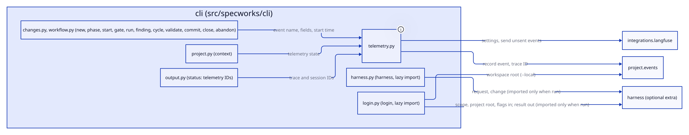
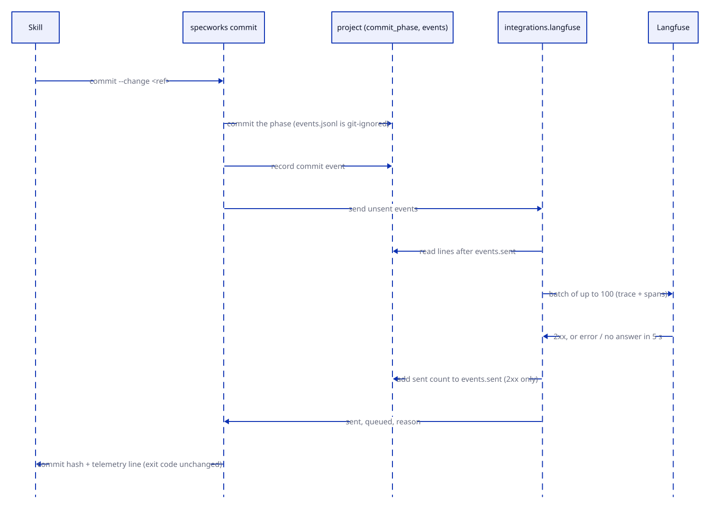

# Design: cli

## Overview

The `specworks` command line (Typer) in `src/specworks/cli`. It is a thin layer:
each command resolves the workspace and the change, calls the capability that
does the work (`project`, `specs`, `workflow`, `integrations`), and prints the
result as text or JSON.
- `app.py`: the Typer app and its command groups (`module`, `spec`, `task`,
  `capability`, `config`, `finding`).
- `output.py`: the shared options, output, errors, and resolving the workspace
  and changes.
- `project.py`: `init`, `skills`, `context`, `list`, `module`, `capability`,
  `config`.
- `changes.py`: `new`, `status`, `abandon`, `reopen`, `phase`, `skip-specs`,
  `instructions`, `task`.
- `specs.py`: `check`, `trace`, `spec`, `diagrams`.
- `workflow.py`: `gate`, `start`, `review`, `finding`, `cycle`, `merge`,
  `validate`, `close`, `run`.
- `telemetry.py`: recording events, sending them after `commit`, and
  `telemetry push`.
- `harness.py`: `harness`, which imports the optional harness capability only
  when it runs.
- `__init__.py`: `main` and the order commands are registered in.

## Decisions

### Agents read JSON, errors are values

Every command an agent reads takes `--json`. Commands just raise a
`SpecworksError`. The app's `command` decorator turns it into `{"error": …}`
(or `error: …` on stderr) and exit 1, and `main` does the same for errors raised
before a command runs. With no project, the answer is `{"root": null, "fix": …}`,
so a skill can tell "not set up" from a crash. (baseline-cli)

### Paths are relative to the workspace root

Every path printed is relative to the top-level project, which `context` prints
as `root`. An option that names a folder of the workspace (`diagrams --dir`) is
read from the root too, so a printed path works from any folder, and a folder
that doesn't exist is refused. `init <path>` and `module add <path>` stay
relative to the working directory: they name a folder where the user stands.
(baseline-cli, diagrams-dir-root)

### A change reference is forgiving but never ambiguous

`module:name` is exact. A bare name prefers the current module, then the only
module that has it. Archived changes are readable only through `status` and
`reopen` (`resolve_archived`: name, `module:name` or `<date>-<name>`), and
every other command says where the change was archived. `reopen` asks
`resolve_change` when no archive holds the name, so an active change is told
it is active instead of "not found". (baseline-cli, add-reopen-change)

### `reopen` records the way back, the skill decides it

`specworks reopen --change <ref> --reason "<why>" [--phase <phase>]` wraps
`reopen_change` in core: a plain, checked move that does not interpret the
reason. Which phase to start at is decided by `/specworks-reopen`, which reads
the problem, says its decision in one line, asks for confirmation and, for
`review`, adds the problem as a finding with `finding add` so the review gate
and build act on it; `/specworks-refine` and `/specworks-specify` read the
latest reason from `status` as the problem to start from. `status` text
appends the count and the latest reason and `--json` carries every record in
`reopened`. `reopen` records no telemetry event: reasons stay out of events.
(add-reopen-change)

### The CLI checks what its own options combine into

The commands refuse option combinations that would skip a safeguard: `close`
runs validate first and takes `--no-run` only with `--dry-run`, and `init`
rejects a bad `--tools` (given or typed at its question) before writing
anything. (baseline-cli, dedupe-copilot-skills)

### Close needs the module's architecture

`close` checks the change's module for `<docs folder>/architecture.md` before
validate, so a missing file fails fast, writing nothing and running none of
the project's commands: `<ref> has no <path>: write the module's architecture
before close (/specworks-close)`. With `--dry-run` it runs validate as before
and reports the file under `missing` (JSON) and a `missing: <path> (write it
before close)` line, so the close skill learns from its dry run what to write.
Only the change's own module is checked, not its parents. Checking the
architecture's content or size was left out. (project-docs)

### The tools are chosen once and saved

`init`, `skills` and `update` call `resolve_tools` and save the result in the
config with `save_tools` when it says to. `--tools` defaults to `None`, not
`auto`, so "not given" can be told from an explicit `auto`. When `init`
installs skills at a top level with no `--tools` and no saved tools, and
`is_terminal()` (`sys.stdin.isatty()`, its own function so tests can replace
it) is true, it asks once, before writing anything, with `typer.prompt`:
`AI tools to install skills for (claude, copilot)`, the detected tools as the
default comma list. The answer goes through `parse_tools`. Without a terminal
it uses `auto`, so scripts and agents are never blocked. A checklist widget was
rejected: the question is one line of text. (dedupe-copilot-skills)

### Git is a precondition; `new` branches unless told to stay

`init` calls `require_repo` after parsing its options and before writing
anything, so a folder outside a repository is left untouched. `new` creates a
branch when `--branch` is given, or when neither flag is given and the top
level's `branch_per_change` is true (the default); `--no-branch`, or the
setting false, stays on the current branch. `--branch/--no-branch` is one
option defaulting to `None`, so `--no-branch` keeps its spelling. Before
creating the change folder, `new` checks everything that can refuse: the repo
always, and a detached HEAD or an existing branch only when it creates the
branch; then it creates the folder and switches to the branch, so a refusal
leaves neither. Staying needs the repo too, and works on a detached HEAD. `new`
finds the base branch with `detect_base` and passes it to core, and reports
`branch` and `startedFrom` (`--json`, both `null` without a branch) and
`stayedOn` (the current branch, from `current_branch`, when it stays; `null`
on a detached HEAD or when a branch was created; text adds `stayed on
<branch>`).
Pushes stay in the skills. The CLI commits in two places: the merge commit
`merge` makes when it joins a half's branch, and `commit`, which the skills
use to commit each phase (what changed since the phase started, chosen by
`commit_phase` in core) instead of building `git add` and `git commit` by
hand. `new` and `phase` pass the workspace root so the change records its
dirty files. `commit` looks up the active change first and, only when there is
none, the newest archived one in the same module, because close archives the
change before the skills commit it; neither found is the unknown change error.
(git-workflow, merge-halves-without-conflicts, commit-command, fix-commit-after-close,
add-branch-default)

### Commands record telemetry explicitly

Each command that acts on a change (`new`, `phase`, `abandon`, `commit`,
`start`, `gate`, `run`, `finding *`, `cycle`, `validate`, `close`) takes
`started = time.monotonic()` once its change is resolved and calls
`record(ws, module, change, event, started, **fields)` after its work and
before it emits or raises `typer.Exit`, so a failed gate is recorded and a
`SpecworksError` is not. Each passes only fixed fields (names, IDs, counts,
booleans, phase lists, check names), never a finding's text, a reason or
command output. `record` reads only the top level's opt-in, so it needs no
keys and no network. A decorator recording every exit was rejected: it cannot
tell a failed check from a refusal, and each command builds other fields.
(add-langfuse-monitoring)

### Commit sends, close does not

`commit` commits, records its own event, then sends the change's unsent
events, so its event goes in the same batch; the send never changes the exit
code, and its result is the `telemetry` value of the output. `close` records
into the archived folder and leaves sending to the commit that follows it.
`telemetry push` sends what is still queued and says why when it cannot.
`telemetry_app` is declared in `app.py` with the other groups, so `app.py`
never imports a command module. (add-langfuse-monitoring)

### `harness` imports its capability only when it runs

`harness.py` registers `specworks harness` and
imports `specworks.harness` inside the command's body, so `import specworks`
and every other command never load chatinho or deepagents. On Python before
3.12, or when the import fails, it raises `SpecworksError("specworks harness
needs the harness extra on Python 3.12 or later: install specworks[harness]")`.
It has no `--json`: it opens a terminal, and errors are `error: ...` on stderr
with exit 1. (add-chatinho-harness) It takes no argument and no option: it
opens the chat empty and the user messages a peer to start or continue a
change; a leftover argument gets the command line's own usage error.
(harness-chat-only)

### Findings are written through `finding`, not by hand

`specworks finding add|decide|done|close` write a change's review.md through
the `workflow` writers, so the skills never edit it by hand and a malformed
line is refused when it is written, not when `gate review` runs. A
`FindingError` reaches the `App` wrapper like any other error. Under `--json`
each prints the change, the finding as `specworks cycle` sees it plus
`done`, and `path` (review.md); `done` is added here rather than to
`Finding.to_dict()`, so `cycle`'s output is unchanged. (finding-commands)

### Config values are set through `config set`, not by hand

`specworks config set <key> [<value>] [--file <path>|-]` wraps
`set_config_value` in core, so the adopt, start, test and code skills write
`commands.<key>` and `context` through a checked writer instead of editing
the YAML. Exactly one of `<value>` and `--file` is taken (`-` reads standard
input, so a multi-line context needs no shell quoting); both or neither is
refused before anything is read or written. The target is `--module` when
given, else the current module, as in `capability add`, except for
`branch_per_change`: only the top level's value is read, so it is always
written to the top level's config, and the output's `config` and `module`
name the top level; `telemetry.*` is written there too. `config get` was left out: `context` already prints the
commands and context. (add-config-set, add-branch-default)

### `spec find` is the specify skill's search

`spec find <term>...` wraps `find_requirements` in specs, so the specify skill
finds the living requirements a change touches (its commands, flags, config
keys and file names) before writing the delta, and records each one in the
proposal's `## Related requirements` as modified or left with a reason. No
term is refused with `give at least one term`; no match is not an error: the
text output says `no requirement mentions <terms>` and `--json` gives an empty
`matches`. (specify-related-requirements)
After the matches, each broad term (more than half of the living requirements
searched, from `search_requirements`) gets a warning line naming it, and
`--json` lists it under `broad`; the matches are still listed and it exits 0,
since a broad term can still be the right one. (narrow-spec-find)

### `capability add --create` makes the code folder

With `--create`, `capability add` creates a missing code folder
(`target.root / path`, relative to the owning module's root) with an empty
`.gitkeep`, so the start skill no longer writes it by hand. Before the config
is written, it refuses a folder, or any parent below the module root, that
exists and is not a folder (`ConfigError`: `<path> exists and is not a
folder; give <name> another --path`); the folder is created only after the
capability is registered, so any refusal creates nothing. An existing folder
is left as it is. The output always carries `created` (the `.gitkeep` path or
`null`). Creating folders without the flag and a `scaffold` command were left
out: adopt, close and done register folders that already exist.
(add-capability-create)

### Modules are linked where the folder lives

`module add <path>` and `init <path>` both link the folder in the config of the
innermost module that contains it, wherever they run. Before writing anything,
both refuse a folder that holds a module (`held_module`): linking it would
leave that module listed past it, which loading refuses. Refusing was chosen
over moving the inner module's link, which would edit a config the user didn't
name. (module-add-nested)

### `init` writes the fixed layout

`init` always writes `.specworks/config.yml` (there is no `--dir`) and makes
`.specworks/changes/active/` and `.specworks/changes/archive/` with it, so the
two states of a change exist from the start; `module add` creates a module's
`.specworks/config.yml` the same way. Both refuse a folder that still holds an
old-style config, with the old-layout error and before writing anything; with
no project found, the "no project" message names `.specworks/config.yml`.
(active-changes-dir, move-config-into-spec-folder)

### Upgrading is uv, then `update`

`uv tool upgrade specworks` upgrades the CLI. `specworks update` then brings
the project's skills up to it, by default for the saved tools, else those that
already have them installed (then saved), and removes the copies no longer
needed. `context`, which every skill runs first, reports the skills
state and the hint `skills out of date: run specworks update`, so an agent
notices a stale project without being told. A self-upgrading `specworks
upgrade` was rejected: the CLI would have to find out how it was installed
and replace itself while running. Config migration will run in `update` once
a second config format exists. (upgrade-project, dedupe-copilot-skills)

## Interfaces

- `src/specworks/cli/__init__.py`: `app`, `main()` (the `specworks` entry
  point).
- `src/specworks/cli/output.py`: `emit`, `fail`, `workspace`,
  `resolve_change`, `resolve_archived`, `require_change`, `ToolsOpt`
  (`--tools`, default `None`: the saved choice).
- `src/specworks/cli/project.py`: `is_terminal() -> bool`.
- `context --json`: each capability entry holds `docsPath` and `testsPath`
  (its test folder), both workspace-relative; each module entry holds
  `docsPath` (workspace-relative) and `hasArchitecture`.
- `close --change <ref> [--dry-run [--no-run]] [--json]`: refuses a module
  with no architecture before validate; `--dry-run` adds `missing` (the
  architecture's path, or empty) and the text line
  `missing: <path> (write it before close)`.
- `reopen --change <ref> --reason "<why>" [--phase <phase>] [--json]`
  (default phase `review`): `change_dict` carries `reopened` (a list of
  `{at, reason, phase}`) when the change has entries (REQ-CLI-020,
  REQ-CLI-021).
- `new <name> [--module M] [--branch|--no-branch] [--json]`: `--json` adds
  `branch`, `startedFrom` and `stayedOn`; text adds `stayed on <branch>`
  when it stays on a named branch.
- The commands as `specworks --help` lists them: `version`, `init`, `skills`,
  `update`, `context`, `list`, `module add|list`, `capability add`, `config set`, `new`, `status`,
  `abandon`, `reopen`, `phase`, `skip-specs`, `instructions`, `task list|done|undo`,
  `check`, `trace`, `spec show|list|find`, `diagrams`, `gate`, `start`, `review`,
  `finding add|decide|done|close`, `cycle`, `merge`, `commit`, `validate`,
  `close`, `run`, `telemetry push`, `harness`.
- `harness` (no argument or option, no `--json`; needs the `harness`
  extra on Python 3.12+) (REQ-CLI-022).
- `src/specworks/cli/telemetry.py`: `record(ws, module, change, event,
  started, **fields)`, `telemetry_state(ws) -> {"state", "host"}`,
  `telemetry_ids(module, change) -> {"traceId", "sessionId"}`,
  `send_after_commit(ws, module, change) -> dict | None`.
- `context --json` adds `telemetry` (`state`: `on` | `keys missing` | `off`,
  `host`; never the keys); `status --json` adds `telemetry` (`traceId`,
  `sessionId`).
- `commit --json` and `telemetry push --change <ref> [--json]` add
  `telemetry: {"sent", "queued", "reason"}`.
- `finding add TYPE TEXT --proposal TEXT`, `finding decide ID DECISION`,
  `finding done ID TEXT --in STEP`, `finding close ID TEXT`, each with
  `--change <ref> [--json]`: `--json` prints the change's fields plus
  `finding` (`id`, `type`, `text`, `phase`, `doneIn` when set, `done`) and
  `path` (review.md, workspace-relative); text output is
  `<id> <type> -> <phase> (open|done)` and the path.
- `capability add <name> --path <folder> [--module/-m <name>] [--prefix P]
  [--description TEXT] [--create] [--json]`: `--json` adds `created` (the
  `.gitkeep` path, workspace-relative, or `null`; present with or without
  `--create`); text adds `created <path>` when one was created.
- `config set <key> [<value>] [--file <path>] [--module/-m <name>] [--json]`
  (`--file -` for standard input): text `set <key> in <config path>`;
  `--json` prints `key`, `value`, `config` (workspace-relative) and `module`
  (the module's label; the top level for `branch_per_change`).
- `spec find <term>... [--json]`: text prints one line per match,
  `<capability>  <ID>  <title>  <path>:<line>`, or
  `no requirement mentions <terms joined by ", ">`, then per broad term
  `warning: '<term>' matches <n> of <m> requirements; try a narrower term`;
  `--json` prints `{"terms": [...], "matches": [{"capability", "id", "title",
  "path", "line", "text"}], "broad": [{"term", "matches", "of"}]}` (`broad`
  empty when no term is broad) (REQ-CLI-016).
- `merge <branch> --change <ref> [--json]`: `--json` prints the change's
  fields plus `merged`, `branch` and `resolved` (workspace-relative paths).
- `commit --change <ref> [--message TEXT] [--trailer TEXT]... [--json]`
  (the active change, else the newest archived one, subject `<ref>: close`):
  `--json` prints `ref`, `commit` (short hash or `null`), `subject`,
  `committed`, `leftOut` and `alreadyDirty` (workspace-relative paths); text
  prints `<hash> <subject>`, one line per committed file, then
  `left out (unchanged since the phase started): <path>` and
  `already dirty when the phase started: <path>` lines, or
  `nothing to commit for <ref>: no file changed since the phase started`
  (exit 0).

## Constraints

- No behaviour of its own beyond option handling, output and resolving
  references: the work belongs to the other capabilities.
