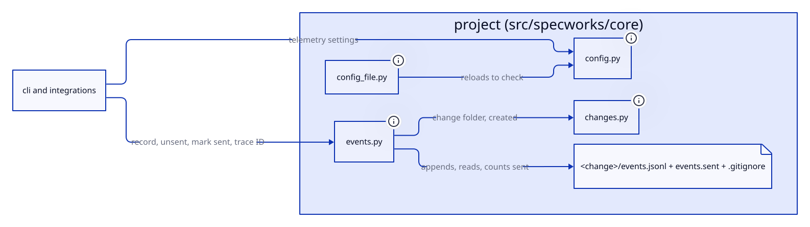

# Design: project

## Overview

The project model, in `src/specworks/core`, is what every other capability
builds on:
- **Config** (`config.py`, `validators.py`): finding the project's
  `.specworks/config.yml` and loading it into a validated `Config` (capabilities, modules, globs,
  commands, diagram settings, `branch_per_change`, `tests_dir`).
- **Config file** (`config_file.py`): writing the default config, adding
  module and capability entries, saving the AI tools a project uses, and
  setting `commands.<key>`, `context` and `branch_per_change`.
- **Workspace** (`workspace.py`): the top-level project and its modules, and
  what each module inherits.
- **Changes** (`changes.py`): changes in flight and archived, and their phases
  (`refine, specify, design, implement, review, validate, close, done`).
- **Runner** (`runner.py`): running the project's own commands and reusing
  their results, including the scoped test command filled with test folders.
- **Events** (`events.py`): a change's git-ignored telemetry log
  (`events.jsonl`, `events.sent`) and its trace and session IDs.
- **Helpers** (`files.py`, `git.py`, `errors.py`): reading project files,
  running git, and the user-facing error types.

## Decisions

### One fixed, hidden workflow folder

A project is a folder holding `.specworks/config.yml`, and its changes live in
`.specworks/changes/`, for the top level and every module, like `.github/`.
`WORKFLOW_DIR` and `CONFIG_FILE` are constants; `Config.dir` stays as a field
(always `.specworks`) so the callers that build paths or skip the folder are
unchanged. `find_config` checks one path per folder and `find_root` walks up.
A `specworks: <n>` line still marks the file. The `dir:` key is refused with a
message saying the folder is always `.specworks/`. A config whose file name set
the folder (`spec.yml` → `spec/`, chosen per workspace with `init --dir`) was
dropped for one layout that is easy to find; a configurable name was rejected.
(baseline-project, move-config-into-spec-folder)

### The old layout is an error, never migrated

When no folder up from the working directory holds `.specworks/config.yml`,
`find_root` looks for an old-style config (a `*.yml` with the marker) in the
same folders; the nearest one fails the lookup with `old_layout_error`, which
names the file and the move (`move spec.yml to .specworks/config.yml and spec/
to .specworks/`). A listed module with only an old-style config fails the same
way, prefixed with the module's name, and `init` in an old-layout folder fails
before writing anything, so it never hides the old changes behind a new, empty
`.specworks/`. A folder with both layouts uses the new one. Reading or
migrating old configs automatically was left out. (move-config-into-spec-folder)

### Modules are linked explicitly, like git submodules

A parent lists each module under `modules:`. Looking up the workspace rises
from the nearest config only through ancestors that list it. A broken outer
config that doesn't list the project is ignored, so an unrelated project
around it can't break it. Context is inherited top level first, and commands
are overridden key by key. A folder is at most one module: loading records each
module's resolved folder before loading its children, so a symlink back to an
ancestor, or a folder linked twice, fails with an error naming both instead of
recursing or loading the folder under two names.
A module must be listed by the innermost module holding its folder: one listed
further up fails with an error naming the module it belongs under, so the
workspace has the same shape from every folder. A module's folder, with
symlinks resolved, must be inside the top level's, so every path the CLI prints
is relative to the root; it is checked before the module's config is read.
Supporting modules outside the workspace was rejected: every path is resolved,
so each one would need rethinking.
(baseline-project, module-cycle-detection, module-add-nested, module-outside-workspace)

### Each capability owns its ID prefix and its docs folder

A workspace refuses to load when two capabilities, in any modules, share an ID
prefix, given or derived, or resolve to the same living-docs folder
(`<module root>/<path>/<docs_dir>`). Either would let one capability's
requirements land in the other's IDs or spec.md. Nested paths are fine.
`capability add` checks both before writing, against the path as the config
will store it, so its error names the capability that owns the prefix or
folder. Sharing a folder on purpose (one docs file per capability) was rejected
as unasked-for. (baseline-project, unique-capability-paths)

### The docs folder belongs to the module too

Every module, the top level included, has a docs folder, `Module.docs_path`
(`root / config.docs_dir`), holding its architecture
(`Module.architecture_path`, `<docs folder>/architecture.md`) and its
`diagrams/` (`architecture-blocks.d2`). No new config key: `docs_dir` already
names every capability's docs folder. A capability on `.` is accepted when the
config is loaded (`validate_relative(..., allow_dot=True)` for capability
paths only) and shares the module's docs folder: its files (`spec.md`,
`requirements.md`, `design.md`, `diagrams/<cap>-blocks.d2`) and the
architecture's do not overlap, so the unique-docs-folder rule is not relaxed
between capabilities. Module paths, `docs_dir`, `tests_dir` and a
capability's `tests:` still refuse `.`; `capability add --path .` is not
supported yet. A separate key for the architecture's folder was rejected.
(project-docs)

### A capability's test folder is derived, never required

A module's `tests_dir` (default `tests`) gives each capability the test folder
`<module root>/<tests_dir>/<name>`; a capability's own `tests:` overrides it
(`Capability.tests_path(root, tests_dir)`, mirroring `docs_path`). A
capability new in a change, with no `Capability` yet, uses the default. Both
values are checked like `docs_dir` and a capability path: relative, inside the
project. Test folders may be shared or nested, unlike docs folders: a shared
folder only runs the same tests twice. The folder only scopes which tests the
review gate runs; tag scanning still uses `test_globs`. (capability-tests)

### Config edits keep comments

Entries are added by editing the config as text, never by dumping YAML. The
file is then re-read, and the edit is undone, with an "add it by hand" message,
when the result isn't the expected mapping. Saving the tools follows the same
rule: `save_tools` replaces a `tools:` entry (a flow list on one line or a
block list) or appends `tools: [a, b]`, then reloads; when the config does not
load with those tools (e.g. a hand-edited one with two `tools:` keys), the file
is restored and the error says to set `tools` by hand.
(baseline-project, dedupe-copilot-skills)

### `commands.<key>` and `context` are set through one checked writer

`set_config_value` sets one of `SETTABLE_KEYS` (`context`, then
`commands.<key>` for every `COMMAND_KEYS` key) in a module's config, so the
skills never edit those keys by hand. An unknown key is refused before the
file is read, listing the valid ones, and a context over `MAX_CONTEXT_BYTES`
before it is written, with the message `load_config` gives. A command
replaces its `  <key>:` line in the top-level `commands:` block, or goes
after the block's last indented line, or a new block is appended; the value
is written plain when YAML reads it back as the same string, JSON-quoted
otherwise, and an empty value writes `  <key>:` (no command). The context
replaces the `context:` entry with a `context: |` block (`|2` when the first
line starts with a space), trailing newlines dropped, so it loads as the text
plus one newline; an empty text writes `context: |` alone (loads as `""`).
The edit stands only when the file loads and its parsed mapping equals the
one before with just that key set; otherwise the original is written back
and the error says to set it by hand. So a flow mapping
(`commands: {test: pytest}`) or a block indented other than two spaces is
refused and restored. A trailing comment on the replaced line is dropped: it
is about the old value, and `init` writes none. A round-trip YAML library was
rejected as a new dependency for two keys; other keys stay hand-edited or
keep their own commands. A non-empty `commands.test_scoped` without
`{paths}` is refused before writing, with the message `load_config` gives.
`branch_per_change` is settable too: its value must
be exactly `true` or `false` (refused before the file is read, an empty value
included, since clearing would only mean the default `true`); an uncommented
top-level `branch_per_change:` line is replaced, else the line is appended
after a blank line, with the same reload check. (add-config-set,
add-branch-default)

### Branching per change is a top-level setting

`branch_per_change` (default `true`) says whether `new` creates a branch for
each change. A value that is not a YAML boolean is refused at load
(`'branch_per_change' must be true or false`). Any module's config may carry
it and still loads, but only the top level's value is read, as for
`diagrams`: the branch belongs to the repository, not to a module.
`DEFAULT_CONFIG` describes it in a commented-out `# branch_per_change: false`
block after `docs_dir`, so a new project keeps the default. An environment
variable and a different default were left out. (add-branch-default)

### Tool IDs are known to core without importing the tools layer

`TOOL_IDS = ("claude", "copilot")` in `config.py` checks the `tools:` list, so
`core` keeps not importing `tools`; a test checks that `TOOLS` has the same
keys in the same order. `tools` belongs to the top level only: a module's
config that sets it is refused when the workspace loads the module, since
skills are installed once, at the root. (dedupe-copilot-skills)

### Telemetry is a small top-level block

`telemetry: {langfuse: bool, host: str}` loads into `TelemetryConfig`
(`Config.telemetry` is `None` when the block is absent; callers read
`ws.top.config.telemetry or TelemetryConfig()`), with `host` checked to start
with `http://` or `https://`. A module's config that sets it is refused in
`load_module_config`, next to `tools`, naming the top level's config.
`config set` handles `telemetry.langfuse` and `telemetry.host` with the same
one-line block edit as `commands.<key>`, always in the top level's config.
(add-langfuse-monitoring)

### The harness model is a top-level block like telemetry

`harness: {model: str}` loads into `HarnessConfig` (`Config.harness` is `None`
when absent), refused in a module's config like `telemetry`. An empty model in
the file is an error, since it would silently mean "no model"; `config set
harness.model ""` removes the line instead, and the `harness:` line with it
once nothing is left under it. A block rather than a flat `harness_model:`
key leaves room for other harness settings. (add-copilot-default-model)

### A change's event log lives in its folder, git-ignored there

`record_event` appends one JSON line (`at` in UTC, `event`, then the fields)
to `events.jsonl` in the change folder with one `write` in append mode, and
makes the folder's `.gitignore` name `events.jsonl` and `events.sent`, so no
project needs its own ignore rule and the log moves with the folder at
archive. `ensure_ignored(folder, names)` adds only the missing names, each on
its own line, keeping the file's other lines; the harness's `chat.jsonl`
shares the same `.gitignore` through it, whichever was written first.
`record_event` does nothing when telemetry is off and never raises.
`events.sent` holds a count of lines already sent, not IDs: the log is
append-only, so `read_unsent` returns the lines after it (each with its line
number), and a line that does not parse is skipped but still counted, so one
bad line never blocks the queue. A log under `.git/` and a committed log were
rejected (out of sight; dirties the folder on every command). The run cache's
fingerprint excludes `.specworks/`, so the log never stops a result being
reused. (add-langfuse-monitoring, add-chatinho-harness)

### A change's trace ID is stable

`trace_id` is the first 32 hex characters of
`sha256("<module label>\n<name>\n<created>")`, valid as a Langfuse and W3C
trace ID; `session_id` is the change's ref. So a resend updates the same trace
and agent telemetry can later be joined to it. (add-langfuse-monitoring)

### Command results are reused on an identical tree

The fingerprint covers the command, the folder, `HEAD`, the diff, and the
untracked files with their contents, leaving out the workflow folders. Every
real run replaces the stored result, so `specworks run` can refresh a result
the fingerprint can't see changing. The store sits inside `.git/` and keeps
the 50 newest runs. Reuse is off without git, with `SPECWORKS_RUN_CACHE=0`,
when a submodule holds untracked files, and when an untracked file can't be
read: whenever the fingerprint can't see the whole tree, the command runs for
real rather than risk a stale result. Untracked names count as the raw bytes
git reports, so a name that isn't UTF-8 is fingerprinted like any other.
(baseline-project, run-reuse-unreadable-files)

### The scoped test command is filled with folders, then reused like any command

`commands.test_scoped` holds a `{paths}` placeholder (refused at load
without one). `scoped_command` makes each folder relative to the module's
folder without resolving it (so a symlinked test folder keeps its own path),
writes it with POSIX separators, quotes it (`shlex.quote`;
`subprocess.list2cmdline` on Windows, whose shell has no single quotes),
joins them with spaces and replaces every `{paths}`. `run_scoped` passes the
filled command to `cached_run` through its keyword-only `command` argument, so
the cache key is the filled command: the same folders reuse, other folders
run. `run_command` refuses key `test_scoped` without an explicit command, so
`specworks run test_scoped` fails: only the review gate knows the folders. A
separate cache for scoped runs was rejected as a second copy of the reuse
rules. (capability-tests)

### `test` and `code` are the halves of `implement`, not phases

`PHASES` has one `implement` phase; `HALVES = ("test", "code")` names its two
halves, which keep their own gates, task markers, review routing and cycle
steps. A `.change.yaml` saved in `test` or `code` is read as `implement` (no
rewrite on read; the next `set_phase` saves `implement`), so no migration step
is needed. `set_phase` refuses a half with an error naming `implement`.
Aliases that move the change to implement were rejected: two names for one
phase. (parallel-test-code)

### A project needs git, and a change gets its own branch

`require_repo(path)` fails unless the folder is inside a git repository, running
git from the nearest existing parent because `init` may be given a folder that
does not exist yet. `GitMissing(GitError)` marks "git cannot be run", so
every existing `except GitError` keeps working. A change's branch is its ref
with `:` replaced by `/` (`billing/tax/add-login` for a nested module). Creating
it is planned first and done second: `plan_branch` has no side effects and
refuses an existing branch or a detached HEAD; `create_branch` is the only
writer, using `git checkout -b` (no minimum git version, carries uncommitted
changes, works before the first commit). The base branch is passed in rather
than found in core, because `detect_base` lives in the workflow layer; a base of
`origin/main` counts as `main`. Rolling back a created branch on error was
rejected: more states to undo. (git-workflow)

### A phase commits what changed since it started

When a change is created or moves to another phase, `create_change` and
`set_phase` (given the workspace root) record in the same `.change.yaml` save
the workspace's dirty and untracked files as `dirty:` (path relative to the
workspace root -> SHA-256 of the content, or `deleted`); moving to the phase
the change is already in keeps the record. `dirty_files` reads `git status
--porcelain=v1 -z --untracked-files=all`, strips `rev-parse --show-prefix` so
paths are relative to a workspace below the git root, and records both paths
of a rename. Outside a git repository the move or creation still succeeds with
an empty record, while `dirty_files` itself raises `GitError`, since
committing needs git. `commit_phase` commits the change folder and every file
dirty now that is missing from the record or has another hash, lists the
recorded, unchanged ones as left out and flags committed files that were
already dirty. `commit` refuses a detached HEAD before staging, adds the
existing paths and runs `git commit` with the paths and the message on stdin,
so nothing else already staged goes in and no shell quoting is involved; it
never pushes. A hidden git ref holding the snapshot was rejected, and a file
edited before and during a phase is committed whole. (commit-command)

### An archived change commits as its close

Close archives the change before the skills commit it, so `commit_phase` also
takes a change in phase `done` (found with `archived_as`): its default subject
is `<ref>: close`, and it commits the archive folder with the removal of the
active one. Files of the change's own folder, and once archived of its former
active folder, are committed but never flagged as already dirty: close's record
names the active `.change.yaml`, which the archive then deletes. Committing an
older archived change on purpose is out of scope; the newest one with the name
is the one close just archived. (fix-commit-after-close)

### Reopening is a move plus a record, all or nothing

`reopen_change` finds the archived change by name or folder (`archived_as`),
refuses one that is active, abandoned or unknown (`ChangeNotFound` when no
archive or `active/` has the name), checks the reason (mandatory) and the
phase (any but `done`, the rules `set_phase` uses), records the dirty files
before the move, appends a `Reopened` entry (`at`, `reason`, `phase`) to the
metadata and moves the folder back to `active/` with `shutil.move`. When the
move raises `OSError`, the metadata is written back as it was, like
`archive_change`. The default phase is `review`. It touches no git state and
no living doc, and it lives in core, not in specs, because it merges nothing
and core must not import specs. The record is a `reopened:` list in
`.change.yaml`, oldest first, written only when it has entries, so a change
reopened twice keeps both reasons and old metadata reads as never reopened.
The reason is free text and never goes into an event. A single `reopened`
string like `abandoned` and putting the move in `merge.py` were rejected.
(add-reopen-change)

### Active and archived changes live in sibling folders

`Config.changes_dir` and `changes_path` name `.specworks/changes/active`, and
`archive_dir` and `archive_path` name its sibling `.specworks/changes/archive`, both
built from the `changes` folder. Every caller goes through these properties, so
the CLI's `changesDir` and the error messages follow. `list_changes` no longer
skips `archive`, and a folder with a `.change.yaml` directly under
`.specworks/changes/` is not a change; there is no migration. `create_change` still
refuses `archive` and `active`, so a change name never looks like a folder
name. A new `active_path` beside `changes_path` was rejected: callers could keep
using the old one. (active-changes-dir)

### Expected failures are `SpecworksError`s

Bad configs, unknown changes, unreadable files and git failures all raise a
`SpecworksError` subclass with a message for the user. The CLI prints it and
exits 1. A message never suggests a fix the config would refuse: `run_command`
refuses a key that is not a command key, listing the valid ones, before saying
where to configure one. (baseline-project, run-unknown-key)

## Interfaces

- `src/specworks/core/config.py`: `WORKFLOW_DIR` (`.specworks`),
  `CONFIG_FILE` (`config.yml`), `find_config(directory) -> Path | None`,
  `find_root(start) -> Path | None` (raises the old-layout error),
  `find_old_config(start) -> Path | None`,
  `old_layout_error(path, module=None) -> ConfigError`,
  `load_config(root) -> Config`, `Config` (`dir`, `config_path`,
  `changes_dir`, `changes_path`, `archive_dir`, `archive_path`, `tools`:
  the saved tool IDs or `None`, `branch_per_change: bool = True`),
  `CONFIG_KEYS`, `TOOL_IDS`, `Capability` (`tests`,
  `tests_path(root, tests_dir) -> Path`), `DiagramSettings`, `Config.tests_dir`,
  `COMMAND_KEYS` (`test`, `test_scoped`, `lint`, `typecheck`, `build`,
  `format`), `SCOPED_TEST_KEY`, `PATHS_PLACEHOLDER` (`{paths}`),
  `DEFAULT_TESTS_DIR` (`tests`).
- `src/specworks/core/workspace.py`: `load_workspace(start=None) -> Workspace | None`,
  `require_workspace(start) -> Workspace`, `Workspace` (`modules`,
  `module(name)`, `split(ref)`, `context_chain`, `merged_context`, `commands`,
  `owner(path)`, `capabilities`, `prefixes`, `docs_folder(module, path)`, `docs_folders`), `Module`
  (`docs_path`, `architecture_path`), `ARCHITECTURE_FILE` (`architecture.md`),
  `capability_prefix(module_name, name, prefix="")`.
- `src/specworks/core/config_file.py`: `write_default_config(root, diagram_theme=None)`
  (writes `.specworks/config.yml`),
  `add_module_entry`, `add_capability_entry`, `save_tools(root, ids)` (raises
  `ConfigError`, file restored), `SETTABLE_KEYS`
  (`context`, `commands.<key>`..., `branch_per_change`),
  `set_config_value(root, key, value)` (an empty value clears the key;
  `branch_per_change` takes only `true` or `false`; raises `ConfigError` for
  an unknown key, a context over `MAX_CONTEXT_BYTES`, a non-boolean
  `branch_per_change`, or an edit that does not load back, file restored).
- Config file: top-level `tools: [claude, copilot]` and
  `branch_per_change: true|false` (only the top level's is read), and
  `telemetry: {langfuse: true|false, host: <http(s) URL>}` and
  `harness: {model: <model id>}` (top level only).
- `src/specworks/core/config.py`: `TELEMETRY_KEYS`, `TelemetryConfig`
  (`langfuse: bool = False`, `host: str = ""`),
  `load_telemetry(raw, present) -> TelemetryConfig | None` (raises
  `ConfigError`), `Config.telemetry`; `HARNESS_KEYS`, `HarnessConfig`
  (`model: str = ""`), `load_harness(raw, present) -> HarnessConfig | None`
  (raises `ConfigError`), `Config.harness`; `SETTABLE_KEYS` also holds
  `telemetry.langfuse`, `telemetry.host` and `harness.model`.
- `src/specworks/core/events.py`: `EVENTS_FILE` (`events.jsonl`), `SENT_FILE`
  (`events.sent`), `IGNORE_FILE` (`.gitignore`),
  `record_event(change, enabled, event, **fields)` (never raises),
  `ensure_ignored(folder, names)` (adds the missing names to the folder's
  `.gitignore`, never raises),
  `read_unsent(change) -> (sent, events)`, `mark_sent(change, count)`,
  `trace_id(module_label, change) -> str`, `session_id(ref) -> str`.

- `src/specworks/core/changes.py`: `PHASES`, `HALVES`, `Change`, `create_change`,
  `load_change`, `list_changes`, `list_archived`, `archived_as`,
  `set_phase(change, phase, root=None)`, `create_change(cfg, name, root=None)`
  (with `root`, both record `Change.dirty`), `CommitResult` (`commit`,
  `subject`, `committed`, `left_out`, `already_dirty`),
  `commit_phase(root, ref, change, subject=None, trailers=()) -> CommitResult`
  (an archived change, phase `done`, defaults to `<ref>: close`).
- `src/specworks/core/changes.py`: `Reopened` (frozen: `at`, `reason`,
  `phase`), `Change.reopened: list[Reopened]`,
  `reopen_change(cfg, name, reason, phase="review", root=None) -> Change`
  (raises `ChangeError`, and `ChangeNotFound` for a name nothing has)
  (REQ-PROJ-033, REQ-PROJ-034).
- `.change.yaml`: `dirty:` (path -> SHA-256 hex or `deleted`), omitted when
  empty; `reopened:` (list of `{at, reason, phase}`), omitted when empty.
- `src/specworks/core/runner.py`: `run_command`, `cached_run` (both with a
  keyword-only `command: str | None` to run under `key`), `RunResult`,
  `scoped_command(ws, module, folders) -> str`,
  `run_scoped(ws, module, folders, reuse=True) -> RunResult`.
- Config file: module-level `tests_dir: <folder>`, a capability's optional
  `tests: <folder>`, and `commands.test_scoped` with `{paths}`.
- `src/specworks/core/files.py`: `read_text(path, keep_newlines=False)`.
- `src/specworks/core/git.py`: `git`, `git_text`, `GitError`, `GitMissing`,
  `require_repo(path)`, `branch_name(ref)`, `Branch` (`name`, `started_from`),
  `plan_branch(cwd, name, base=None)`, `create_branch(cwd, branch)`,
  `current_branch(cwd) -> str | None` (`None` on a detached HEAD),
  `dirty_files(root) -> dict[str, str]`,
  `commit(root, paths, message) -> str` (the short hash).

## Constraints

- No dependency on the CLI, specs or workflow layers: they build on this one.
- Every path the CLI prints is relative to the workspace root
  (`Workspace.rel`).
