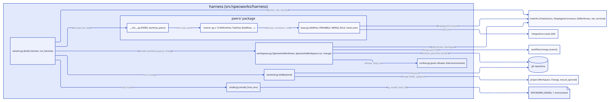
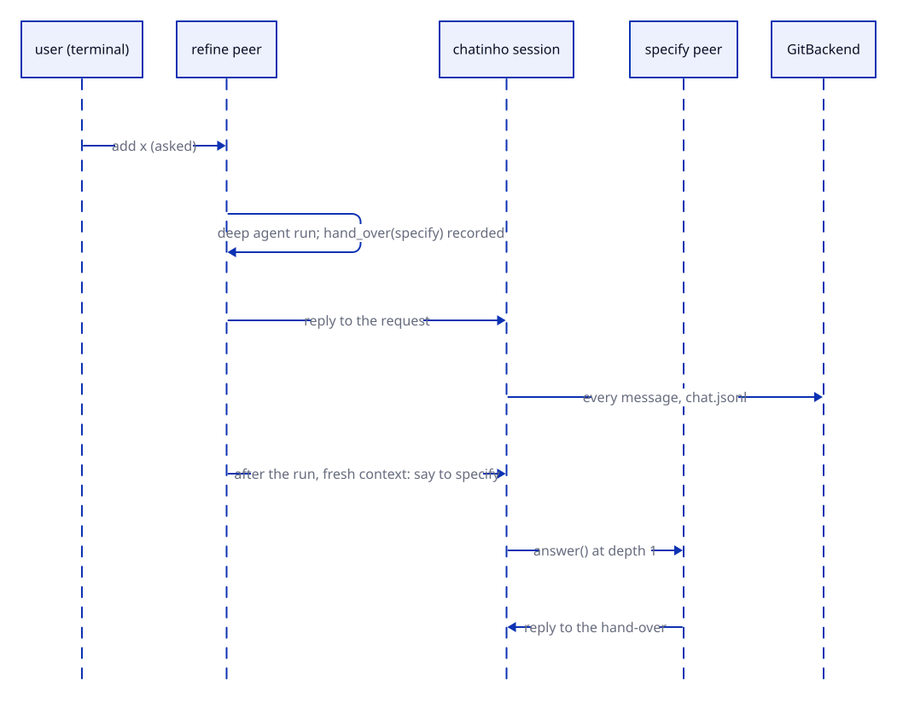

# Design: harness

## Overview

`specworks harness [REQUEST] [--change REF]` runs the whole specworks flow as a
chatinho chat in the terminal. The user is peer zero; every packaged skill is a
peer named after it without the `specworks-` prefix (`refine`, `specify`,
`build`, `test`, ...), each a LangChain Deep Agent whose instructions are a
short harness preamble followed by the skill unchanged. Peers hand work to each
other by message, work in git worktrees ("workspaces") that the harness creates
and merges, and the conversation is kept in the change's folder. The package
`src/specworks/harness` needs the optional `harness` extra (chatinho,
deepagents; Python 3.12+) and is imported only by the `harness` command.

- `session.py`: `build_harness` (the session: user, peers, backend, commands),
  `run_harness`, `first_peer`.
- `peers.py`: `SkillPeer` (one per skill), the pinned preamble, `hand_over`.
- `workspaces.py`: `Workspaces`, the `/workspace` and `/merge` commands.
- `confine.py`: `ConfinedShell`, `PeerShell`, the push refusal, the shell's
  environment.
- `backend.py`: `GitBackend` (`chat.jsonl`).
- `model.py`: `model_from_env`.

## Decisions

### SkillPeer extends AgentConnector and swaps the inner agent

`SkillPeer(AgentConnector)` overrides `graph()` with the same shape as
chatinho's, calling `create_deep_agent(model, tools, system_prompt=...,
backend=self.shell)` instead of `create_agent`, and caches the graph per chat
shape only. Everything else (history from the chat, `ask_<peer>`, `ask_user`,
`run_<command>`, error replies that give the failure's kind, never its message)
is AgentConnector's. `listen()` does nothing: a skill peer acts only on what is
addressed to it. A connector written from scratch was rejected: it would copy
the chat-tool and history code; chatinho is pinned to a commit and a test
fails if `graph()`'s shape changes. (add-chatinho-harness)

### One backend per peer that follows its workspace

`self.shell` is one `PeerShell` per peer that calls `Workspaces.path_of(peer)`
on every file or shell call and passes the call to `confined(<that folder>)`
(one `ConfinedShell` kept per folder), so a `/workspace` switch moves the file
tools and the shell within the same run. A backend picked once per run kept
writing into the old workspace, and deepagents 0.7 has no backend factories.
(add-chatinho-harness)

### A hand-over is said after the run, from a fresh context

`hand_over(peer, text)` checks the peer (a skill peer, not itself) and records
it; once `answer()` has its reply, the peer says the text to that peer,
replying to the message it answered, in a task created with a fresh
`contextvars.Context()`, so its depth starts at one. The reply is posted before
the next stage starts and no stage nests in another, so a full run never
reaches chatinho's `max_depth`. `build` and `done` keep using `ask_<peer>`,
which waits and nests one level, as the skills expect. Naming the next peer in
the text (`@specify ...`) was rejected: it bypasses chatinho's addressing.
(add-chatinho-harness)

### The preamble, then the skill unchanged

`skill_instructions(skill, peers)` is `preamble(name, peers)`, a blank line,
then `read_skill(skill)`. The preamble (`PREAMBLE` in `peers.py`, pinned
verbatim by a test) says that `/specworks-<name>` means the peer `<name>`,
that a question offering only the next step is answered by taking the
`(recommended)` option and calling `hand_over`, that any other question goes
to `ask_user`, and that `stop here` ends without a hand-over. No skill text
changes for the harness. (add-chatinho-harness)

### Workspaces are git worktrees the commands own

`Workspaces` maps each peer to a workspace name (`main` by default, the main
checkout). `/workspace <name>` (names `^[a-z0-9][a-z0-9-]*$`) creates or reuses
`.specworks/workspaces/<name>` with `git worktree add -b <branch>--<name>`,
writing `.specworks/workspaces/.gitignore` with `*`. `/merge <name>` refuses a
workspace with uncommitted changes (they would be left behind, and the
worktree could not be removed), then calls `merge_branch` (workflow) in the
main checkout for the run's change; on success the worktree and branch are
removed and its peers go back to `main`; on a conflict the merge is aborted,
the workspace stays and the files go back to the peer as an error reply.
Worktrees outside the repository were rejected: that folder may not be
writable. (add-chatinho-harness)

### Confinement in the backend, push refused before the shell

`ConfinedShell` is a `LocalShellBackend(root_dir=<workspace>,
virtual_mode=True)`: a path with `..`, `~` or outside the workspace raises
`OutsideWorkspaceError` (a `PermissionError`), so every file operation returns
an error result the agent sees and changes nothing. `execute` refuses a git
push (`PUSH_RE`: `git`, any global options, then the `push` subcommand, so
`git stash push` and a commit message mentioning push still run) and runs
everything else in the workspace with `shell_env()`: the environment without
`SPECWORKS_MODEL_*` and `SPECWORKS_LANGFUSE_*`, so no key reaches the shell's
output. The shell is not a sandbox: a command can still reach the machine, and
the push refusal is a pattern on the command text. (add-chatinho-harness)

### The conversation lives in the change's folder

`GitBackend` appends each message as one JSON line (`id`, `from`, `to`,
`replyTo`, `status`, `text`, `at`; never credentials) to a git-ignored
`chat.jsonl` in the change's folder, and `load()` returns them at start, so
`--change REF` continues a stopped run. Before the run has created its change,
lines are held in memory; after each message it looks for an active change
that did not exist at start, and the first found becomes the run's change and
gets the held lines. The folder's `.gitignore` gains `chat.jsonl` through
`ensure_ignored` (project). A write failure is logged and ignored.
(add-chatinho-harness)

### The model comes from the environment

`model_from_env` builds `ChatOpenAI` from `SPECWORKS_MODEL_API_KEY`,
`SPECWORKS_MODEL_MODEL` and the optional `SPECWORKS_MODEL_BASE_URL`; a missing
one raises `ModelSettingsError` naming the variable, never a value.
(add-chatinho-harness)

## Interfaces

- `specworks.harness`: `build_harness`, `run_harness`, `model_from_env`,
  `ModelSettingsError`.
- `session.py`: `first_peer(change) -> str` (`refine` without a change, else
  by phase: `design`/`implement`/`review` -> `build`, `validate`/`close` ->
  `done`, a `baseline-*` change from specify to review -> `baseline`);
  `build_harness(ws, model, *, request=None, change=None, frontend=None) ->
  ChatSession` (the request is said to `first_peer(change)` once the session
  starts; `frontend=None` builds the terminal); `run_harness(ws, request,
  change)`.
- `peers.py`: `PREFIX`, `PREAMBLE`, `peer_name(skill)`, `preamble(name,
  peers)`, `skill_instructions(skill, peers)`; `SkillPeer(skill, model,
  workspaces, peers)` with `shell`, `graph()`, `answer()`, `listen()`,
  `hand_over_tool()` (agent tool `hand_over(peer, text)` -> `handed over to
  <peer>` or `error: unknown peer '<peer>'` / `error: cannot hand over to
  yourself`).
- `workspaces.py`: `WORKSPACES_DIR`, `MAIN`, `NAME_RE`, `WorkspaceError`
  (`files`), `Workspaces(ws, module)` with `path_of`, `name_of`, `branch_of`,
  `open(name, peer)`, `merge(name, change)`; `WorkspaceCommand`
  (`run_workspace`), `MergeCommand` (`run_merge`, an error reply before the
  run has a change).
- `confine.py`: `PUSH_RE`, `refuses(command)`, `shell_env()`,
  `OutsideWorkspaceError`, `ConfinedShell(root)`, `confined(root)`,
  `PeerShell(root_of)` (the deepagents sandbox protocol, each call passed to
  the current folder's `ConfinedShell`).
- `backend.py`: `CHAT_FILE` (`chat.jsonl`), `GitBackend(ws, module, change)`
  with `change`, `listen`, `load`, `forget` (drops held lines only),
  `to_line(msg)`, `from_line(line)`.
- `model.py`: `MODEL_KEY`, `MODEL_NAME`, `MODEL_BASE_URL`,
  `ModelSettingsError(variable)`, `model_from_env(env=None)`.

## Constraints

- Imported only from the `harness` command's body; `import specworks` and
  every other command never load chatinho or deepagents.
- Python 3.12+ with the `harness` extra (chatinho pinned to a commit,
  `deepagents>=0.7,<0.8`); tests in `tests/harness/` skip without it and use a
  scripted chat model (no network). On 3.11, coverage omits the package.
- No peer pushes; refusals are errors the agent sees, never crashes of the run.
