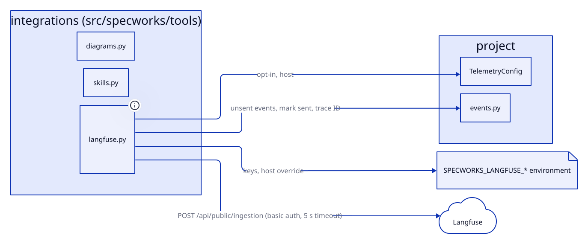

# Design: integrations

## Overview

specworks' integrations with outside tools, in `src/specworks/tools`:
- **Diagrams** (`diagrams.py`): D2 sources in a `diagrams/` folder rendered to
  SVG through pyd2, with the workspace's shared settings, and a stamp that
  tells whether an SVG is still current.
- **Skills** (`skills.py`): the packaged agent skills (`src/specworks/skills`)
  installed for Claude Code and GitHub Copilot.
- **Langfuse** (`langfuse.py`): the telemetry settings from the config and the
  environment, and sending a change's unsent events to Langfuse.

## Decisions

### SVGs carry a stamp, not a timestamp

Each generated SVG holds a hash of its source and render settings, right after
the XML declaration. Staleness is read from the stamp, not from file times,
which git doesn't keep. A hand-edited SVG has no matching stamp, so it reads as
stale. Checking needs no d2. The render options are part of the hash, so they
must stay stable. (baseline-integrations)

### pyd2 provides d2, `SPECWORKS_D2` overrides it

Rendering uses pyd2's pinned d2 release, so every user gets the same output.
`SPECWORKS_D2` names another program, which the tests use for a fake d2. Every
failure (no binary, a program that doesn't run, a compile error) becomes a
`DiagramError` naming the diagram, and so does an SVG that d2 wrote but that
can't be read or stamped (an unclosed `<?xml` declaration, non-UTF-8 output):
a render error for that diagram, never a crash, while the rest of the run
goes on. (baseline-integrations, diagram-bad-svg)

### One skill source, rendered per tool

Skills follow the Agent Skills format (`<name>/SKILL.md` with frontmatter).
Shared text lives once in `skills/_shared/` and is filled in at install time.
Each tool keeps only the frontmatter keys it understands, so Copilot drops
Claude Code's `allowed-tools`. The frontmatter is copied as text, line by line,
not through a YAML parser, so today's skills install byte-for-byte as written.
An indented line belongs to the key above it, so a multi-line value is kept or
dropped whole. Skills are the slash commands, so no Copilot prompt files are
written (they repeated each skill in Copilot's `/` menu). `auto` installs for
the tools a project already uses, or for all of them when none is detected.
(baseline-integrations, skill-frontmatter-multiline, dedupe-copilot-skills)

### Includes take parameters, checked both ways

An include line is `<!-- specworks:include <name> key=value key2="two words" -->`
(`INCLUDE_RE`): a value is unquoted (no spaces or quotes) or quoted (any text
but `"`, empty allowed). `fill_includes(text, skill, shared)` replaces each
include with the shared file after replacing every `{{key}}` by its value; an
include with no parameters and no `{{` is copied as it is. A `{{key}}` left
unfilled, a key the shared file does not use, or a key given twice raises a
`ToolError` naming the skill, the include and the key. So a rule that differs
between skills only by a phase name or a sentence (`back-from-review.md`,
`start-implement.md`) is written once, and a typo cannot install a skill with
a raw placeholder. A value cannot hold a `"`; conditionals and loops in shared
files were left out, to keep shared text plain Markdown. (share-skill-rules)

### Every skill is filled in before anything is removed or written

`write_skills` (`specworks skills`) and `update_skills` (`specworks update`)
first fill in every skill (`expected_skills(tools)`), then remove stale ones,
then write. A skill that fails to fill in therefore writes, changes and
removes nothing on disk. (share-skill-rules)

### Each tool lists the folders it reads; the installer picks the fewest

`Tool.reads` lists the skills folders a tool reads, its preferred one
(`skills_dir`) first: Claude Code `.claude/skills/`; Copilot `.github/skills/`,
then `.claude/skills/` and `.agents/skills/`. `skill_folders` goes through the
chosen tools in `TOOLS` order (Claude Code first) and gives a tool its
preferred folder only when no folder picked so far is in its `reads`, so
Claude Code and Copilot together get `.claude/skills/` only. Each folder's
copy keeps the frontmatter keys of the tool that owns it. A special case for
the Claude Code + Copilot pair was rejected: the table covers any harness
added later with one line. (dedupe-copilot-skills)

### The saved choice of tools, resolved in one place

The chosen tools are saved as the top-level config's `tools:` list, which is
the source of truth once it exists. `resolve_tools(root, saved, given)` returns
the tools and whether to save them: `--tools` wins and is saved; else the saved
list; else the tools whose skills are installed (`installed_tools`), else
`auto`, and that inferred choice is saved. Inference from the folders is only
for projects that never saved a choice. (dedupe-copilot-skills)

### Stale specworks skills are removed by name

Before installing, specworks looks in the skills folders of every tool in
`TOOLS` (not only the chosen ones) and deletes every skill folder in its own
namespace (the `specworks-` prefix, or a retired name such as `sw-refine`)
that it no longer ships or that sits in a folder `skill_folders` did not pick,
plus every such Copilot prompt file in `.github/prompts/` (`PROMPTS_DIR`, kept
only to find them), and prints each one. Any other name is never touched, and a symlinked skill is
unlinked without following it. A manifest of installed files was rejected: it
would add a file to every project and miss the copies older versions already
left behind. (remove-stale-skills, dedupe-copilot-skills)

### Staleness is found by comparing files, not versions

`expected_skills(tools)` renders, in memory, every file the install writes.
`install_skills` writes from it, and `skills_state` compares it with the
installed files: a file can be `changed`, `missing` or `stale` (a no longer
shipped name or a copy no longer needed, from the same rule as the removal).
That way the comparison can never disagree with the install. The tools checked
are the saved ones, else those that already have a `specworks-` skill
installed (`installed_tools`); with none installed the state is `none`. A version stamp
was rejected because installs come from git and the version does not move.
Hashes kept in a manifest were also rejected: they add one more file and miss
hand edits. `update_skills` writes only the files that differ, so an update
of current skills touches nothing. (upgrade-project, dedupe-copilot-skills)

### Telemetry settings are computed once, keys only from the environment

`langfuse_settings(config, env)` returns the state (`on`, `keys missing`,
`off`), the host and the keys. Keys come only from
`SPECWORKS_LANGFUSE_PUBLIC_KEY` and `SPECWORKS_LANGFUSE_SECRET_KEY`;
`SPECWORKS_LANGFUSE_HOST` overrides `telemetry.host`, and with neither the
host is `https://cloud.langfuse.com`. The plain `LANGFUSE_*` variables are
never read, so a project's own Langfuse keys never receive specworks data.
Only `send_events` uses the keys; `LangfuseSettings`' repr leaves them out
and no error string is built from them. (add-langfuse-monitoring)

### Each event is a span with a stable ID

`send_events` posts `{"batch": [...]}` to `<host>/api/public/ingestion` with
basic auth, stdlib `urllib` only, a 5 s timeout, up to 100 events per batch:
one `trace-create` (ID, name and `sessionId` = ref, metadata `module`), then
one `span-create` per line (`name` = event, `endTime` = `at`, `startTime` =
`at - ms`, metadata = the other fields), so Langfuse shows durations. A span's
ID is `<trace ID>-<line number>`, so a batch sent again after a lost answer
updates the same spans. Any 2xx counts as accepted and adds the batch's size
to `events.sent`; sending stops at the first failed batch, so one slow host
costs one timeout. It never raises for network or server failures: the reason
is built from the status code, or the exception type and the URL's host.
(add-langfuse-monitoring)

## Interfaces

- `src/specworks/tools/diagrams.py`: `Diagram`, `diagrams_in(folder)`,
  `state(diagram, settings) -> "ok" | "missing" | "stale"`,
  `render(diagram, settings)` (raises `DiagramError`), `find_d2()`,
  `referenced_images(markdown)`.
- `src/specworks/tools/skills.py`: `TOOLS`, `Tool` (`skills_dir`, `reads`),
  `PROMPTS_DIR`, `parse_tools(value, root)` (raises `ToolError`),
  `resolve_tools(root, saved, given) -> (tools, save)`,
  `skill_folders(tools) -> list[(Tool, folder)]`,
  `install_skills(root, tools) -> list[Path]`,
  `remove_stale_skills(root, tools) -> list[Path]`, `RETIRED_NAMES`,
  `packaged_skills()`, `INCLUDE_RE`, `fill_includes(text, skill, shared) ->
  str` (raises `ToolError`), `read_skill(name)` (fills in from the packaged
  `_shared/`, raises `ToolError`), `expected_skills(tools) ->
  dict[str, str]`, `installed_tools(root)`, `skills_state(root, saved=None) ->
  SkillsState` (`state`: `current` | `outdated` | `none`, `files`:
  `SkillFile(path, reason)`), `update_skills(root, tools) -> (updated,
  removed)`.
- `src/specworks/tools/langfuse.py`: `DEFAULT_HOST`, `TIMEOUT` (5.0),
  `BATCH_SIZE` (100), `ENV_PUBLIC_KEY`, `ENV_SECRET_KEY`, `ENV_HOST`,
  `LangfuseSettings` (`state`, `host`, `missing`; keys with `repr=False`),
  `langfuse_settings(config, env=None) -> LangfuseSettings`, `SendResult`
  (`sent`, `queued`, `reason`),
  `send_events(change, settings, trace, session, module_label) -> SendResult`.

## Constraints

- The render settings come only from the top-level config, so every diagram in
  the workspace shares one look.
- Skills are installed at the workspace root, never inside a module, and the
  saved `tools:` list lives only in the top-level config.
- Only `specworks-…` names (and retired ones) are ever removed; a user's own
  skills and prompt files are never touched.
- The only outbound HTTP is to the configured Langfuse host, only when
  telemetry is on and both keys are set. Keys are never written or printed.
