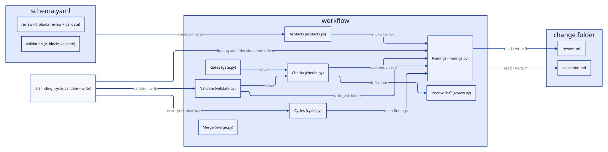

# Design: workflow

## Overview

The workflow a change goes through,
`refine → specify → design → implement (test | code) → review → validate → close`, as far as
the CLI can check it. The phase skills do the work that needs judgement; this
capability gives them facts and gates.
- **Artifacts** (`artifacts.py`): the artifact graph from the packaged
  `schema.yaml` (what each phase writes and what it requires), each artifact's
  state, the instructions and template for writing it, each half's task
  progress in implement, and the check artifacts (review.md `R`,
  validation.md `V`) that hold findings.
- **Findings** (`findings.py`): one parser and one set of writers for the
  findings of every check artifact.
- **Checks** (`checks.py`): every check defined once, as a function of a
  `GateContext` that computes what it reads (analysis, review report, each
  check artifact's findings) on first use.
- **Gates** (`gate.py`): each phase's (and each half's) list of checks, and
  `start`, which runs the gates a phase depends on before moving the change.
- **Review** (`review.py`): the drift report (changed files against the base
  branch, untagged code and tests).
- **Cycles** (`cycle.py`): which steps the next build cycle runs after a
  review, and the change's next state.
- **Validate** (`validate.py`): the grouped final report, and, with
  `--write`, validation.md with one finding per failed blocking check.

- **Merge** (`merge.py`): merging a half's branch into the checkout in a
  build, resolving the change's `tasks.md` and `traceability.md`.

## Decisions

### Gates only check what the CLI can see

The gates look at specs, tasks, tags, the check artifacts, git and the project's own
commands. Anything that needs judgement (whether a test fails for the right
reason, whether the code matches the spec's intent) stays with the skills.
(baseline-workflow)

### A change's interfaces live in its own module

The design gate counts a file named under Interfaces only when it exists inside
the change's module folder. The path may be written relative to the module or
to the workspace root, the form every CLI path is printed in. A same-named file
elsewhere in the workspace must not stand in for a missing stub, and work
across modules belongs to a change at the top level or in the lowest common
module. (module-interface-paths)

### One definition per check, shared by gates and validate

Gates and validate are lists of the same check functions. Validate adds a
group and the phase skill that fixes each failure, and `start` prints that fix
too. A check returns `None` when it doesn't apply. Warnings
(`blocking=False`) never fail a gate. (baseline-workflow)

### Validate warns on the module's architecture diagrams

`architecture_diagrams_current`, a coherence check fixed by
`/specworks-close`, runs `state` on every diagram in the module's
`<docs folder>/diagrams/` and warns (non-blocking) naming each stale or
missing SVG, with the fix `specworks diagrams --dir <module docs folder>`
built from `Module.docs_path`. It returns `None` when the folder has no
diagram. A capability on `.` shares the folder, so its block diagram is
checked there too, which is harmless. (project-docs)

### Implement's halves are gated separately

`implement` has two halves that run in parallel, each reading only the
project, refinement, specs and design: the test half and the code half.
`gate test` and `gate code` each check one half (its `[test]` or `[code]`
tasks); `gate implement` runs the test gate, then the code gate once the test
gate passes, with each check named `test: ` or `code: `. `start` treats
implement's gate as both, so leaving implement needs both halves; going back
to implement needs only the design gate. The half checks are new functions
(`half_tasks_done`, `code_tests_pass`, `review_tests_pass`) rather than
parameters on `tests_pass`, so validate keeps its blocking-suite check
unchanged. (parallel-test-code) The code gate's `code_tests_pass` was later
removed, see below. (code-half-no-tests)

### Validate reports open tasks by kind

Validate has three task checks instead of one "every task is done": the
`[test]` and `[code]` halves' own `half_tasks_done(half)` checks (naming
`/specworks-test` and `/specworks-code`) and `unmarked_tasks_done` for tasks
with neither marker, design's stub tasks (naming `/specworks-design`). Each
check still names one skill, so a failure points to the phase that fixes it
and `goBackTo` keeps its shape. The unmarked check is its own function rather
than `half_tasks_done("")`, whose name is built from the marker and which the
gates never need. Open tasks of a change written before the markers existed
go to `/specworks-design`. With tasks.md missing all three fail, behind
`planning artifacts exist` naming `/specworks-specify`. The single
`tasks_done` check is gone. (fix-validate-test-task-skill)

### The code gate does not run the tests

The code half is written without reading the change's tests, which the test
half writes in parallel and which are missing or red by design, so the code
gate needs no `@ac` test per criterion (parallel-test-code) and does not run
`commands.test` at all. It runs one check per configured command, `build`,
`typecheck` and `lint` in that order, each blocking when it fails and skipped
(`None`) when not configured, as `stubs_build` does for the design gate.
With none of the three configured, a `[warn]` check (`ok` False, `blocking`
False) says the tests run in review, and the gate passes. One combined check
was rejected (one failure would hide the others' output), and so was
`optional_command` (an "ok, not configured" line per missing command). So
`gate implement` and `start review` run no suite; the tests first meet the
code in review, whose gate runs the tests (the touched capabilities' ones when
`commands.test_scoped` is set) and blocks on them, except as a
warning under `--allow-open` while review.md has an open finding. A broken
existing test is no longer caught before review. (code-half-no-tests)

### The design gate does not run the tests

The design gate runs no test command: it checks the stubs with `build` and
`typecheck`, and the tests first meet the change in the review gate. Its former
check, `existing_tests_pass`, ran the whole existing suite to see that the stubs
break nothing, which build and typecheck already cover; it cost a full run and
a red suite failed or warned the gate for reasons that are not about the API.
Its helper rules, `own_tests` and `has_own_ac_tests` (a red suite was only a
warning when the change had tests of its own), went with it. Scoping the run to
the touched capabilities, as `test_plan` does for review, was rejected: it
keeps a test run and the warning at design for what build and typecheck cover.
A stub that breaks an existing test is caught at review, not design.
(scope-design-gate-tests)

### The review gate runs only the touched capabilities' tests

One plan, `test_plan(ctx)` (cached as `ctx.test_plan`, a `TestPlan` of
`full`, `runs` and `missing`), decides what the review gate runs, so the test
check and the missing-folder warning agree. A capability is touched when the
change has a delta for it or a changed file (any kind, deleted included) lies
under its code path or test folder; nested capabilities can both be touched.
The plan falls back to the full suite (`commands.test`) when nothing is
touched, when a touched capability's module has no `test_scoped`, or when a
touched test folder does not exist; otherwise it runs `test_scoped` once per
module with that module's touched folders, sorted, modules in workspace order.
`review_tests_pass` runs the plan as one check, named
`the touched capabilities' tests pass (commands.test_scoped)` for a scoped run,
its details holding each run's command line and, on a failure, its output
tail; `--no-run` and the `--allow-open` warning behave as for the full suite.
`test_folders_exist`, a warning listed before it, names the missing folders
(workspace-relative), and is `None` when none is missing or `test_scoped` is
not configured. Validate still runs the full suite, so a
test a scoped run misses still blocks before close. (capability-tests)

### Specs are fingerprinted when they are agreed

Leaving specify through `start` records a fingerprint of each requirement.
Later gates warn, without blocking, when the specs drift from that agreement,
and starting design again accepts the new specs. (baseline-workflow)

### Deleted code is reviewed like changed code

The drift report lists files deleted on the branch (kind `deleted`, with the
kind they had). Deleted source and test files must be accounted for in
review.md, like untagged changed files, because the trace only checks the
change's own requirements: a deletion is where another requirement can silently
lose its code. Detecting that loss automatically (reading the deleted file's
tags at the base) was left for later. (review-deleted-files)

### The schema declares the check artifacts

An artifact in `schema.yaml` that holds findings has a `findings:` entry with
its ID `letter` and the gates its open findings `block`: review (`R`, blocks
review and validate) and the optional validation (`V`, blocks validate,
requires review). `check_artifacts()` lists them in schema order; the
artifact's `phase` is the step that closes its findings
(`confirmed in <phase>:`) and the skill named by its readability and
open-findings checks. A duplicate letter fails when the schema loads. A new
check step (inspect) is a schema entry and a template. Hard-coding the two
files was rejected. (unify-check-findings)

### Findings have their own module, parametrised by the artifact

The parser, routing and writers live in `findings.py`, parametrised by a
`CheckArtifact`; `review.py` keeps the drift report only, with no re-export.
`FINDING_RE` is built per letter, and a checkbox with another letter's ID is
unreadable, like any other stray checkbox. `decide`, `done` and `close` take
an ID only, and its letter names the artifact (`check_artifact_for`), so a
command never names the file twice or the wrong one; only `add` takes
`--artifact` (default `review`). (unify-check-findings)

### Gates read the check artifacts that block them

`artifact_readable(artifact)` and `artifact_closed(artifact)` build the
readability and open-findings checks of one check artifact (review's keep
their names and details). The review gate runs them for every check artifact
whose `blocks` holds `review`, validate for every one whose `blocks` holds
`validate`, each fixed by the artifact's phase skill; so open `V` findings
fail validate but not the review gate. A missing validation.md is no
failure (it is optional); `review_written` stays. `--allow-open` applies to
every artifact the review gate reads. (unify-check-findings)

### Validate keeps its own findings in step with its checks

Validate writes nothing unless asked: `write_validation(ctx)` (behind
`validate --write`) runs every `VALIDATE` row except the open-findings checks
of every check artifact and validation.md's readability check, since a
finding is never turned into another finding. For each failed blocking check
with no open `V` finding carrying its `**Check**` line it adds one, typed
from the row's fix (specify → `spec-gap`, design → `design-gap`, test →
`test-gap`, code → `code-gap`, review → `quality`) with the Proposal
`back to <step>: make the check pass`; each open `V` finding whose check now
passes is closed with `confirmed in validate: the check passes`. It rewrites
the `## Summary` (verdict, the three group counts, the warnings, which never
become findings) and `None.` under Findings, then runs every check again and
returns them, so the verdict printed is the one after the write. Findings
with no `**Check**` line (added by the skill or by hand) are never touched; a
check that fails again after its finding was closed gets a new one. Each
write goes through the finding writers. An old `**Check**` line whose check
was renamed matches nothing and stays open until closed by hand.
(unify-check-findings)

### A finding waits for the step that found it

Review checks the work done for every finding but closes only its own `R`
ones; for a `V` finding it writes `done in review:`, which routes it on to
validate (`NEXT_STEP["review"] = "validate"`). A finding routed to validate
starts no build cycle, and validate confirms and closes it. Without this a
`V` finding would bounce between code and review. (unify-check-findings)

### Findings are parsed strictly

A checkbox the parser can't read, or an open finding with no known type or
`back to <step>:`, fails the review gate and validate, even inside a build.
A finding the parser misses would otherwise let a gate pass with it still open.
The same goes for any checkbox outside a finding, at the top level or indented
under another bullet: only sub-steps inside a finding's block are allowed, so
open work can't hide behind indentation. (baseline-workflow, review-indented-checkboxes)

### Findings are written by commands that read their edit back

The `finding` writers (`add_finding`, `decide_finding`, `mark_finding_done`,
`close_finding`) edit a check artifact's text in place: each finds the finding's
block as `parse_findings` sees it (its checkbox line and the indented lines
after it), adds one line at the end of the block, replaces the Decision line
or ticks the box, then parses the new text and checks that the finding reads
back as expected (ID, state, step). Only then is the file written; otherwise a
`FindingError` names the problem and the file is left as it was. The writers
use the reader's own rules (`FINDING_RE`, `TYPE_PHASE`, `BACK_RE`, `DONE_RE`,
`FINDING_STEPS`), so they cannot write what the gate would refuse. A
structured data file with review.md generated from it was rejected.
(finding-commands)
- A decision starts `back to <step>:`, `back to design only:` or
  `accepted:`; `accepted` ticks the box. `only` after any other step is
  refused before any write (`DECISION_FORM` names the three forms).
  (skip-halves-for-design-text) A new finding is expected to route where the reader routes it: the form
  its Proposal line starts with, else its type's step, so a proposal written
  in that form is not refused; a form only quoted in its text or Proposal
  does not route it. (fix-route-quoted-forms)
- With an ID repeated, the writers act on the first block with it, as
  `parse_findings` does, and a refusal is a `FindingError`, never a traceback.
- `close_finding` adds `confirmed in <artifact phase>: <text>`; the parser
  does not route on it (only the box counts).
- A new check artifact gets the template's title (the change ref), `Base:`
  line, headings and comments, without its example lines, which would read as
  a bad finding.
- Replacing a Decision replaces its first line only: a hand-wrapped Decision
  keeps its continuation lines, and when they would misroute the finding the
  read-back refuses. Accepted, since the commands write one-line Decisions.

### Build cycles run only the steps the findings need

A finding's route is a step: `specify, design, implement, test, code,
review, validate`. It is set by its type, by `back to <step>:` (`implement` means both
halves), or past a `done in <step>:` (specify → design, design → implement,
implement, test or code → review, review → validate). `next_cycle` reads the
open findings of every check artifact (each with its ID) and adds `next`:
the step its findings start at, or with none open the phase after the
change's current one (None after close); a separate `specworks next` was
rejected as the same computation. Its `phases`
lists the steps to run: code half and review, test half and review, both
halves and review, or design, both halves and review. A spec finding hands
over to specify instead of starting a cycle. Re-running every phase after the
earliest finding was replaced: a code finding no longer re-runs the tests.
(baseline-workflow, parallel-test-code)
- `back to design only:` sets the finding's `design_only`: once
  `done in design:`, it goes to review instead of implement, and it adds no
  half to the cycle. The halves join design only when a finding needs design
  without `only`, needs implement, or names that half: only design-only
  findings give `design, review`; design-only plus a code finding gives
  `design, code, review`. It is agreed in the Decision, before the cycle
  starts; detecting a text-only design change from git, or deciding it after
  the design step, were rejected. `only` reads with the `back to` that carries
  it, and the last route in the block wins, so a later plain `back to design:`
  clears it. (skip-halves-for-design-text)
- A route form (`back to <step>:`, `back to design only:`, `done in
  <step>:`) counts only where it starts a line's text: after the line's
  indentation, an optional bullet (`-`, `*`, `+`, `1.`, `1)`) and an optional
  bold label with its colon, bold before or after the colon (`**Decision**:`,
  `**Decision:**`). One rule (`LINE_STARTS`, read by `_route` and `_done_in`)
  serves `parse_findings` and every writer. Anything later on a line, and the
  finding's own checkbox line, is text, so a form only quoted (in a finding's
  text, a Proposal or a `confirmed in review:` line) no longer routes it.
  Any bold label is accepted, not only Decision and Proposal, so a
  hand-written `**Fix**: back to code:` keeps routing with one pattern; a
  list of known labels, or one rule per line kind (`done in` has no label),
  were rejected. A route written mid-line by hand stops routing: the finding
  then routes by its type, or is unreadable without one, never silently
  skipped. It replaced reading a route from anywhere in the block, which
  made quoted forms set a finding design-only. (fix-route-quoted-forms)

### Merging a half's branch resolves only tasks.md and the trace

Both implement halves tick `tasks.md` and rewrite `traceability.md`, so the
test half's worktree branch conflicts there on every build. `merge_branch`
refuses a dirty checkout or an unknown branch, runs `git merge --no-ff
--no-edit`, and on conflicts resolves only those two files of the change:
`tasks.md` keeps a line ticked when either side ticked it (`merge_ticks`,
reading both sides from the index), and the trace is regenerated for the
merged checkout. Any other conflicting file, or a `tasks.md` line that
differs in more than its box, runs `git merge --abort`, so the checkout is
never left half-merged. git's `union` strategy was rejected: it keeps both
versions of a line, so a task would appear twice. Two task files and a git
merge driver were rejected too. The merge commit keeps git's default message.
Its error, `BranchMergeError`, is named apart from `specs.merge.MergeError`,
which close raises. (merge-halves-without-conflicts)

## Interfaces

- `src/specworks/schema.yaml`: `findings: {letter, blocks}` on `review`
  (`R`, `[review, validate]`) and on the optional `validation`
  (`validation.md`, phase validate, requires review; `V`, `[validate]`).
- `src/specworks/workflow/artifacts.py`: `load_artifacts()`,
  `artifact_states(change)`, `instructions(ws, module, change, artifact_id)`,
  `half_progress(change)` (`{"test": {"done", "total"}, "code": {...}}` in
  implement, else None; `status` shows it as `test 3/3, code 1/4`);
  `Artifact.findings`; `CheckArtifact(id, file, letter, phase, blocks)`,
  `check_artifacts()`, `check_artifact(artifact_id)`,
  `check_artifact_for(finding_id)` (each unknown name or letter a
  `WorkflowError` naming the check artifacts).
- `src/specworks/workflow/checks.py`: `Check`, `GateContext`, `passed(checks)`,
  `run_checks(ctx, checks)`, and the check functions (including
  `half_tasks_done(half)`, `unmarked_tasks_done`, `review_tests_pass`,
  `TestPlan`, `test_plan(ctx) -> TestPlan`, `test_folders_exist(ctx)`,
  `code_command(key, name) -> CheckFn` (runs `commands.<key>`, blocking on
  failure, `None` when not configured), `no_code_commands(ctx)` (the `[warn]`
  named `build, typecheck and lint` when none is configured),
  `artifact_readable(artifact)`, `artifact_closed(artifact)`);
  `GateContext.findings(artifact)` (cached per artifact) and
  `GateContext.review` (review's).
- `src/specworks/workflow/gate.py`: `GATE_CHECKS` (`code`: specs, code tasks, tags,
  then `code_command` for build, typecheck and lint, then
  `no_code_commands`; `review`: `test_folders_exist` before
  `review_tests_pass`), `GATES` (with `test`, `code` and `implement`), `run_gate(ctx, phase)`, `gates_to_start(current, phase)`,
  `start_phase(ctx, phase)`; the review gate's findings rows come from the
  check artifacts whose `blocks` holds `review`.
- `src/specworks/workflow/review.py`: `review_change(analysis, base)`,
  `changed_paths(ws, since)`, `deleted_paths(ws, since)`, `detect_base`,
  `ChangedFile` (`kind`, `was`), `ReviewReport`, `CODE_EXTENSIONS`.
- `src/specworks/workflow/findings.py`: `TYPE_PHASE`, `FINDING_STEPS`,
  `NEXT_STEP`, `Finding` (`phase` holds its step; `design_only`, shown as
  `"designOnly": true` by `to_dict()` when set; `check`, its `**Check**`
  line), `FindingsDoc` (`artifact`; `accounted`/`accounts_for` empty outside
  review.md), `parse_findings(text, artifact)`, `read_findings(change,
  artifact)`, `read_all_findings(change)` (schema order, missing files with
  `exists=False`); the writers, each returning the finding as it reads after
  the write and raising `FindingError` with the file unchanged:
  `add_finding(change, kind, text, proposal, artifact="review", check="")`
  (`kind` one of `TYPE_PHASE`; the next free ID of the artifact's letter,
  under `## Findings`), `decide_finding(change, finding_id, decision)`,
  `mark_finding_done(change, finding_id, step, text)` (`step` one of specify,
  design, implement, test, code, review), `close_finding(change, finding_id,
  text)`, the artifact found from the ID's letter. Lines written:
  `  - **Proposal**: …`, `  - **Decision**: …`, `  - **Check**: …`,
  `  - done in <step>: …`, `  - confirmed in <artifact phase>: …`.
- `src/specworks/workflow/cycle.py`: `next_cycle(change)` (`reviewed`, `open`
  (each with its `id`), `startAt`, `phases`, `handOver`, `next`; `phases`
  lists steps).
- `src/specworks/workflow/validate.py`: `VALIDATE` (rows of group, the skill
  that fixes a failure, check; the findings rows built from the check
  artifacts whose `blocks` holds `validate`), `validate_change(ctx)`,
  `summary(checks)`, `architecture_diagrams_current(ctx) -> Check | None`,
  `write_validation(ctx) -> tuple[list[Check], Path]` (the checks after the
  write, validation.md's path).
- validation.md as validate writes it: under a finding
  `  - **Check**: <check name>` and
  `  - **Proposal**: back to <step>: make the check pass`; its close
  `  - confirmed in validate: the check passes`; `## Summary` holds
  `Verdict: PASS | FAIL (<n> critical, <n> warnings)`, the lines
  `- Completeness|Correctness|Coherence <passed>/<total>`, and `Warnings:`
  with `- <check name>: 
` when there is one.
- `src/specworks/workflow/merge.py`: `merge_branch(ws, module, change, branch)
  -> MergeResult` (raises `BranchMergeError`, and `GitError` outside a git
  repository), `MergeResult(merged, branch, resolved)` (`merged` is False only
  when there was nothing to merge; `to_dict(ws)` gives workspace-relative
  paths), `BranchMergeError` (`files`: the conflicting files, empty when
  refused before merging), `merge_ticks(ours, theirs) -> str | None` (None
  when a line differs in more than its box).

## Constraints

- Validate (without `--write`) and the gates write nothing to the project.
  Only `start` writes, to the change's metadata, `merge_branch`, which
  commits a merge or leaves the checkout as it was, the finding writers,
  which write only the change's check artifacts and only when they read back
  as expected, and `write_validation`, which writes validation.md through
  them.
- Built on `project` (config, workspace, changes, runner) and `specs` (specs,
  tags, trace).
