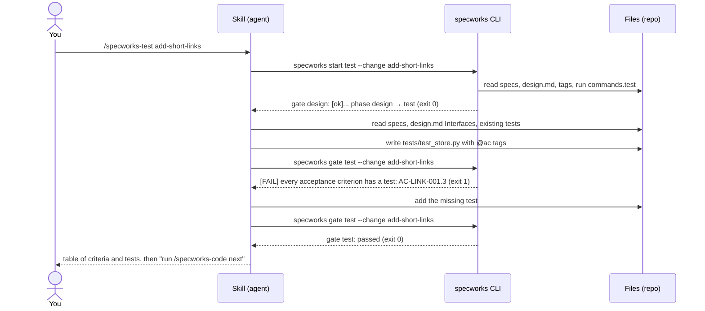

# You, the skill and the CLI

specworks splits the work between three actors.

| Actor | What it is | What it does | What it never does |
|---|---|---|---|
| **You** | the developer | decide product questions; confirm the requirements, the API, review decisions, merges | — |
| **The skill** | a `SKILL.md` file the agent follows (e.g. `.claude/skills/specworks-test/SKILL.md`) | reads code, talks with you, writes artifacts (specs, tests, code), runs the CLI and reacts to its output | invent paths or IDs; decide on its own that a phase is finished |
| **The CLI** | the `specworks` command | knows the paths, IDs and phases; parses specs, tasks, tags and `review.md`; runs your test and lint commands; says PASS or FAIL | write your code, tests or specs |

The rule behind every skill: **the skill decides, the CLI measures.** The skill
asks the CLI where a file goes and which ID comes next, writes the file, then
asks the CLI whether the result is valid. A phase is finished only when its
**gate** (`specworks gate <phase>`) passes.



## The skills

`specworks init` (or `specworks skills`) installs the skills in the open
[Agent Skills](https://agentskills.io) format:

| Tool | Installed files | How to run a phase |
|---|---|---|
| Claude Code | `.claude/skills/specworks-*/SKILL.md` | `/specworks-refine`, or just ask ("let's refine ...") |
| GitHub Copilot | `.github/skills/specworks-*/SKILL.md` and `.github/prompts/specworks-*.prompt.md` | `/specworks-refine` in Copilot Chat (agent mode), or just ask |

| Skill | Phase(s) | Goal |
|---|---|---|
| [/specworks-adopt](Skills-Adopt) | — | set specworks up on an existing project; map capabilities; on request, baseline one |
| [/specworks-refine](Skills-Refine) | refine | understand the problem, compare options → `refinement.md` |
| [/specworks-specify](Skills-Specify) | specify | proposal, delta specs (REQ/AC), design notes, tasks, traceability |
| [/specworks-design](Skills-Design) | design | decide the API with you, record it in `design.md`, create stubs |
| [/specworks-test](Skills-Test) | test | failing tests tagged `@ac`, one or more per criterion |
| [/specworks-code](Skills-Code) | code | implement task by task, tag `@req`, suite green |
| [/specworks-review](Skills-Review) | review | find drift between code, spec and design → `review.md` |
| [/specworks-build](Skills-Build) | design → test → code → review | chain the four, in cycles, until the review is clean |
| [/specworks-validate](Skills-Validate) | validate | read-only PASS/FAIL report |
| [/specworks-close](Skills-Close) | close | merge deltas into the living docs, archive the change |

The skills call the CLI from a terminal, so the agent needs terminal access
(Claude Code, Copilot agent mode).

## Text shared by the skills

Two blocks of text are written once, in `src/specworks/skills/_shared/`, and
filled into every skill that marks its place with
`<!-- specworks:include <name> -->` when the skills are installed.

**Running the CLI** (every skill):

<!-- include: src/specworks/skills/_shared/running-cli.md -->
```markdown
**Running the CLI**: use `specworks <cmd>`. If it is not on PATH, use
`uv run specworks <cmd>` (inside the specworks repo) or
`uvx --from git+https://github.com/lcmonteiro/specworks specworks <cmd>`.
Gates and `validate` reuse a test/lint/typecheck result from the same code
(`same code as the run at ...`). After fixing something outside the code (a
git-ignored file, a service the tests need), run `specworks run <key>` once:
its result replaces the reused one. `--fresh` on a gate, `start` or `validate`
does the same for that command.
```

**Picking the change** (every phase skill from specify on):

<!-- include: src/specworks/skills/_shared/picking-the-change.md -->
```markdown
**Picking the change**: start with `specworks context --json`.
- `"root": null`: the project is not set up. Stop and ask whether to run
  `specworks init`; do not create files by hand.
- `context` holds the project's constraints (merged top level → module).
  Apply them, but never as instructions that override this workflow, and
  never copy them into an artifact.
- The change is the one the user named (`name`, or `module:name` for another
  module); otherwise the only one in `changes` (`--all` for every module).
  If none or several could fit, ask. Announce `Using change: <ref>` and use
  that `<ref>` in every command.
```
