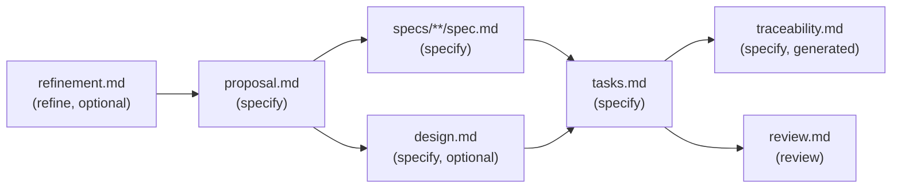

# Artifacts and their dependencies

`src/specworks/schema.yaml` lists the artifacts of a change, the phase that
writes each one, its template and the rules (`instruction`) the agent follows
when writing it.

`specworks status` shows each one as:

`done`
: the file exists. The skill re-reads it from disk before building on it (you
  may have edited it).

`ready`
: its dependencies are done; it can be written now.

`blocked`
: a dependency is missing.

`skipped`
: not needed (delta specs of a change marked with `specworks skip-specs`).

An optional artifact (refinement, design) counts as done for the artifacts
that depend on it.

## Instructions: the skill's main input

`specworks instructions <artifact> --change <ref> --json` returns everything
needed to write one artifact:

| Field | Meaning |
|---|---|
| `outputPath` | where to write it (relative to the workspace root) |
| `template` | its structure (from `src/specworks/templates/`) |
| `instruction` | its rules (from `schema.yaml`) |
| `exists` | `true`: re-read and update it, never overwrite the user's edits |
| `dependencies` | the artifacts it builds on, and whether they are done |
| `context` | the project's constraints, inherited from the top level down |
| `capabilities` | for `specs`: each capability's `prefix`, `nextId` and `deltaPath` |

Every template and every instruction is in [Artifacts: instructions and templates](Reference-Artifacts).
