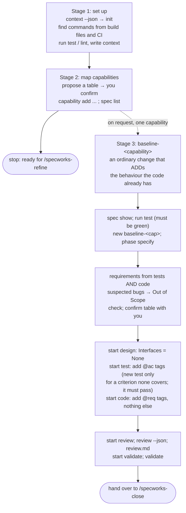

# /specworks-adopt

:Phase: none (set-up)
:Writes: the config; on request, one `baseline-<capability>` change at a time
:Next: `/specworks-refine` for new work; `/specworks-close baseline-<capability>` after a baseline
:Example: [0. Set up the project](Tutorial-Setup) (stages 1-2)

Bring a project that already has code into specworks, without pretending it
was built with it and without changing any behaviour. Use it when you say
"adopt", "onboard", "baseline a capability", or start using specworks on an
existing (brownfield) project.



**By default it stops after stage 2.** A project is ready for new changes once
its capabilities are mapped; a capability gets a baseline when you ask,
typically the first time a change touches it.

## Stage 1: set up

| # | Step | Command | What it reads from the output |
|---|---|---|---|
| 1 | Check the project | `specworks context --json`; `specworks init --dir <dir>` (with your go-ahead) | `root: null` → not set up. Several independent projects → one module each (`specworks module add <path>`) |
| 2 | Find the commands | reads `pyproject.toml`, `package.json`, `Makefile`, `Cargo.toml`, `go.mod`, CI workflows...; then `specworks run test`, `specworks run lint` | a table of `test` / `lint` / `typecheck` / `build` with where each came from; a failing command is the starting state, reported, not fixed |
| 3 | Write the context | reads README, `CLAUDE.md`, `AGENTS.md`, contributing guide | a few lines: what the project is, its stack, conventions a change must follow |
| 4 | Scan globs (when needed) | — | `test_globs` / `source_globs` to skip generated, vendored or fixture code |

## Stage 2: map the capabilities

| # | Step | Command | What it reads from the output |
|---|---|---|---|
| 5 | Propose capabilities | — | a table: capability, path, prefix, description. Grouped by behaviour you would recognise (no `utils` or `models`), a few broad ones. **Stops and waits** for you |
| 6 | Register them | `specworks capability add <name> --path <path> [--prefix <P>] [--description "..."]`; `specworks spec list` | a prefix clash is an error to resolve |
| 7 | Report and stop | — | config, commands (and whether each passes), context, modules, capabilities |

## Stage 3: baseline one capability (on request)

A baseline is an ordinary change named `baseline-<capability>` whose specs
ADD the behaviour the code already has. Its tests and code exist, so the test
and code phases only add tags.

| Phase | In a normal change | In a baseline |
|---|---|---|
| (before) | — | `specworks spec show` (a capability with requirements needs no baseline); `specworks run test` **must be green**, otherwise stop: a red suite cannot show the baseline matches the code |
| specify | requirements for new behaviour | requirements for behaviour the code **already has**, read from existing tests **and** code; `## Purpose` + only ADDED; suspected bugs go to Out of Scope; confirmed with you |
| design | API decided with you, stubs | `## Interfaces` = "None: a baseline records existing behaviour and changes no API." |
| test | failing tests | `@ac` tags on existing tests; a new test only for a criterion none covers, and it must **pass** (if it fails: the criterion is wrong or it is a bug → back to specify) |
| code | implementation | `@req` tags only; any other code change is a review finding |
| review, validate | as usual | the only changed files should be tests and code that gained tags |
| close | as usual | writes the capability's first living spec |

## Guardrails

- One capability per baseline, and only the one asked for.
- Never changes behaviour: no refactors, bug fixes or renames. A failing
  command or a bug is reported, not fixed; it can become its own change.
- You confirm the commands, the capability table and each baseline's
  requirements before they are written.
- Records behaviour the code **has**, not behaviour it should have.
- Never edits living docs by hand.

## Source

<details>
<summary>specworks-adopt/SKILL.md</summary>

<!-- include: src/specworks/skills/specworks-adopt/SKILL.md -->
````markdown
---
name: specworks-adopt
description: Adopt specworks in a project that already has code - set it up, find the project's test/lint commands and context, map the existing code to capabilities, and, per capability on request, record the behaviour the code already has as a baseline living spec. Use when the user wants to start using specworks on an existing (brownfield) project, onboard a codebase, baseline a capability, or says "adopt", "onboard" or "specworks adopt".
allowed-tools: Bash(specworks:*), Bash(uv run specworks:*), Bash(uvx --from git+https://github.com/lcmonteiro/specworks specworks:*), Read, Grep, Glob, Write, Edit
---

Adopt: bring a project that already has code into specworks, without
pretending it was built with it. It runs in stages:

1. **Set up**: the config, the project's commands and its context.
2. **Map**: the capabilities of the existing code, registered in the config.
3. **Baseline** (only on request, one capability at a time): the behaviour
   the code already has, written as requirements, tied to the existing tests
   and code with `@ac` / `@req` tags, and closed into the capability's living
   spec through an ordinary change.

**By default, stop after stage 2.** A project is ready for new changes once
its capabilities are mapped; a capability gets a baseline when the user asks,
typically the first time a change touches it. Never baseline the whole
project in one go.

**Boundary**: adopting changes no behaviour. Stages 1-2 write only the config.
Stage 3 writes a change folder and adds comment tags (and tests only for
criteria no test covers); it never fixes the code, even a bug it finds.

<!-- specworks:include running-cli -->

---

## Stage 1: Set up

1. **Check the project**

   ```bash
   specworks context --json
   ```

   - `"root": null`: not set up yet. Look for an existing workflow-like
     folder (`spec/`, `docs/`, `openspec/`) and ask the user for the folder
     name (`--dir`, default `specworks`); it also names the config file and
     cannot change without renaming both. Then, with their go-ahead:
     ```bash
     specworks init --dir <dir>
     ```
   - Already set up: say so, and continue with whatever is still missing
     (empty `commands`, empty `context`, no capabilities). Never overwrite
     what the user wrote.
   - Several independent projects in one repository (each with its own
     build file: `services/*/pyproject.toml`, a `packages/*/package.json`
     workspace, ...): propose one module per project and, once confirmed,
     `specworks module add <path>` for each. Run stages 1-2 in each module
     from its folder.

2. **Find the project's commands**

   Read, without running anything yet: `pyproject.toml`, `package.json`
   scripts, `Makefile`, `Cargo.toml`, `go.mod`, `CMakeLists.txt`, `tox.ini`,
   `noxfile.py`, the CI workflows (`.github/workflows/*.yml`, `.gitlab-ci.yml`)
   and the README's development section. CI is the best evidence: it shows
   the commands the project really runs.

   Propose `test`, and `lint` / `typecheck` / `build` when the project has
   them, in a short table with where each one came from. Once confirmed, write
   them under `commands:` in the config (`<dir>.yml` in the module's folder,
   `dir` in `specworks context --json`), then run each one:
   ```bash
   specworks run test
   specworks run lint
   ```
   A failing command is the project's starting state, not something to fix
   here: report it, and tell the user that the design and code gates need
   `commands.test` to pass.

3. **Write the context**

   From the README, `CLAUDE.md` / `AGENTS.md` / `.github/copilot-instructions.md`,
   the contributing guide and the dependencies: a few lines on what the
   project is, its stack, and the conventions a change must follow (style,
   error handling, layering, what not to touch). Show it, apply corrections,
   and write it under `context:` in the config. Keep it short: it is read
   before every phase. Point to those files rather than copying them.

4. **Choose the files to scan for tags** (only when needed)

   Empty `test_globs` / `source_globs` scan every file outside the workflow
   folder. Set them when that would pick up generated code, vendored code or
   fixtures (`vendor/`, `dist/`, `node_modules/`, snapshot files):
   `test_globs: ["tests/**/*.py"]`, `source_globs: ["src/**"]`.

---

## Stage 2: Map the capabilities

5. **Propose capabilities**

   A capability is a durable behaviour of the system that owns a code folder
   (`user-auth` → `src/auth`); its living docs go to `<path>/<docs_dir>/`.
   Read the layout, the entry points (routes, CLI commands, public modules)
   and the tests' folder structure, and propose a table:

   ```
   Capability    Path            Prefix    Description
   user-auth     src/auth        AUTH      Login, sessions and password reset
   invoices      src/billing     INVOICES  Invoice creation, numbering and PDF export
   ```

   - Group by behaviour the user would recognise, not by technical layer: no
     `utils`, `models` or `helpers` capability.
   - Prefer a few broad capabilities to many small ones; one can be split
     later.
   - Each capability needs its own prefix; keep them short and readable.
   - Code that is pure plumbing (build scripts, generated code) needs no
     capability.

   Ask the user to confirm or edit the table. **Stop and wait.**

6. **Register them**

   For every confirmed row:
   ```bash
   specworks capability add <name> --path <path> [--prefix <P>] [--description "<one line>"]
   ```
   Then check the result:
   ```bash
   specworks spec list
   ```

7. **Report and stop**

   Summarize: the config file, the commands and whether each passes, the
   context written, the modules and the capabilities. Then:

   "specworks is set up. New work starts with `/specworks-refine`. A
   capability has no living spec yet; when a change first touches one (or
   now, if you prefer), ask me to baseline it: I record the behaviour it
   already has, so the change's specs can MODIFY requirements instead of
   only ADDING them."

   **End here unless the user asked for a baseline.**

---

## Stage 3: Baseline one capability (on request)

A baseline is an ordinary change named `baseline-<capability>` whose specs
ADD the behaviour the code already has. Its tests and code exist, so the
test and code phases only add tags; `close` then writes the living spec
exactly as for any other change. Do one capability per change.

8. **Check the capability and create the change**

   ```bash
   specworks spec show "<capability>" --json
   ```

   A capability with requirements already has a living spec: it needs no
   baseline (offer `/specworks-refine` for what is missing).

   The test suite must be green: the design and code gates require it, and a
   red suite cannot show that the baseline matches the code. Check it first:
   ```bash
   specworks run test
   ```
   If it fails, stop before creating anything: name the failing tests and
   suggest fixing them first, in their own change (`/specworks-refine`), or
   baselining a capability whose tests pass. Never narrow `commands.test`
   to hide the failures.

   Otherwise, preferably on a new branch (review compares the branch with
   its base):
   ```bash
   specworks new "baseline-<capability>" --json
   specworks phase specify --change "baseline-<capability>"
   ```
   (`--module <m>` on `new` for a capability of another module.)

9. **Read the behaviour**

   Read the capability's code and its tests; requirements come from both:
   - existing tests: each one asserts behaviour someone decided on;
   - the code: public entry points, validation, error handling and side
     effects, including behaviour no test checks yet;
   - the README, docs, comments and changelog, to name and explain them.

   Record only observable behaviour (inputs, outputs, errors, side effects),
   not how the code does it. Keep a list of what looks like a bug or is
   unclear: it is not specified here (step 10).

10. **Write proposal, delta spec and tasks**

    Use `specworks instructions proposal|specs|tasks --change "<ref>" --json`
    as `/specworks-specify` does, with these differences:
    - `proposal.md`: Why = "record the existing behaviour of `<capability>`";
      What Changes = "no behaviour change"; the capability under Modified
      Capabilities (it is registered); Out of Scope = the suspected bugs and
      unclear behaviour from step 9, each as a candidate for its own change.
    - The delta spec starts with `## Purpose` (one or two sentences: the
      capability has no living spec yet), then only `## ADDED Requirements`,
      IDs from `nextId`.
      Prefer fewer, meaningful requirements. A criterion read from the code
      alone is as valid as one a test shows; step 12 gives it a test, so
      do not mark it in the spec.
    - `tasks.md`: per requirement, one task to tag the tests that check its
      criteria (`@ac`) and to write a test for any criterion with none, and
      one task to tag the code that implements it (`@req`).

    ```bash
    specworks check --change "<ref>"
    ```

    Show the requirements and criteria table as `/specworks-specify` step 5
    does, with the source of each (the test that shows it, or `code only:
    <file>` for one that gets a new test in step 12), and the
    list of suspected bugs. **Stop and wait** for the user to confirm: a
    baseline that records a bug as a requirement makes the bug the spec.

11. **Gate specify and record the API as unchanged**

    ```bash
    specworks trace --change "<ref>" --write
    specworks start design --change "<ref>"
    ```
    Write `design.md` with only:
    ```markdown
    ## Interfaces

    None: a baseline records existing behaviour and changes no API.
    ```

12. **Tag the tests**

    ```bash
    specworks start test --change "<ref>"
    ```
    Add `@ac <ID>` comments to the existing tests that check each criterion
    (one tag may list several IDs). Write a new test only for a criterion
    that none covers; it must pass against the current code (if it fails,
    the criterion is wrong or it is a bug: back to step 10, not a code fix).
    Tick the test tasks: `specworks task done --change "<ref>" <N.M>`.

13. **Tag the code**

    ```bash
    specworks start code --change "<ref>"
    ```
    Add `@req <ID>` comments where each requirement is implemented (the
    function or class that decides the behaviour, not every caller). Change
    nothing else. Tick the code tasks.

14. **Review and validate**

    ```bash
    specworks start review --change "<ref>"
    specworks review --change "<ref>" --json
    ```
    Write `review.md` (`specworks instructions review --change "<ref>" --json`).
    The only changed files should be tests and code that gained tags (and any
    new test); a code change other than a tag is a finding. Then:
    ```bash
    specworks start validate --change "<ref>"
    specworks validate --change "<ref>"
    ```
    Every failure names the step to go back to.

15. **Hand over to close**

    Show the summary: requirements and criteria recorded, tests tagged and
    added, files tagged, the suspected bugs left out. End with:
    "The baseline of `<capability>` passes validate. Run `/specworks-close
    baseline-<capability>` to write its living spec. The suspected bugs can
    each start with `/specworks-refine`."

---

## Guardrails

- Stop after stage 2 unless the user asked for a baseline; then do one
  capability per change, and only the one asked for.
- Never change behaviour while adopting: no refactors, no bug fixes, no
  renames. A failing command or a bug is reported, not fixed.
- The user confirms the commands, the capability table and each baseline's
  requirements before they are written into the project.
- Capability names, prefixes, IDs and delta paths come from the CLI
  (`spec show`, `instructions`), never invented.
- Record behaviour the code has, not behaviour it should have: what it
  should do is a new change, through `/specworks-refine`.
- Never edit the living docs (`<path>/<docs_dir>/`) by hand: `close` writes
  them.
````

</details>
