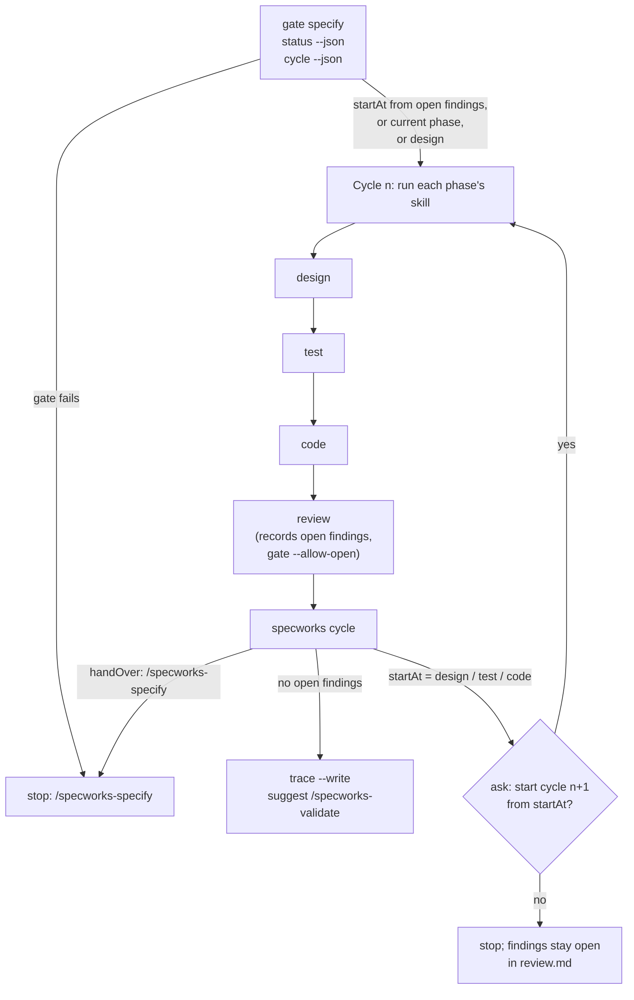

# /specworks-build

:Phases: design → test → code → review, in cycles
:Writes: everything those four phases write
:Next: `/specworks-validate <ref>`
:Example: [6. review](Tutorial-Review) and [7. The second build cycle](Tutorial-Build-Cycle)

Take a specified change through design → test → code → review in one run,
then repeat the part of the cycle the review findings need, until the review
is clean or you stop. Each phase is done **exactly** as its own skill says
(same steps, gates and questions); this skill only chains them and decides
where a new cycle starts. Use it when you say "build the change", "run the
build cycle" or "specworks build".



## Steps

| # | Step | Command | What it reads from the output |
|---|---|---|---|
| 1 | Where to start | `specworks gate specify`; `specworks status --json`; `specworks cycle --json` | gate fails → stop, `/specworks-specify`. Start at `startAt` when a review left open findings; else at the current phase if it is design, test, code or review; else at design |
| 2 | Run each phase | the phase skill's own steps (it moves the change with `specworks start`) | one-line result per phase instead of the phase's "Report and stop" |
| 3 | Review: propose, do not fix | `specworks gate review --allow-open` | findings that need work recorded open with `back to <phase>: ...` |
| 4 | Ask about a new cycle | `specworks cycle` | none open → done; `handOver: /specworks-specify` → stop; otherwise show the findings and ask "Start cycle n from X?" |
| 5 | Report and stop | `specworks trace --write` | per cycle: phases, API, tests, code, findings found/resolved/accepted |

## How the next cycle is chosen

| Open findings | Next cycle |
|---|---|
| `code-gap`, `tag`, `quality` | code → review |
| `test-gap` | test → code → review |
| `design-gap` | design → test → code → review |
| `spec-gap` | stop; `/specworks-specify`, then `/specworks-build` resumes at design |

The earliest phase any finding needs wins. A `back to <phase>:` in a
Decision overrides the type; a `done in <phase>:` line moves the finding to the
phase after that one. From cycle 2 on, each phase works only on its findings
(and what later phases need to follow them).

After the third cycle the skill says how many cycles ran and what keeps
coming back: repeated findings usually mean the spec or design needs a
decision, not another cycle.

## Guardrails

- Every phase follows its own skill; no gate or decision is skipped.
- A new cycle starts only after you say yes, and only from the phase the
  findings need.
- Spec problems are never fixed inside the build.
- No weakened tests, skipped gates or findings marked resolved to finish a cycle.

## Source

<details>
<summary>specworks-build/SKILL.md</summary>

<!-- include: src/specworks/skills/specworks-build/SKILL.md -->
````markdown
---
name: specworks-build
description: Build a specified change end to end in cycles of design → test → code → review, running each phase's own skill in order; after each review with findings, ask whether to start a new cycle and start it from the earliest phase the findings need (code findings → code, review; test findings → test, code, review; design/API findings → design, test, code, review). Use when a specworks change has been specified and the user wants to build it in one go, or says "build the change", "run the build cycle", "design test code review" or "specworks build".
allowed-tools: Bash(specworks:*), Bash(uv run specworks:*), Bash(uvx --from git+https://github.com/lcmonteiro/specworks specworks:*), Bash(git diff:*), Bash(git log:*), Bash(git status:*), Read, Grep, Glob, Write, Edit
---

Build: take a specified change through **design → test → code → review** in
one run, then repeat the part of that cycle the review findings need until
the review is clean (or the user stops). Each phase is done exactly as its
own skill says; this skill only chains them and decides where a new cycle
starts.

It covers phases three to six of `refine → specify → design → test → code → review → validate → close`.

**Phase skills**: `specworks-design`, `specworks-test`, `specworks-code` and
`specworks-review`, installed next to this skill (`../specworks-<phase>/SKILL.md`).
Read each one when its phase starts and follow its steps, checks and
guardrails, including every point where it asks the user (agreeing the
API, deciding review findings). Skip only its final "Report and stop": give
a one-line result instead and go on to the next phase.

**Boundary**: the build stops, and does not work around it, when a phase gate
fails and cannot be fixed within that phase, when the specs turn out wrong
(spec findings go to `/specworks-specify`), or when the user says stop.

<!-- specworks:include running-cli -->

<!-- specworks:include picking-the-change -->

---

## Steps

1. **Pick the change and where to start**

   Pick the change (above), then:
   ```bash
   specworks gate specify --change "<ref>"
   specworks status --change "<ref>" --json
   specworks cycle --change "<ref>" --json
   ```

   - If `gate specify` fails, stop and suggest `/specworks-specify <ref>`.
   - Start point:
     - a previous review left open findings (`cycle` returns `startAt`):
       resume with that cycle (step 4);
     - the change is already in `design`, `test`, `code` or `review`: resume
       at that phase;
     - otherwise start at `design`.
   - Say the plan, e.g. `Cycle 1: design → test → code → review`.

2. **Run the cycle's phases in order**

   For each phase of the cycle, announce `Cycle <n> · <phase>`, then follow
   that phase's skill (it moves the change with `specworks start`, does the
   work, and runs its gate). After its gate passes, report one line (what was
   decided or changed, gate passed) and continue with the next phase.

   From the second cycle on, each phase works on the **open findings in
   review.md** that belong to it (`specworks cycle --change "<ref>" --json`
   lists each finding with its phase): carry out the agreed proposal in the
   finding's Decision, plus whatever the later phases need to follow it (a
   new API needs its tests and code). A finding marked `done in <phase>:` has
   that phase's part done already (e.g. the spec change from specify): carry
   out what it means for this phase. Do not redo untouched work.

   If a gate fails, fix it inside the phase as its skill says. If it cannot
   be fixed there (the specs are wrong, the user must decide something
   outside the build), stop and report where and why.

3. **Review: propose, do not fix**

   Run `specworks-review` as written, with one difference: in a build, every
   finding that needs work is recorded **open** with its agreed proposal and
   the phase that will carry it out, instead of being fixed inside review:

   ```markdown
   - [ ] R2 **design-gap** `reset()` returns None; callers need the token (REQ-AUTH-003)
     - **Decision**: back to design: return `ResetToken` from `ResetService.request_reset`
   ```

   Findings from an earlier cycle that are now done are ticked (`- [x]`)
   with what was done. Findings the user accepts as they are get
   `accepted: <reason>` and are ticked. Spec findings (`spec-gap`) are
   recorded open with `back to specify: ...`.

   Gate it with `specworks gate review --change "<ref>" --allow-open`: open
   findings do not fail it here (step 4 turns them into the next cycle), but
   every other check (tests pass, untagged files accounted for, tags, a known
   type or `back to <phase>:` on every open finding) must.

4. **After the review: ask about a new cycle**

   ```bash
   specworks cycle --change "<ref>"
   ```

   - **No open findings**: the build is done (go to step 5).
   - **A spec finding** (`handOver` is `/specworks-specify`): stop the build.
     Explain which requirement is missing or wrong, and suggest
     `/specworks-specify <ref>` to fix the specs, then `/specworks-build <ref>`
     to continue. Specify marks each finding it carried out `done in specify:
     ...`, so `cycle` then starts at design and the build resumes there.
   - **Otherwise** show the open findings and where each one is resolved,
     then ask:

     ```
     Review found 3 open findings:
       R1 code-gap    lockout counter not reset on success   -> code
       R2 design-gap  reset() should return the token        -> design
       R3 test-gap    AC-AUTH-003.2 only checks the status   -> test
     Start cycle 2 from design: design → test → code → review?
     ```

     - **Yes**: go back to step 2 with the next cycle number, starting at
       `startAt`; that phase's skill moves the change back with
       `specworks start <startAt>`.
     - **No**: stop. The findings stay open in review.md; the user can run a
       single phase skill, or `/specworks-build <ref>` later to resume.

   The cycle starts at the earliest phase any finding needs: code findings
   (`code-gap`, `tag`, `quality`) → code, review; test findings → test, code,
   review; design/API findings → design, test, code, review. A
   `back to <phase>: ...` in a finding's Decision overrides its type, and a
   `done in <phase>: ...` line moves it on to the phase after that one.

   After the third cycle, say how many cycles have run and what keeps coming
   back before asking again: repeated findings usually mean the spec or the
   design needs a decision, not another cycle.

5. **Report and stop**

   Summarize per cycle: the phases run, the API agreed or changed, tests
   added, the code written, and the findings (found, resolved, accepted).
   Run `specworks trace --change "<ref>" --write`. End with: "The build is
   complete. When you are ready, run `/specworks-validate <ref>` for the final
   check before closing."

---

## Guardrails

- Every phase follows its own skill: same steps, same gates, same questions to
  the user. The build never skips a gate or a decision to keep going.
- A new cycle only starts after the user says yes, and only from the phase the
  open findings need.
- Spec problems are not fixed inside the build: hand over to
  `/specworks-specify`.
- Do not weaken tests, skip gates or mark findings resolved to finish a cycle.
- Re-read specs, design.md, tasks and review.md from disk at the start of
  every phase.
````

</details>
