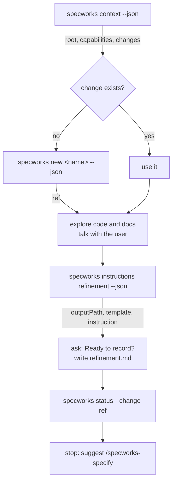

# 1. refine

**Skill**: [/specworks-refine](Skills-Refine). **Writes**: `refinement.md` only.
**Boundary**: no requirements, tasks, tests or code, even if you ask to
"build" something.



| Step | Command | Output used for |
|---|---|---|
| 1. Check the project | `specworks context --json` | see [0. Set up the project](Tutorial-Setup) |
| 2. Create the change | `specworks new add-short-links --json` | `ref`, for every later command |
| 3. Explore | (reads code, asks one question at a time) | problem, scope, constraints, options |
| 4. Write `refinement.md` | `specworks instructions refinement --change <ref> --json` | `outputPath`, `template`, `instruction`, `exists` |
| 5. Show the result | `specworks status --change <ref>` | summary; then stop |

## Create the change

```console
$ specworks new add-short-links --json
{
  "name": "add-short-links",
  "ref": "add-short-links",
  "module": "(top)",
  "path": "spec/changes/add-short-links",
  "phase": "refine",
  "created": "2026-10-17T19:55:11",
  "skipSpecs": false
}
```

It creates `spec/changes/add-short-links/.change.yaml`:

```yaml
name: add-short-links
created: '2026-10-17T19:55:11'
phase: refine
```

## Ask for the instructions

Long strings abridged:

```console
$ specworks instructions refinement --change add-short-links --json
{
  "artifact": "refinement",
  "phase": "refine",
  "change": "add-short-links",
  "module": "(top)",
  "root": "/work/shortlink",
  "changeDir": "spec/changes/add-short-links",
  "outputPath": "spec/changes/add-short-links/refinement.md",
  "exists": false,
  "optional": true,
  "context": "Python 3.12 library, standard library only. ...",
  "instruction": "Capture the shared understanding of the problem BEFORE committing to a solution.\nThis is the input for the proposal; it is not a plan.\n\nSections:\n- **Problem**: 2-4 sentences. ...",
  "template": "# Refinement: <!-- change name -->\n\n## Problem\n\n<!-- What hurts, for whom, and why now -->\n\n## Context\n\n**Observed:** ...",
  "dependencies": []
}
```

> [!TIP]
> **How the output feeds the skill**
>
> `template` gives the headings, `instruction` the rules for each section
> (Problem in 2-4 sentences, Observed vs Assumed, 2-3 real options with effort
> and capabilities touched, a Recommendation or "Pending"), `outputPath` the
> file to write. `exists: false` means "create"; `true` would mean "re-read it
> and update it; do not overwrite the user's edits". The full instruction and
> template: [Artifacts: instructions and templates](Reference-Artifacts).

## Write `refinement.md`

After the conversation, and after asking "Ready to record the refinement?"
(agreeing to answers during the discussion is not permission to write):

[`spec/changes/add-short-links/refinement.md`](https://github.com/lcmonteiro/specworks/blob/main/examples/shortlink/spec/changes/archive/2026-10-17-add-short-links/refinement.md):

<!-- include: examples/shortlink/spec/changes/archive/2026-10-17-add-short-links/refinement.md -->
```markdown
# Refinement: add-short-links

## Problem

Our newsletter tool pastes long tracking URLs into emails; they wrap, break and
look untrustworthy. The team wants "a tiny library that turns a long URL into a
short code and back", usable from the newsletter service.

## Context

**Observed:**
- `src/shortlink/` holds only an empty package; capability `links` is registered
  (prefix LINK) with no living spec yet.
- The project is standard-library only (context).

**Assumed:**
- One process; persistence is not needed for the first version.

## Constraints

- [hard] Standard library only.
- [hard] The same URL must not get two different codes (analytics count per code).
- [soft] Codes short enough to read aloud (6-8 characters).

## Options

### Option A: Random codes in an in-memory store

`LinkStore.shorten(url)` draws a random 6-char base62 code, stores it in a dict.

- **Pros:** simple, codes not guessable in sequence
- **Cons:** needs a reverse map to keep one code per URL
- **Effort:** S
- **Touches:** links

### Option B: Hash of the URL

Code = first 6 chars of base62(sha256(url)).

- **Pros:** deterministic, no reverse map
- **Cons:** collisions must still be handled; code leaks nothing but is fixed forever
- **Effort:** S
- **Touches:** links

## Recommendation

Option A, agreed with the user: a reverse map is trivial and collision handling is simpler.

## Open Questions

- Should codes expire? (who can answer: product owner) - not now; a later change.

## Candidate Capabilities

- `links`: modified - first requirements of the registered capability.
```

## Show the result and stop

```console
$ specworks status --change add-short-links
add-short-links (phase: refine)
  [ done  ] refinement.md
  [ ready ] proposal.md
  [blocked] specs/**/spec.md
  [blocked] design.md
  [blocked] tasks.md
  [blocked] traceability.md
  [blocked] review.md
```

> [!TIP]
> **How the output feeds the skill**
>
> `refinement.md` is `done`, which makes `proposal.md` `ready`: the next
> artifact belongs to specify. The skill summarises the problem, options and
> recommendation, and ends with "When you are ready, run `/specworks-specify
> add-short-links`."

> [!NOTE]
> The open question "Should codes expire?" is the seed of change 2
> ([Change 2: modifying a capability with a living spec](Tutorial-Modify)).
