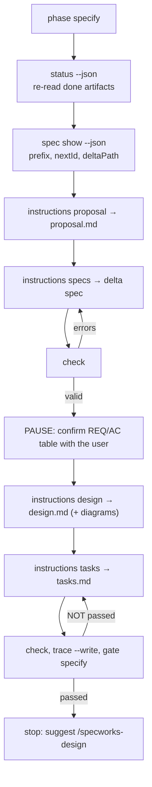

# 2. specify

**Skill**: [/specworks-specify](Skills-Specify). **Writes**: `proposal.md`, delta specs,
`design.md` (when needed), `tasks.md`, `traceability.md`, all inside the change
folder. **Boundary**: planning only; no tests, no code.



| Step | Command | Output used for |
|---|---|---|
| 1. Enter the phase | `specworks phase specify --change <ref>` | the phase marker |
| 2. Load what exists | `specworks status --json`; `specworks spec show <cap> --json`; `specworks cycle --json` (only when back from review) | artifacts to re-read; existing requirements; findings to carry out |
| 3. Proposal | `specworks instructions proposal --json` | template and rules |
| 4. Delta specs | `specworks instructions specs --json`, then `specworks check` | `capabilities[].deltaPath/prefix/nextId`; errors to fix |
| 5. Confirm | (a table shown to you; **stop and wait**) | your corrections |
| 6. Design | `specworks instructions design --json`; `specworks diagrams` | whether a design is worth writing; SVGs |
| 7. Tasks | `specworks instructions tasks --json` | rules for tasks |
| 8. Validate | `specworks check`, `specworks trace --write`, `specworks gate specify` | must pass |
| 9. Report | `specworks status` | summary |

## Where things go, and which ID comes next

```console
$ specworks phase specify --change add-short-links
add-short-links: phase → specify
$ specworks spec show links --json
{
  "ref": "links",
  "module": "(top)",
  "name": "links",
  "new": false,
  "prefix": "LINK",
  "nextId": "REQ-LINK-001",
  "deltaPath": "specs/links/spec.md",
  "codePath": "src/shortlink",
  "livingSpec": "src/shortlink/docs/spec.md",
  "hasSpec": false,
  "purpose": "",
  "requirements": []
}
```

> [!TIP]
> **How the output feeds the skill**
>
> The delta spec goes to the change folder + `deltaPath`:
> `spec/changes/add-short-links/specs/links/spec.md`. The first requirement is
> `nextId`, `REQ-LINK-001`. `hasSpec: false` means the delta starts with
> `## Purpose` and has only ADDED requirements.

`specworks instructions specs --json` returns the same data under
`capabilities`, plus the rules (`instruction`, `template` and `context`
omitted here):

```json
{
  "artifact": "specs",
  "phase": "specify",
  "change": "add-short-links",
  "module": "(top)",
  "changeDir": "spec/changes/add-short-links",
  "outputPath": "spec/changes/add-short-links/specs/**/spec.md",
  "exists": false,
  "optional": false,
  "dependencies": [
    { "id": "proposal", "path": "spec/changes/add-short-links/proposal.md", "done": false }
  ],
  "capabilities": [
    {
      "ref": "links", "module": "(top)", "name": "links", "new": false,
      "prefix": "LINK", "nextId": "REQ-LINK-001", "deltaPath": "specs/links/spec.md",
      "codePath": "src/shortlink", "livingSpec": "src/shortlink/docs/spec.md",
      "hasSpec": false, "purpose": "", "requirements": []
    }
  ],
  "writtenDeltas": []
}
```

## The proposal

Its Capabilities section is the contract for the next step: every capability
listed there gets a delta spec.

[`proposal.md`](https://github.com/lcmonteiro/specworks/blob/main/examples/shortlink/spec/changes/archive/2026-10-17-add-short-links/proposal.md):

<!-- include: examples/shortlink/spec/changes/archive/2026-10-17-add-short-links/proposal.md -->
```markdown
# Proposal: add-short-links

## Why

Long tracking URLs break in newsletter emails. A short code per URL fixes that
(refinement.md, Option A).

## What Changes

- New `LinkStore` with `shorten(url)` and `resolve(code)`.
- New errors `InvalidUrl` and `UnknownCode`.

## Capabilities

### Modified Capabilities

- `links`: first requirements of the registered capability (no living spec yet).

## Impact

New module `src/shortlink/store.py` and `src/shortlink/errors.py`. No dependencies.

## Out of Scope

- Persistence; expiry of codes; custom codes.
```

## The delta spec, and how `check` feeds back

A first draft with two mistakes (no SHALL/MUST; a criterion numbered under the
wrong requirement):

```markdown
### Requirement: REQ-LINK-001 Shorten a URL

The system returns a 6-character code made of letters and digits for an http(s) URL.
...
### Requirement: REQ-LINK-002 Resolve a code

The system SHALL return the original URL for a code it issued.

#### Scenario: AC-LINK-001.2 Known code
```

```console
$ specworks check --change add-short-links
error   spec/changes/add-short-links/specs/links/spec.md:9: REQ-LINK-001: state the requirement with SHALL or MUST
error   spec/changes/add-short-links/specs/links/spec.md:22: AC-LINK-001.2 is under REQ-LINK-002; number it AC-LINK-002.<n>
warning spec/changes/add-short-links/tasks.md: tasks.md is not written yet
add-short-links: INVALID (2 errors, 1 warnings)
```

> [!TIP]
> **How the output feeds the skill**
>
> Each `error` names the file, the line and the fix. The skill applies them and
> runs `check` again until it is valid: "fix every error before going on". The
> warning `tasks.md is not written yet` is expected at this point; the skill
> says so explicitly.

The corrected spec, with error and edge cases as their own criteria:

[`specs/links/spec.md`](https://github.com/lcmonteiro/specworks/blob/main/examples/shortlink/spec/changes/archive/2026-10-17-add-short-links/specs/links/spec.md):

<!-- include: examples/shortlink/spec/changes/archive/2026-10-17-add-short-links/specs/links/spec.md -->
```markdown
# Spec Delta: links

## Purpose

Turn long URLs into short codes and resolve the codes back.

## ADDED Requirements

### Requirement: REQ-LINK-001 Shorten a URL

The system SHALL return a 6-character code of letters and digits for an http or https URL, and the same code every time the same URL is shortened.

#### Scenario: AC-LINK-001.1 A valid URL gets a code

- **WHEN** `shorten("https://example.com/a")` is called
- **THEN** it returns a 6-character code of letters and digits

#### Scenario: AC-LINK-001.2 The same URL keeps its code

- **GIVEN** `shorten("https://example.com/a")` returned code `c`
- **WHEN** `shorten("https://example.com/a")` is called again
- **THEN** it returns `c`

#### Scenario: AC-LINK-001.3 A URL that is not http(s) is rejected

- **WHEN** `shorten("ftp://example.com")` or `shorten("not a url")` is called
- **THEN** it raises `InvalidUrl`

### Requirement: REQ-LINK-002 Resolve a code

The system SHALL return the original URL for a code it issued, and reject a code it did not issue.

#### Scenario: AC-LINK-002.1 A known code resolves

- **GIVEN** `shorten(url)` returned code `c`
- **WHEN** `resolve(c)` is called
- **THEN** it returns `url`

#### Scenario: AC-LINK-002.2 An unknown code is rejected

- **WHEN** `resolve("zzzzzz")` is called on an empty store
- **THEN** it raises `UnknownCode`
```

```console
$ specworks check --change add-short-links
warning spec/changes/add-short-links/tasks.md: tasks.md is not written yet
add-short-links: valid (0 errors, 1 warnings)
```

## The pause: confirm the requirements

The skill shows one line per criterion and **stops** until you confirm,
because design, tests and code are all built on this list:

```text
Capability  Requirement                          Acceptance criterion
links       REQ-LINK-001 Shorten a URL (ADDED)   AC-LINK-001.1 A valid URL gets a code
                                                 AC-LINK-001.2 The same URL keeps its code
                                                 AC-LINK-001.3 A URL that is not http(s) is rejected
links       REQ-LINK-002 Resolve a code (ADDED)  AC-LINK-002.1 A known code resolves
                                                 AC-LINK-002.2 An unknown code is rejected
Are these the right requirements and acceptance criteria? Design and tasks are built on them.
```

## The design notes and a diagram

The design instruction lists when a design is worth writing: a cross-cutting
change, a new pattern or dependency, a data model or API change, a risk, or a
real ambiguity. Here the API is new, so it is written, with the Decisions;
`## Interfaces` is left for the design phase. A diagram in D2:

[`diagrams/shorten-flow.d2`](https://github.com/lcmonteiro/specworks/blob/main/examples/shortlink/spec/changes/archive/2026-10-17-add-short-links/diagrams/shorten-flow.d2):

<!-- include: examples/shortlink/spec/changes/archive/2026-10-17-add-short-links/diagrams/shorten-flow.d2 -->
```
direction: right
caller: Newsletter service
store: LinkStore {
  by_url: "url -> code"
  by_code: "code -> url"
}
caller -> store: "shorten(url)"
store.by_url -> store.by_code: "new code: store both"
caller -> store: "resolve(code)"
```

```console
$ specworks diagrams --change add-short-links
rendered  spec/changes/add-short-links/diagrams/shorten-flow.svg
```

The SVG is stamped with a hash of its source and the theme settings, so
validate can tell later when it is outdated.


At this point `design.md` holds Context, Goals, the two Decisions, the
diagram and the risks, with `<!-- Settled in the design phase. -->` under
Interfaces. Its final version, after the design phase, is in [3. design](Tutorial-Design).

## The tasks

The rules from `specworks instructions tasks`:

```text
- Group tasks under `## N. <group>` headings, in dependency order.
- Every task is `- [ ] N.M <description>`; only `- [x]` counts as done.
- Every task names the requirement or acceptance-criterion IDs it serves
  (e.g. `(REQ-AUTH-001, AC-AUTH-001.2)`), and every acceptance criterion
  is covered by at least one task.
- Every task says how to verify it: a test, a command or an observable
  result.
- Interfaces, then tests, then behaviour: in each group, first the task
  that adds or extends the API as stubs (the design phase), then the
  failing tests for its acceptance criteria (tagged `@ac <AC-ID>`), then
  the implementation tasks (tagged `@req <REQ-ID>`). ...
```

```markdown
# Tasks: add-short-links

## 1. Shorten

- [ ] 1.1 Add `LinkStore.shorten` and `InvalidUrl` as stubs (REQ-LINK-001); verify the existing tests pass
- [ ] 1.2 Write failing tests for AC-LINK-001.1, AC-LINK-001.2 tagged `@ac`; verify they fail on the stub
- [ ] 1.3 Implement `shorten` (REQ-LINK-001) tagged `@req`; verify the 1.2 tests pass

## 2. Resolve

- [ ] 2.1 Add `LinkStore.resolve` and `UnknownCode` as stubs (REQ-LINK-002); verify the existing tests pass
- [ ] 2.2 Write failing tests for AC-LINK-002.1, AC-LINK-002.2 tagged `@ac`; verify they fail on the stub
- [ ] 2.3 Implement `resolve` (REQ-LINK-002) tagged `@req`; verify the 2.2 tests pass
```

> [!IMPORTANT]
> **Coverage rule.** A criterion is covered by a task that names either the
> criterion (`AC-LINK-001.3`) or its requirement (`REQ-LINK-001`). Task 1.2 does
> not name `AC-LINK-001.3`, but tasks 1.1 and 1.3 name `REQ-LINK-001`, so `check`
> is satisfied. When neither is named, `check` reports `AC-... (links) is not
> covered by any task; mention AC-... or REQ-... in a task`.

## Check, trace and gate

```console
$ specworks check --change add-short-links
add-short-links: valid (0 errors, 0 warnings)
$ specworks trace --change add-short-links --write
# Traceability: add-short-links

Generated by `specworks trace --write`; do not edit by hand.

| Capability | Requirement | Acceptance criterion | Tasks | Tests | Code |
|---|---|---|---|---|---|
| links | REQ-LINK-001 Shorten a URL (ADDED) | AC-LINK-001.1 A valid URL gets a code | 1.1, 1.2, 1.3 | — | — |
| links | REQ-LINK-001 Shorten a URL (ADDED) | AC-LINK-001.2 The same URL keeps its code | 1.1, 1.2, 1.3 | — | — |
| links | REQ-LINK-001 Shorten a URL (ADDED) | AC-LINK-001.3 A URL that is not http(s) is rejected | 1.1, 1.3 | — | — |
| links | REQ-LINK-002 Resolve a code (ADDED) | AC-LINK-002.1 A known code resolves | 2.1, 2.2, 2.3 | — | — |
| links | REQ-LINK-002 Resolve a code (ADDED) | AC-LINK-002.2 An unknown code is rejected | 2.1, 2.2, 2.3 | — | — |

## Gaps

- Acceptance criteria without a test (`@ac`): AC-LINK-001.1, AC-LINK-001.2, AC-LINK-001.3, AC-LINK-002.1, AC-LINK-002.2
- Requirements without code (`@req`): REQ-LINK-001, REQ-LINK-002

wrote spec/changes/add-short-links/traceability.md
$ specworks gate specify --change add-short-links
[ok  ] specs and tasks are valid (specworks check)
[ok  ] specworks check has no warnings
[ok  ] tasks.md is written
gate specify: passed
```

> [!TIP]
> **How the output feeds the skill**
>
> At this phase the Tests and Code columns are empty and the gaps are expected:
> they are exactly what the test and code phases will fill. `gate specify:
> passed` is the condition for suggesting `/specworks-design add-short-links`; it
> is also the first thing the design skill checks.
